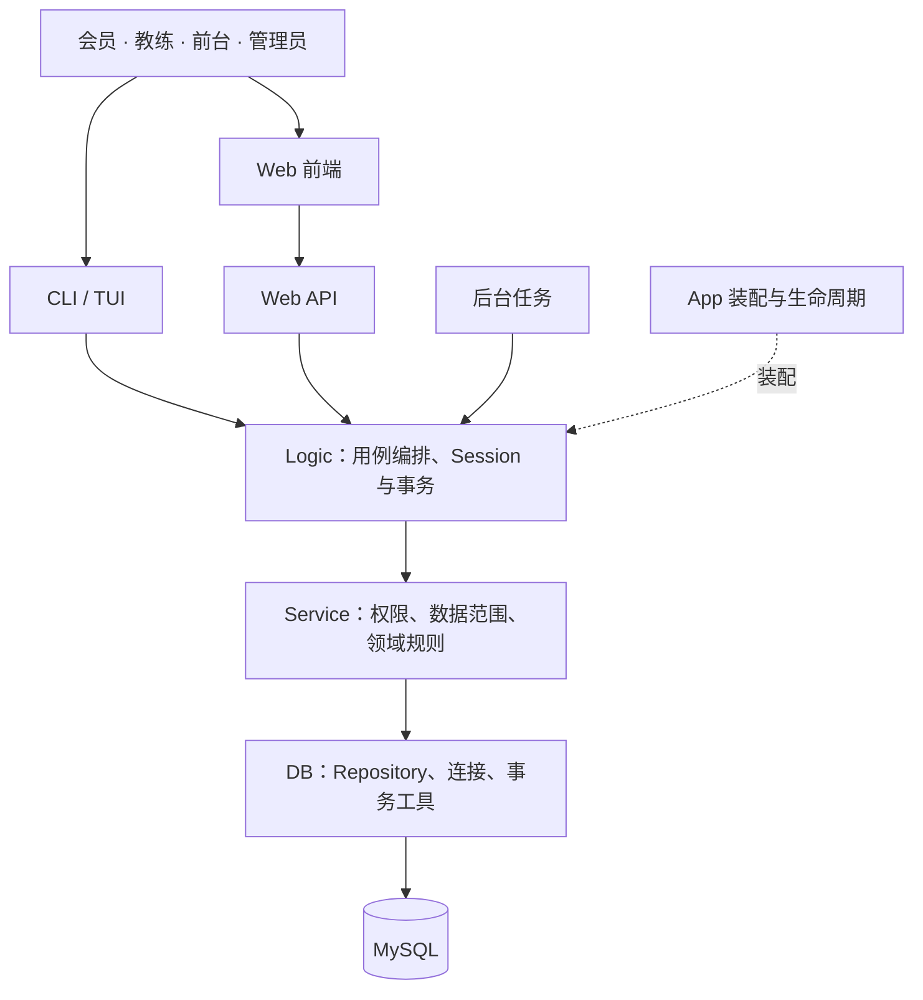

# 系统架构总览

本文档是健身房管理系统的架构入口，说明系统范围、运行入口、分层关系、公共约定和详细分册位置。后端字段、接口、SQL、事务和权限以[后端架构](architecture/backend.md)为准；浏览器端页面、路由、状态和 API 使用以[前端架构](architecture/frontend.md)为准。

## 找到自己要做的功能

从根 README 进入后，先在[功能清单](feature-list.csv)筛选自己的名字和交付类别，选定一个功能 ID，查看状态、验收要点和依赖 ID。共同负责的条目在开发备注中写明各自负责的方法。再按下表进入设计章节：

| 负责内容与功能 ID | 负责人 | 设计与代码入口 |
|---|---|---|
| 账号、权限与日志 `AUTH-*`、`LOG-*` | Jiafeng YE | 后端[账号权限](architecture/backend.md#9-账号身份与权限)、[错误](architecture/backend.md#10-错误处理)、[日志](architecture/backend.md#11-日志系统)；`auth_logic.py`、`auth_service.py`、`src/errors/`、`src/logging/` |
| 会员、卡、课包、赠卡、门禁 `MEM-*`、`CARD-*`、`PKG-*`、`GIFT-*` | Xingzhou PENG；销售与收款部分按清单和 Mingjin LI 协作 | 后端[会员与权益](architecture/backend.md#12-会员产品销售与权益领域)；`member_logic.py`、`product_logic.py`、`sales_logic.py`、`entitlement_logic.py`、`access_logic.py` |
| 收款、订单与报表 `PAY-*`、`SALE-*`、`REPORT-*` | Mingjin LI | 后端[销售与付款类型](architecture/backend.md#1225-销售付款和赠送类型)、[报表与导出](architecture/backend.md#138-报表与导出)；`sales_logic.py`、`report_logic.py` 与对应服务、仓储 |
| 教练 `COACH-*`；课程与预约 `COURSE-*`、`BOOK-*` | 教练由 Weijie ZHOU；课程与预约由 Weijie ZHOU、Yuxi ZHU 共同负责 | 后端[课程预约](architecture/backend.md#13-课程预约到课与关联业务)；`course_logic.py`、`reservation_logic.py` 与对应服务、仓储 |
| 到课结算与评价 `ATT-*`、`REVIEW-*` | Yihao QIAN；消课、缺席等条目按清单由 Lvzhen ZHOU 承接 | 后端[签到消课](architecture/backend.md#134-签到消课与缺席)、[评价](architecture/backend.md#137-评价)；`attendance_logic.py`、`review_logic.py` |
| 体测 `MEASURE-*`；器械 `EQ-*` | 体测由 Tuao SONG、Mingjin LI；器械由 Tuao SONG | 后端[体测授权](architecture/backend.md#136-体测授权)、[器械维修](architecture/backend.md#14-器械与维修)；`measurement_logic.py`、`equipment_logic.py` |
| 候补、通知、推荐与后台任务 `WAI-*`、`NOTIFY-*`、`REC-*`、`TAG-*`、`JOB-*` | Lvzhen ZHOU | 后端[候补、通知与课程推荐](architecture/backend.md#16-候补通知与课程推荐)；`reservation_logic.py`、`notification_logic.py`、`recommendation_logic.py`、`src/tasks/` |
| 浏览器端 `FE-*` 与 Web API `API-*` | Lvzhen ZHOU | 前端[功能域](architecture/frontend.md#6-功能域与功能-id-映射)、[角色路由](architecture/frontend.md#3-身份路由与角色入口)，后端[Web API](architecture/backend.md#17-web-api)；`frontend/src/features/`、`src/web/` |
| 基础装配、结构和测试 `SYS-*`、`ENG-*`、`TEST-*` | Lvzhen ZHOU 统筹，各模块补自己的验证 | 后端[启动](architecture/backend.md#5-配置与程序启动)、[数据库工具](architecture/backend.md#6-数据库连接与事务)、[验证合同](architecture/backend.md#15-结构版本与验证合同)；`src/app.py`、`tests/` |

表中负责人用于定位；具体每行的分工、优先级与状态以功能清单为准。后端通用类型先读[公共接口约定](architecture/backend.md#4-公共接口约定)，再按[全部用例入口](architecture/backend.md#45-全部用户用例入口)找到 Logic 和对应 Service。每个领域章节给出输入、结果、可空字段、权限、异常、事务及 SQL；查到目标后就能判断要实现哪些方法、与哪些模块配合。

例如 `MEM-01` 会员建档：查 `MemberInput`、`MemberView` 和 `members` 表，再实现会员仓储、会员服务、`MemberLogic.create_member`，接入 CLI；Web API 与 `FE-MEM-01` 按关联 ID 接入同一用例。完成时检查合法建档、空姓名、权限拒绝、相同请求重试及失败回滚，并同步清单和测试记录。环境准备、具体命令与完整步骤见[参与指引](README.md#怎样在骨架中完成一个功能)。

## 1. 系统范围

系统管理会员、账号、健身房卡、私教课包、销售收款、门禁入场、教练、课程排期、预约、候补、签到、消课、评价、体测、器械、站内通知、课程推荐和经营报表。

默认交互入口为命令行界面（CLI）。终端界面（TUI）是可选入口，浏览器端是独立的 Web 入口。三种用户入口共用后端业务用例；后台任务通过应用内部装配获得系统用例调用权。交互入口负责采集输入和展示结果，业务规则和 SQL 分别由服务与仓储执行。

当前代码提供启动参数、配置读取、数据库资源装配、CLI 公共输入、Logic/Service 声明、Web 登录路由、周期 Worker、浏览器应用及分类测试骨架。领域方法仍是占位，浏览器业务页显示待实现状态。数据库脚本和结构检查符合 v4 合同；真实 MySQL 建表及业务流程仍需验证。

## 2. 整体分层

Logic 是所有业务用例的统一入口，包含写入、详情、列表和结果核实。Logic 创建并关闭用例所需的数据库 Session，决定事务边界和服务调用顺序。Service 接收调用方提供的 Session，校验身份、角色、数据归属和领域规则。Repository 接收同一 Session，执行参数绑定、SQL、锁定读取、分页和持久化。连接池、Session 工厂、事务上下文、结构检查和资源释放由 `src/db/connection.py` 提供。

以售课包为例：入口收集会员、产品和请求编号，Logic 在一个事务中编排会员锁、产品规则、订单、收款、课包和赠卡；Service 校验权限、金额和资格；Repository 写入数据库。办卡、收款和权益生成一起成功或一起回滚。

## 3. 代码与文档入口

| 内容 | 位置 | 说明 |
|---|---|---|
| 应用装配 | `src/app.py` | 配置资源、数据库、Logic、Service 和交互入口的装配点 |
| 流程入口 | `src/logic/*_logic.py` | 按用例组织跨服务编排、Session 生命周期和事务 |
| 领域服务 | `src/services/*_service.py` | 权限、数据范围、资格、状态和金额规则 |
| 仓储 | `src/db/*_repo.py` | 参数绑定、SQL、分页、锁和持久化 |
| 数据库工具 | `src/db/connection.py` | 引擎、会话工厂、事务、结构版本检查和释放 |
| CLI / TUI | `src/ui/` | 输入、菜单、操作处理器、格式化和可选 TUI |
| 数据类型 | `src/models/contracts.py` | Input、Query、View、Page、Actor 和固定状态值 |
| 异常 | `src/errors/` | 业务异常、存储异常、提交结果未知和统一错误结果 |
| 密码与日志 | `src/security/`、`src/logging/` | 密码哈希工具与日志生命周期、脱敏事件、快照合同 |
| 浏览器应用 | `frontend/src/` | Vue 装配、角色路由、身份与 API 适配 |
| 测试 | `tests/`、`frontend/tests/` | 后端契约、单元、API 与 MySQL 验证，以及前端单元和浏览器测试 |
| 后端合同 | [`architecture/backend.md`](architecture/backend.md) | 后端完整字段、方法、SQL、权限、事务和测试矩阵 |
| 前端合同 | [`architecture/frontend.md`](architecture/frontend.md) | Web 页面、路由、状态、API 使用和前端验收 |
| 功能清单 | [`feature-list.csv`](feature-list.csv) | ID、模块、负责人、优先级、状态和验收要点 |
| 参与步骤 | [`README.md`](README.md) | 文档入口、开发步骤、验证命令和当前状态 |

`src/db/` 和 `src/db/connection.py` 保持现有命名。`db` 包同时包含仓储和数据库运行工具，由文件职责区分。

## 4. 公共合同摘要

### 数据返回

- 列表统一返回 `Page[T]`，其中 `items` 始终是列表，空结果返回空列表。
- 单条查询和写操作返回固定的 View 类型；失败抛项目异常。
- 输入、查询和结果类型在 `src/models/contracts.py` 与后端分册中保持一致。
- 时间存储为 UTC，展示时转换为门店时区；日期区间使用前含后不含格式。
- 金额使用 `Decimal` 和数据库 `DECIMAL`；Python 与 SQL 的 ID 使用正整数，HTTP 与 TypeScript 使用规范十进制字符串保留精度。

### 身份与权限

入口提取当前操作者（Actor）并传给 Logic。Logic 和 Service 共同完成用例编排与领域校验，Service 是角色和数据归属的最终安全边界。会员只能访问本人数据，教练只能管理授权课程和学员，前台和管理员按后端合同访问业务范围。隐藏菜单、路由守卫和 CLI 菜单不能代替服务端校验。

### 事务与请求编号

同一原子操作涉及的服务与仓储使用一个共享 Session。Logic 在成功时提交，在异常时回滚并关闭资源。销售、收款、发卡、课包和赠卡的写入共用事务；预约与课包占用、消课与课包扣减分别共用事务。取消预约先提交取消事务，再开启独立递补事务；候补转正、预约、课包占用和通知在递补事务内一起成功或回滚。

创建会员、销售、课次创建与取消、预约与取消、入场和候补入队接收 `request_id`（请求编号）。提交结果未知时先按请求编号核实原记录，再决定是否允许重试。签到、已读、标签和状态维护按各自的自然主键、状态或冲突合同处理，重试前刷新目标记录。操作日志在业务提交后记录；错误日志隐藏密码、连接串、完整联系方式和体测明细。

## 5. 按功能查阅架构

### 后端开发

从[后端架构](architecture/backend.md)查找目标功能的 Input、View 或 Page、权限、异常、SQL 和事务边界。后端分册说明 Logic、Service、数据库骨架与 Web API 的目标合同和当前实现状态。

### 前端开发

从[前端架构](architecture/frontend.md)查找页面、路由、角色入口、查询缓存和错误恢复方式；字段、权限、错误动作和请求核实引用后端分册。前端使用功能 ID 与后端任务关联，页面可以组合功能但不改变业务合同。

### 其他文档

- [文档索引](README.md)：参与顺序、功能清单填写、骨架开发步骤和验证命令。
- [项目规范](project-standards.md)：代码、SQL、权限、异常、测试和完成标准。
- [候补、通知与推荐](architecture/backend.md#16-候补通知与课程推荐)：业务范围、协作接口和数据合同。

## 6. 当前实现状态

| 能力 | 当前状态 |
|---|---|
| CLI 启动、配置、资源装配和统一测试入口 | 基础实现已接入；业务处理器仍为空操作占位 |
| Service、Repository、模型和 SQL | 结构版本为 v4；领域方法仍有占位实现，真实 MySQL 建表尚未验证 |
| Logic 与共享 Session 合同 | Logic 入口和 App/CLI 装配已建立；业务方法仍有占位实现 |
| Web API 与浏览器前端 | 后端认证路由及生命周期、`frontend/` 应用装配、角色导航、登录表单、身份与 API 客户端已建立；认证 Logic 和业务页仍为占位；浏览器端由 Lvzhen ZHOU 负责 |
| 测试与公共工具 | 后端按合同、单元、API、集成分类；前端建立单元与浏览器测试入口；密码和日志分别位于 `src/security/` 与 `src/logging/` |
| 候补、通知与课程推荐 | 类型、Service、Logic 和 v4 表结构已建立；业务方法仍有占位实现 |
| 周期任务 | Worker 单线程调度和关闭骨架已建立；候补核对与推荐刷新 Logic 仍是占位 |
| TUI | 可选入口尚未就绪，状态以 `UI-01` 为准 |

架构设计已确认不等于代码已实现。实现状态以功能清单、源码和测试证据为准；未运行的数据库、并发和端到端测试不标记为通过。
