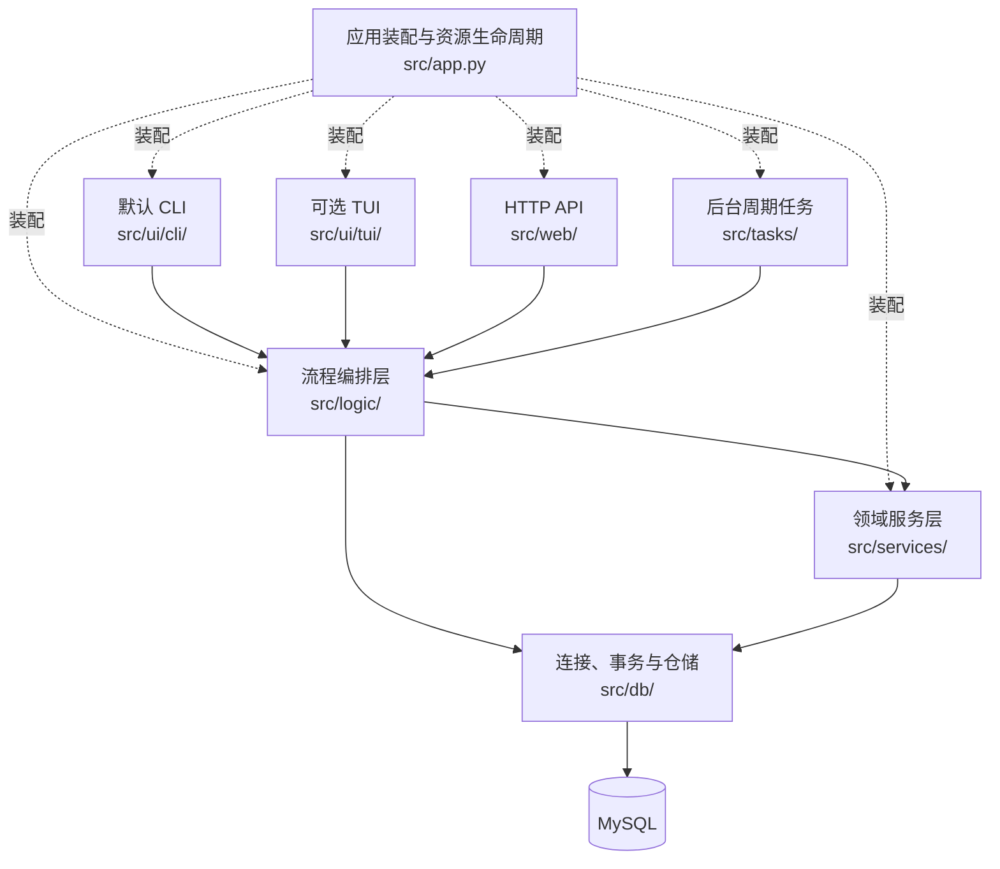

# 后端架构与接口合同

本分册维护后端实现的完整合同：Logic（流程编排）、Service（领域规则）、DB（数据库连接与仓储）、CLI/TUI 适配、后台任务、数据类型、异常、事务、锁、SQL 和后端验证。系统范围、前后端关系和分册入口见[总架构](../architecture.md)。浏览器端页面、路由和状态使用见[前端架构](frontend.md)。

开发一个业务功能时，先在本分册找到对应的 Input、View 或 Page、权限和事务边界，再沿“交互入口 → Logic → Service → DB”实现。数据库操作使用调用方传入的 Session；Logic 统一管理一次用例的会话与提交。列表返回 `Page[T]`，详情返回固定 View，失败抛项目异常。

本分册定义后端合同。当前已实现体测、收款查询、经营统计与 CSV 导出的 CLI、Logic、Service 和仓储，以及这些入口使用的身份复核、会员锁定和授课关系检查。登录、销售编排及其余领域按各文件与功能清单标记实现状态。数据库脚本、初始化和结构检查使用 v4；真实 MySQL 建表、锁与业务联调待验证。浏览器业务路由与 TUI 的当前状态见总架构与功能清单。

## 后端目录

- [1. 项目基本情况](#1-项目基本情况)：技术栈、默认 CLI 和时间约定
- [2. 代码怎么组织（分层架构）](#2-代码怎么组织分层架构)：Logic、Service、DB、App 与交互入口
- [3. 目录与文件职责](#3-目录与文件职责)：源码位置和依赖方向
- [4. 公共接口约定](#4-公共接口约定)：Input、View、Page、字段、错误和请求编号
- [5. 配置与程序启动](#5-配置与程序启动)：配置读取、App 装配与生命周期
- [6. 数据库连接与事务](#6-数据库连接与事务)：Session、提交、回滚和资源释放
- [7. 数据库维护命令](#7-数据库维护命令)：初始化、结构检查和演示数据
- [8. 公共 CLI](#8-公共-cli)：输入、菜单、分页和格式化
- [9. 账号、身份与权限](#9-账号身份与权限)：Actor、认证和数据范围
- [10. 错误处理](#10-错误处理)：异常分类、结果转换和提交结果未知
- [11. 日志系统](#11-日志系统)：业务日志、系统错误和管理员查询
- [12. 会员、产品、销售与权益领域](#12-会员产品销售与权益领域)
- [13. 课程、预约、到课与关联业务](#13-课程预约到课与关联业务)
- [14. 器械与维修](#14-器械与维修)
- [15. 结构版本与验证合同](#15-结构版本与验证合同)
- [16. 候补、通知与课程推荐](#16-候补通知与课程推荐)
- [17. Web API](#17-web-api)：HTTP 身份、类型、路由、结果核实与错误映射

功能 ID 与负责人以 [`feature-list.csv`](../feature-list.csv) 为准。候补历史重入和普通预约与递补之间的空位分配规则见第 16 章。

### 按功能找到实现位置

先从[总览的任务导航](../architecture.md#找到自己要做的功能)或清单定位自己负责的功能 ID，再按以下顺序查合同。以 `MEM-01` 为例：

1. 查[会员类型](#1222-会员档案类型)，确定 `MemberInput`、`MemberView` 的字段和可空性。
2. 查[会员服务](#1231-memberservice)，读 `create_member` 的权限、异常、请求编号和数据变更。
3. 查[全部用例入口](#45-全部用户用例入口)，确定调用方使用 `MemberLogic.create_member`；服务显式接收本次 Session。
4. 查[会员仓储](#1251-memberrepository)与[会员表](#1261-会员档案)，确定参数绑定、记录保存和幂等查询依赖。
5. 查[验证矩阵](#152-测试矩阵)，按[参与指引](../README.md#怎样在骨架中完成一个功能)实现仓储、领域服务、Logic、交互适配并执行相关验证。

跨模块功能还要读依赖方章节。例如售课包同时涉及订单、付款、课包和赠卡，由一笔 Logic 事务统筹；各负责人按同一输入结果合同配合实现。浏览器端通过第 17 章 API 连接相同用例，前端任务以对应 `FE-*` ID 跟踪。

## 1. 项目基本情况

本系统用于管理健身房会员、账号、产品销售、门禁入场、课程排期、预约、候补递补、站内通知、课程推荐、签到、消课、评价、体测、器械和经营报表。默认交互入口为命令行界面（CLI）；可选终端界面（TUI）与 CLI 共用应用流程和业务服务。

### 用什么技术

- **编程语言**：Python 3.10+
- **数据库**：MySQL 8.4
- **界面**：命令行（CLI），有时间再做终端界面（TUI）
- **测试**：pytest
- **Web API**：FastAPI 与 Pydantic 2，依赖安装见 `requirements/web.txt`

时间存储统一用 UTC，显示时转成上海时区。日期区间是 `[开始, 结束)`，包含开始那天，不包含结束那天。

---

## 2. 代码怎么组织（分层架构）



实线表示业务调用，虚线表示应用装配。全部业务用例，包括写入、详情、列表和结果核实，统一从 Logic 进入。数据库维护命令使用第 7 章的专用连接和维护接口。

### 会员买健身房卡

1. CLI 采集会员、产品和付款方式，调用 `SalesLogic.sell_gym_card(...)`。
2. 销售流程创建本次 Session，并开启一个事务。
3. 销售服务在传入的 Session 中复核身份、权限和会员状态，按锁内产品价格计算付款金额。
4. 服务调用同一 Session 下的 Repository，写入订单、付款、健身房卡和操作记录。
5. Logic 提交事务并关闭 Session，CLI 显示返回的订单和卡片 View。

办卡和收款在一个事务中：两者一起成功，任一步失败时一起回滚。提交结果未知时沿原请求编号查询结果。

### 每层职责

| 层 | 文件位置 | 职责 |
|---|---|---|
| 交互适配 | `src/ui/cli/`、`src/ui/tui/`、`src/web/` | 采集和解析输入、提取可信身份、调用 Logic、转换展示或 HTTP 响应 |
| 流程编排 | `src/logic/` | 承接完整用例，管理读写 Session 和事务，协调服务调用、跨领域锁序、结果核实及提交后的后续动作 |
| 领域服务 | `src/services/` | 复核账号、角色、数据范围和领域规则，在调用方 Session 中执行领域读写 |
| 数据访问 | `src/db/` | 管理连接设施，提供参数绑定、查询、行锁和持久化接口 |
| 后台调度 | `src/tasks/` | 根据周期和停止事件调用系统 Logic 用例 |
| 应用装配 | `src/app.py` | 创建并连接依赖，管理当前终端身份和资源启动、关闭顺序 |

Logic 持有会话工厂，每次调用创建独立 Session，并在成功或失败后释放。Service 和 Repository 接收该 Session，事务的提交、回滚和重开由 Logic 统一完成。预约与等待候补的互斥校验、预约写入和候补状态变化使用同一事务；具体锁序见第 12 章。

## 3. 目录与文件职责

| 路径 | 职责 |
|---|---|
| `main.py`、`src/app.py`、`src/config.py` | 入口、生命周期、装配和配置 |
| `src/db/` | 连接、事务、结构检查和 Repository |
| `src/errors/` | 项目异常、错误结果和安全转换 |
| `src/models/` | 公共合同和内部存储模型 |
| `src/logic/` | 全部业务用例入口、Session 生命周期和读写事务 |
| `src/services/` | 权限、数据范围、领域规则及传入 Session 中的领域读写 |
| `src/tasks/` | 周期任务、线程生命周期与关停协调 |
| `src/security/passwords.py` | 密码格式校验、Argon2 哈希与验证 |
| `src/logging/` | 日志生命周期、固定操作事件与日志快照公共入口 |
| `src/ui/cli/`、`src/ui/tui/` | 默认 CLI 和可选 TUI |
| `tests/contracts/`、`tests/unit/`、`tests/api/` | 公共声明、基础行为与 HTTP 适配测试 |
| `tests/integration/`、`tests/support/` | 独立 MySQL 集成测试与共享测试资源 |
| `sql/`、`docs/` | 数据库结构和项目文档 |

后端合同集中维护在本分册，总览入口为 `docs/architecture.md`，参与步骤维护在 `docs/README.md`，工程规范维护在 `docs/project-standards.md`。开发进度、设计决策和测试发现分别记录到 `docs/dev-materials-for-report/development-log.md`、`design-decisions.md` 和 `testing-notes.md`。

日志公共名称由 `src/logging/__init__.py` 导出。生命周期接口在 `lifecycle.py`，操作枚举与脱敏事件在 `events.py`，固定快照读取和查询在 `snapshots.py`。密码工具由 `src/security/passwords.py` 提供。日志方法按第 11 章合同保留占位状态。

## 4. 公共接口约定

### 4.1 返回类型

- 详情方法返回对应的 `View`；目标不存在或对当前操作者不可见时抛 `NotFoundError`。
- 列表方法返回 `Page[T]`；空结果为 `Page(items=[], total=0, page=..., page_size=...)`。
- 创建和修改方法返回写入后的 View 或专用结果 View。
- 失败通过项目异常表达，返回类型在所有执行分支保持一致。

```python
T = TypeVar("T")

@dataclass(frozen=True, kw_only=True)
class PageRequest:
    page: int = 1
    page_size: int = 20

@dataclass(frozen=True, kw_only=True)
class Page(Generic[T]):
    items: list[T]
    total: int
    page: int
    page_size: int

@dataclass(frozen=True, kw_only=True)
class DateWindow:
    start: datetime
    end: datetime

@dataclass(frozen=True, kw_only=True)
class NamedQuery:
    keyword: str = ""
    is_active: bool | None = None
    paging: PageRequest = field(default_factory=PageRequest)
```

`PageRequest.page` 从 1 开始，`page_size` 取 1～100。列表在唯一且稳定的排序规则下分页；默认使用 `id` 升序。报表等需要业务排序的接口在对应模块明确次级唯一排序键。

### 4.2 字段规则

- 数据库编号和关联编号使用正整数 `int`。
- 金额和精确业务小数使用 `Decimal`，从十进制字符串构造，并按字段精度量化。
- 时刻使用带时区 `datetime`，进入持久层前转换为 UTC。
- 纯日期使用 `date`。
- 有限状态使用 `Literal` 或 `Enum` 的固定英文值。
- 可空字段使用 `T | None`；文本进入服务后按字段规则去除首尾空白并校验长度。
- `request_id` 使用标准 UUID 字符串，并在进入事务前完成格式校验。

### 4.3 方法文档

每个公开服务方法的类型签名和文档需明确：

1. 输入字段及完整提交语义；
2. 返回类型；
3. 角色权限和数据可见范围；
4. 可抛出的项目异常；
5. 写入、更新或删除的数据；
6. 事务、幂等和并发锁定规则。

### 4.4 Logic、Service 与 Session 合同

Logic 是交互入口和后台任务调用的完整用例。每次调用由 Logic 创建 Session，读写流程在结束时提交或回滚，并在 `finally` 或上下文退出时关闭。Service 的所有业务方法在 `self` 后显式接收 `session: Session`；公开用例的参数和返回类型与对应 Service 一致，仅由 Logic 持有 Session。构造函数只接收稳定依赖：Logic 接收会话工厂和所需领域服务，Service 接收身份服务、日志配置、门店时区或推荐快照存储等实际使用的依赖。

```python
# 面向 CLI、API 的用例
class SalesLogic:
    def sell_gym_card(
        self, actor: Actor, data: GymCardSaleInput, request_id: str,
    ) -> GymCardSaleResultView: ...

# 领域服务：同一调用方 Session 中校验、读取和写入
class SalesService:
    def sell_gym_card(
        self, session: Session, actor: Actor,
        data: GymCardSaleInput, request_id: str,
    ) -> GymCardSaleResultView: ...
```

写用例通过 `src/db/connection.py` 的 `transaction` 统一提交；返回给交互入口的 View 已完成提交。Service 在本次 Session 中建立 Repository。需要有界重试或核实并发胜者时，由 Logic 回滚并重开 Session。提交结果未知直接抛 `OutcomeUnknownError`，沿原请求或记录编号核实。

查询用例同样经过 Logic。已登录用户的领域服务先调用 `AuthService.verify_actor(session, actor)`，使用锁定当前读复核最新身份；普通业务读取随后使用同一 REPEATABLE READ 快照。列表的范围条件、`total` 和当前页，体测比较的两条记录，以及报表聚合均使用同一快照和同一个 `as_of`。短事务结束时释放身份锁、游标和 Session。日志快照复制为不可变内存数据，后续翻页使用新的短 Session 复核身份并读取既有快照。

Service 保留角色、数据归属、状态和领域校验。账号管理中需要锁定多个账号时，先按第 9 章合并全部账号并升序取锁；其他服务只在已取得的锁范围内复核。Logic 在跨领域写入前确定本次全部锁资源，使各 Service 的调用顺序符合第 12.4.2 节全局锁序。

### 4.5 全部用户用例入口

下表列出 `src/logic/` 的公开入口及领域服务对应关系。签名省略 `self`；返回类型、输入规则、权限、异常和数据变更由后续对应领域章节完整定义。读取和结果核实也由 Logic 管理 Session；表内“写”表示由 Logic 开启业务写事务。所有成员函数均保持该返回类型，失败抛项目异常。

账号与身份：`AuthLogic`（`src/logic/auth_logic.py`）。

| 公开入口与返回类型 | 领域服务 | 会话用途 |
|---|---|---|
| `login(username: str, password: str) -> Actor` | `AuthService.login` | 读 |
| `get_current_actor(actor: Actor) -> Actor` | `AuthService.verify_actor` | 读 |
| `create_account(actor: Actor, data: AccountInput) -> AccountView` | `AuthService.create_account` | 写 |
| `get_account(actor: Actor, account_id: int) -> AccountView` | `AuthService.get_account` | 读 |
| `list_accounts(actor: Actor, query: NamedQuery) -> Page[AccountView]` | `AuthService.list_accounts` | 读 |
| `set_account_active(actor: Actor, account_id: int, active: bool) -> AccountView` | `AuthService.set_account_active` | 写 |
| `link_member(actor: Actor, data: MemberAccountLinkInput) -> AccountView` | `AuthService.link_member` | 写 |
| `link_coach(actor: Actor, data: CoachAccountLinkInput) -> AccountView` | `AuthService.link_coach` | 写 |
| `relink_member(actor: Actor, account_id: int, member_id: int) -> AccountView` | `AuthService.relink_member` | 写 |
| `relink_coach(actor: Actor, account_id: int, coach_id: int) -> AccountView` | `AuthService.relink_coach` | 写 |
| `open_log_snapshot(actor: Actor) -> LogSnapshot` | `AuthService.open_log_snapshot` | 读 |
| `query_logs(actor: Actor, query: LogQuery, *, snapshot: LogSnapshot) -> Page[LogEntry]` | `AuthService.query_logs` | 读 |

会员档案：`MemberLogic`（`src/logic/member_logic.py`）。

| 公开入口与返回类型 | 领域服务 | 会话用途 |
|---|---|---|
| `create_member(actor: Actor, data: MemberInput, request_id: str) -> MemberView` | `MemberService.create_member` | 写 |
| `get_member_by_request(actor: Actor, request_id: str) -> MemberView` | `MemberService.get_member_by_request` | 读 |
| `get_member(actor: Actor, member_id: int) -> MemberView` | `MemberService.get_member` | 读 |
| `list_members(actor: Actor, query: MemberQuery) -> Page[MemberView]` | `MemberService.list_members` | 读 |
| `update_member(actor: Actor, member_id: int, data: MemberInput) -> MemberView` | `MemberService.update_member` | 写 |
| `set_member_status(actor: Actor, member_id: int, status: MemberStatus) -> MemberView` | `MemberService.set_member_status` | 写 |

产品与赠卡规则：`ProductLogic`（`src/logic/product_logic.py`）。

| 公开入口与返回类型 | 领域服务 | 会话用途 |
|---|---|---|
| `create_gym_card_product(actor: Actor, terms: GymCardProductTerms) -> GymCardProductView` | `GymCardProductService.create_gym_card_product` | 写 |
| `update_gym_card_product(actor: Actor, product_id: int, terms: GymCardProductTerms) -> GymCardProductView` | `GymCardProductService.update_gym_card_product` | 写 |
| `get_gym_card_product(actor: Actor, product_id: int) -> GymCardProductView` | `GymCardProductService.get_gym_card_product` | 读 |
| `list_gym_card_products(actor: Actor, query: NamedQuery) -> Page[GymCardProductView]` | `GymCardProductService.list_gym_card_products` | 读 |
| `set_gym_card_product_sale_enabled(actor: Actor, product_id: int, enabled: bool) -> GymCardProductView` | `GymCardProductService.set_gym_card_product_sale_enabled` | 写 |
| `set_gym_card_product_gift_enabled(actor: Actor, product_id: int, enabled: bool) -> GymCardProductView` | `GymCardProductService.set_gym_card_product_gift_enabled` | 写 |
| `create_lesson_package_product(actor: Actor, terms: LessonPackageProductTerms) -> LessonPackageProductView` | `LessonPackageProductService.create_lesson_package_product` | 写 |
| `update_lesson_package_product(actor: Actor, product_id: int, terms: LessonPackageProductTerms) -> LessonPackageProductView` | `LessonPackageProductService.update_lesson_package_product` | 写 |
| `get_lesson_package_product(actor: Actor, product_id: int) -> LessonPackageProductView` | `LessonPackageProductService.get_lesson_package_product` | 读 |
| `list_lesson_package_products(actor: Actor, query: NamedQuery) -> Page[LessonPackageProductView]` | `LessonPackageProductService.list_lesson_package_products` | 读 |
| `set_lesson_package_product_sale_enabled(actor: Actor, product_id: int, enabled: bool) -> LessonPackageProductView` | `LessonPackageProductService.set_lesson_package_product_sale_enabled` | 写 |
| `get_gift_rule(actor: Actor, rule_id: int) -> LessonPackageGiftRuleView` | `LessonPackageProductService.get_gift_rule` | 读 |
| `list_gift_rules(actor: Actor, query: LessonPackageGiftRuleQuery) -> Page[LessonPackageGiftRuleView]` | `LessonPackageProductService.list_gift_rules` | 读 |
| `create_gift_rule(actor: Actor, data: LessonPackageGiftRuleInput) -> LessonPackageGiftRuleView` | `LessonPackageProductService.create_gift_rule` | 写 |
| `replace_gift_rule(actor: Actor, rule_id: int, data: GiftRuleRevisionInput) -> LessonPackageGiftRuleView` | `LessonPackageProductService.replace_gift_rule` | 写 |
| `set_gift_rule_active(actor: Actor, rule_id: int, active: bool) -> LessonPackageGiftRuleView` | `LessonPackageProductService.set_gift_rule_active` | 写 |

权益：`EntitlementLogic`（`src/logic/entitlement_logic.py`）。

| 公开入口与返回类型 | 领域服务 | 会话用途 |
|---|---|---|
| `get_gym_card(actor: Actor, gym_card_id: int) -> GymCardView` | `EntitlementQueryService.get_gym_card` | 读 |
| `list_gym_cards(actor: Actor, query: GymCardQuery) -> Page[GymCardView]` | `EntitlementQueryService.list_gym_cards` | 读 |
| `get_lesson_package(actor: Actor, lesson_package_id: int) -> LessonPackageView` | `EntitlementQueryService.get_lesson_package` | 读 |
| `list_lesson_packages(actor: Actor, query: LessonPackageQuery) -> Page[LessonPackageView]` | `EntitlementQueryService.list_lesson_packages` | 读 |
| `get_gym_membership(actor: Actor, member_id: int, business_date: date \| None=None) -> GymMembershipView` | `EntitlementQueryService.get_gym_membership` | 读 |
| `void_gym_card(actor: Actor, gym_card_id: int) -> GymCardView` | `EntitlementQueryService.void_gym_card` | 写 |
| `void_lesson_package(actor: Actor, lesson_package_id: int) -> LessonPackageView` | `EntitlementQueryService.void_lesson_package` | 写 |

销售与订单：`SalesLogic`（`src/logic/sales_logic.py`）。

| 公开入口与返回类型 | 领域服务 | 会话用途 |
|---|---|---|
| `get_sale_order(actor: Actor, sale_order_id: int) -> SaleOrderDetailView` | `SalesService.get_sale_order` | 读 |
| `list_sale_orders(actor: Actor, query: SaleOrderQuery) -> Page[SaleOrderView]` | `SalesService.list_sale_orders` | 读 |
| `sell_gym_card(actor: Actor, data: GymCardSaleInput, request_id: str) -> GymCardSaleResultView` | `SalesService.sell_gym_card` | 写 |
| `sell_lesson_package(actor: Actor, data: LessonPackageSaleInput, request_id: str) -> LessonPackageSaleResultView` | `SalesService.sell_lesson_package` | 写 |
| `get_gym_card_sale_by_request(actor: Actor, request_id: str) -> GymCardSaleResultView` | `SalesService.get_gym_card_sale_by_request` | 读 |
| `get_lesson_package_sale_by_request(actor: Actor, request_id: str) -> LessonPackageSaleResultView` | `SalesService.get_lesson_package_sale_by_request` | 读 |

课程资源与排期：`CourseLogic`（`src/logic/course_logic.py`）。

| 公开入口与返回类型 | 领域服务 | 会话用途 |
|---|---|---|
| `create_coach(actor: Actor, data: CoachInput) -> CoachView` | `CoachService.create_coach` | 写 |
| `update_coach(actor: Actor, coach_id: int, data: CoachInput) -> CoachView` | `CoachService.update_coach` | 写 |
| `get_coach(actor: Actor, coach_id: int) -> CoachView` | `CoachService.get_coach` | 读 |
| `list_coaches(actor: Actor, query: NamedQuery) -> Page[CoachView]` | `CoachService.list_coaches` | 读 |
| `set_coach_active(actor: Actor, coach_id: int, is_active: bool) -> CoachView` | `CoachService.set_coach_active` | 写 |
| `create_course(actor: Actor, data: CourseInput) -> CourseView` | `CourseService.create_course` | 写 |
| `update_course(actor: Actor, course_id: int, data: CourseInput) -> CourseView` | `CourseService.update_course` | 写 |
| `get_course(actor: Actor, course_id: int) -> CourseView` | `CourseService.get_course` | 读 |
| `list_courses(actor: Actor, query: NamedQuery) -> Page[CourseView]` | `CourseService.list_courses` | 读 |
| `set_course_active(actor: Actor, course_id: int, is_active: bool) -> CourseView` | `CourseService.set_course_active` | 写 |
| `create_session(actor: Actor, data: SessionInput, request_id: str) -> SessionView` | `CourseService.create_session` | 写 |
| `get_session(actor: Actor, session_id: int) -> SessionView` | `CourseService.get_session` | 读 |
| `list_sessions(actor: Actor, query: SessionQuery) -> Page[SessionView]` | `CourseService.list_sessions` | 读 |
| `get_session_by_request(actor: Actor, request_id: str) -> SessionView` | `CourseService.get_session_by_request` | 读 |
| `complete_session(actor: Actor, session_id: int) -> SessionView` | `CourseService.complete_session` | 写 |
| `create_room(actor: Actor, data: RoomInput) -> RoomView` | `RoomService.create_room` | 写 |
| `update_room(actor: Actor, room_id: int, data: RoomInput) -> RoomView` | `RoomService.update_room` | 写 |
| `get_room(actor: Actor, room_id: int) -> RoomView` | `RoomService.get_room` | 读 |
| `list_rooms(actor: Actor, query: NamedQuery) -> Page[RoomView]` | `RoomService.list_rooms` | 读 |
| `set_room_active(actor: Actor, room_id: int, is_active: bool) -> RoomView` | `RoomService.set_room_active` | 写 |

预约、候补与课次取消：`ReservationLogic`（`src/logic/reservation_logic.py`）。

| 公开入口与返回类型 | 领域服务 | 会话用途 |
|---|---|---|
| `cancel_session(actor: Actor, session_id: int, request_id: str) -> SessionView` | `CourseService.cancel_session` | 写 |
| `book(actor: Actor, data: BookingInput, request_id: str) -> BookingView` | `BookingService.book` | 写 |
| `cancel(actor: Actor, booking_id: int, request_id: str) -> BookingView` | `BookingService.cancel` | 写 |
| `get_booking(actor: Actor, booking_id: int) -> BookingView` | `BookingService.get_booking` | 读 |
| `get_booking_by_request(actor: Actor, request_id: str) -> BookingView` | `BookingService.get_booking_by_request` | 读 |
| `list_bookings(actor: Actor, query: BookingQuery) -> Page[BookingView]` | `BookingService.list_bookings` | 读 |
| `join_waitlist(actor: Actor, data: WaitlistInput, request_id: str) -> WaitlistView` | `WaitlistService.join_waitlist` | 写 |
| `leave_waitlist(actor: Actor, waitlist_id: int) -> WaitlistView` | `WaitlistService.leave_waitlist` | 写 |
| `get_waitlist(actor: Actor, waitlist_id: int) -> WaitlistView` | `WaitlistService.get_waitlist` | 读 |
| `get_waitlist_by_request(actor: Actor, request_id: str) -> WaitlistView` | `WaitlistService.get_waitlist_by_request` | 读 |
| `list_waitlist(actor: Actor, query: WaitlistQuery) -> Page[WaitlistView]` | `WaitlistService.list_waitlist` | 读 |
| `get_waitlist_summary(actor: Actor, session_id: int) -> WaitlistSummaryView` | `WaitlistService.get_waitlist_summary` | 读 |

到课与结算：`AttendanceLogic`（`src/logic/attendance_logic.py`）。

| 公开入口与返回类型 | 领域服务 | 会话用途 |
|---|---|---|
| `check_in(actor: Actor, booking_id: int) -> BookingView` | `AttendanceService.check_in` | 写 |
| `correct_attendance(actor: Actor, booking_id: int, present: bool) -> BookingView` | `AttendanceService.correct_attendance` | 写 |
| `complete(actor: Actor, booking_id: int) -> ConsumptionView` | `AttendanceService.complete` | 写 |
| `mark_no_show(actor: Actor, booking_id: int) -> BookingView` | `AttendanceService.mark_no_show` | 写 |

门禁入场：`AccessLogic`（`src/logic/access_logic.py`）。

| 公开入口与返回类型 | 领域服务 | 会话用途 |
|---|---|---|
| `get_today_entry(actor: Actor, member_id: int) -> EntryView` | `AccessService.get_today_entry` | 读 |
| `register_entry(actor: Actor, data: EntryInput, request_id: str) -> EntryView` | `AccessService.register_entry` | 写 |
| `get_entry_by_request(actor: Actor, request_id: str) -> EntryView` | `AccessService.get_entry_by_request` | 读 |

体测：`MeasurementLogic`（`src/logic/measurement_logic.py`）。

| 公开入口与返回类型 | 领域服务 | 会话用途 |
|---|---|---|
| `record(actor: Actor, data: MeasurementInput) -> MeasurementView` | `MeasurementService.record` | 写 |
| `get_measurement(actor: Actor, measurement_id: int) -> MeasurementView` | `MeasurementService.get_measurement` | 读 |
| `list_measurements(actor: Actor, query: MeasurementQuery) -> Page[MeasurementView]` | `MeasurementService.list_measurements` | 读 |
| `compare(actor: Actor, before_id: int, after_id: int) -> MeasurementComparison` | `MeasurementService.compare` | 读 |

评价：`ReviewLogic`（`src/logic/review_logic.py`）。

| 公开入口与返回类型 | 领域服务 | 会话用途 |
|---|---|---|
| `create_review(actor: Actor, data: ReviewInput) -> ReviewView` | `ReviewService.create_review` | 写 |
| `get_review(actor: Actor, review_id: int) -> ReviewView` | `ReviewService.get_review` | 读 |
| `list_reviews(actor: Actor, query: ReviewQuery) -> Page[ReviewView]` | `ReviewService.list_reviews` | 读 |

报表与导出：`ReportLogic`（`src/logic/report_logic.py`）。

| 公开入口与返回类型 | 领域服务 | 会话用途 |
|---|---|---|
| `get_payment(actor: Actor, payment_id: int) -> PaymentView` | `ReportService.get_payment` | 读 |
| `list_payments(actor: Actor, query: PaymentQuery) -> Page[PaymentView]` | `ReportService.list_payments` | 读 |
| `revenue(actor: Actor, window: DateWindow) -> RevenueView` | `ReportService.revenue` | 读 |
| `membership_stats(actor: Actor) -> MembershipStats` | `ReportService.membership_stats` | 读 |
| `session_stats(actor: Actor, query: SessionQuery) -> Page[SessionStatsView]` | `ReportService.session_stats` | 读 |
| `coach_stats(actor: Actor, window: DateWindow, paging: PageRequest) -> Page[CoachStatsView]` | `ReportService.coach_stats` | 读 |
| `export_payments(actor: Actor, query: PaymentQuery) -> CsvExport` | `ReportService.export_payments` | 读 |
| `export_revenue(actor: Actor, window: DateWindow) -> CsvExport` | `ReportService.export_revenue` | 读 |
| `export_memberships(actor: Actor) -> CsvExport` | `ReportService.export_memberships` | 读 |
| `export_sessions(actor: Actor, query: SessionQuery) -> CsvExport` | `ReportService.export_sessions` | 读 |
| `export_coaches(actor: Actor, window: DateWindow) -> CsvExport` | `ReportService.export_coaches` | 读 |

器械与维修：`EquipmentLogic`（`src/logic/equipment_logic.py`）。

| 公开入口与返回类型 | 领域服务 | 会话用途 |
|---|---|---|
| `create_equipment(actor: Actor, data: EquipmentInput) -> EquipmentView` | `EquipmentService.create_equipment` | 写 |
| `get_equipment(actor: Actor, equipment_id: int) -> EquipmentView` | `EquipmentService.get_equipment` | 读 |
| `list_equipment(actor: Actor, query: EquipmentQuery) -> Page[EquipmentView]` | `EquipmentService.list_equipment` | 读 |
| `update_equipment(actor: Actor, equipment_id: int, data: EquipmentUpdateInput) -> EquipmentView` | `EquipmentService.update_equipment` | 写 |
| `report_fault(actor: Actor, equipment_id: int, description: str) -> MaintenanceView` | `EquipmentService.report_fault` | 写 |
| `finish_maintenance(actor: Actor, maintenance_id: int) -> MaintenanceView` | `EquipmentService.finish_maintenance` | 写 |
| `retire_equipment(actor: Actor, equipment_id: int) -> EquipmentView` | `EquipmentService.retire_equipment` | 写 |
| `list_maintenance(actor: Actor, equipment_id: int, paging: PageRequest) -> Page[MaintenanceView]` | `EquipmentService.list_maintenance` | 读 |

站内通知：`NotificationLogic`（`src/logic/notification_logic.py`）。

| 公开入口与返回类型 | 领域服务 | 会话用途 |
|---|---|---|
| `list_notifications(actor: Actor, query: NotificationQuery) -> Page[NotificationView]` | `NotificationService.list_notifications` | 读 |
| `mark_read(actor: Actor, notification_id: int) -> NotificationView` | `NotificationService.mark_read` | 写 |
| `mark_all_read(actor: Actor) -> NotificationReadResultView` | `NotificationService.mark_all_read` | 写 |

标签与推荐：`RecommendationLogic`（`src/logic/recommendation_logic.py`）。

| 公开入口与返回类型 | 领域服务 | 会话用途 |
|---|---|---|
| `add_course_tag(actor: Actor, data: CourseTagInput) -> CourseTagView` | `RecommendationService.add_course_tag` | 写 |
| `remove_course_tag(actor: Actor, course_id: int, tag: str) -> CourseTagRemovalView` | `RecommendationService.remove_course_tag` | 写 |
| `list_course_tags(actor: Actor, course_id: int, paging: PageRequest) -> Page[CourseTagView]` | `RecommendationService.list_course_tags` | 读 |
| `recommend_courses(actor: Actor, query: RecommendationQuery) -> Page[RecommendedCourseView]` | `RecommendationService.recommend_courses` | 读 |

### 4.6 跨领域协作与系统入口

预约流程统一协调普通预约、候补和课次取消：

| 流程 | Logic 负责的顺序 | 领域服务负责的内容 |
|---|---|---|
| 普通预约与加入候补 | 在同一事务取得身份、会员与课次等资源锁，协调有效预约和 `waiting` 候补互斥，再执行写入 | 预约服务检查课次、余额、时段和重复预约；候补服务查询和维护候补状态 |
| 候补递补 | 定位队首、按全局顺序取得本用例所需的完整锁、调用预约写入、更新候补和通知、统一提交 | 预约服务复用预约资格规则并创建正式预约；候补服务复核队首和状态；通知服务写入固定类型通知 |
| 取消预约 | 提交取消和课节释放，再开启独立递补事务 | 预约服务完成取消规则和占用释放，候补服务参与后续递补 |
| 取消课次 | 获取稳定候选集和全部锁，在一次事务内调用课程、预约、候补、通知服务 | 课程服务维护课次和操作记录，预约服务释放课节并关闭预约，候补服务关队，通知服务最后插入通知 |

互斥判断依靠已经持有的会员与课次串行化锁。Logic 先取得本用例需要的课包和预约锁，再通过候补服务执行锁定当前读；随后调用预约服务时复用已取得的锁。预约服务执行本领域的预约检查；候补表的读取和互斥协调由 Logic 调用候补服务完成。这样同一会员并发预约与入队时，后取得锁的用例按前一笔提交后的状态判断，且候补锁始终排在预约锁之后。

跨服务协作方法使用当前 Session 和明确类型的领域输入、View 或受限的内部结果；内部批量写入的候选结果可用不可变元组表达。用户查询继续返回 `Page[T]`。课程取消与候补递补的内部方法按照应用装配授予的系统调用权执行，输入范围由前序定位和锁内复核确定。系统任务复用领域资格、余额和锁序规则，系统生成预约的幂等依据是候补状态及正式预约关联。

```python
# 仅由应用启动流程和 Worker 调用的系统用例
class ReservationLogic:
    def reconcile_waitlists(self) -> None: ...

class RecommendationLogic:
    def refresh_snapshot(self) -> None: ...
```

`reconcile_waitlists` 根据数据库持久状态定位未来空位与等待候补，也关闭已开课的残留候补；每个候选由 Logic 管理独立写事务，修改候补、预约、课包和通知，失败回滚本次事务并抛项目异常。`refresh_snapshot` 在独立读取快照中取得输入，关闭读取会话后计算并交换完整不可变快照；失败保留原快照并抛 `StorageError` 或 `ResourceError`。Worker 记录脱敏错误，并按下一周期重试。系统入口由 App 内部装配和 Worker 持有。

## 5. 配置与程序启动

### 5.1 配置类型

```python
@dataclass(frozen=True, kw_only=True)
class StartupOptions:
    tui: bool = False
    config_path: str | None = None

@dataclass(frozen=True, kw_only=True)
class DatabaseConfig:
    host: str
    port: int
    database: str
    username: str
    password: str = field(repr=False)
    charset: str = "utf8mb4"
    pool_size: int = 5

@dataclass(frozen=True, kw_only=True)
class LogConfig:
    directory: Path = Path("logs")
    level: str = "INFO"
    max_bytes: int = 5 * 1024 * 1024
    backup_count: int = 3

@dataclass(frozen=True, kw_only=True)
class WebConfig:
    host: str = "127.0.0.1"
    port: int = 8000
    allowed_origins: tuple[str, ...] = ()
    issuer: str = "cs2-group3-se"
    audience: str = "cs2-group3-se-web"
    token_lifetime_seconds: int = 7200
    jwt_secret_env_var: str = "GYM_JWT_SECRET"

@dataclass(frozen=True, kw_only=True)
class AppSettings:
    database: DatabaseConfig
    timezone_name: str = "Asia/Shanghai"
    log: LogConfig = field(default_factory=LogConfig)
    web: WebConfig = field(default_factory=WebConfig)
```

配置文件为 UTF-8 JSON。根对象只接受 `database`、`timezone_name`、`log` 和 `web`；各子对象也只接受已定义字段，以便把拼写错误在启动阶段转为明确错误。

配置约束：

- `database.port` 为 1～65535。
- `database.charset` 固定为 `utf8mb4`。
- `database.pool_size` 为 1～20。
- `log.level` 为 `DEBUG`、`INFO`、`WARNING`、`ERROR` 或 `CRITICAL`。
- `log.max_bytes` 为 1 字节～5 MiB，`backup_count` 为 0～3，日志文件总容量上限为 20 MiB。
- `timezone_name` 必须是 `zoneinfo` 可识别的 IANA 时区名称。
- `web.port` 为 1～65535；令牌有效期为 60～86400 秒，默认 7200 秒；跨域来源为来源字符串数组。
- `web.jwt_secret_env_var` 保存签名密钥的环境变量名，默认是 `GYM_JWT_SECRET`；Web API 启动时要求该变量提供至少 32 字节的随机密钥。
- 相对日志目录以配置文件所在目录为基准解析为绝对路径。
- 环境变量 `DB_PASSWORD` 存在时覆盖配置文件中的数据库密码。

### 5.2 `load_config`

```python
def load_config(config_path: str | None = None) -> AppSettings: ...
```

- 输入：可选 JSON 路径；`None` 表示当前目录下的 `config.json`。
- 返回：完成类型、范围、未知字段和时区校验的 `AppSettings`。
- 异常：文件缺失、UTF-8 解码失败、JSON 语法错误、字段缺失或取值非法时抛 `InvalidInputError`。
- 数据变更：无；读取配置不会创建目录、文件或数据库资源。

### 5.3 主入口

```python
def parse_args(argv: list[str] | None = None) -> StartupOptions: ...
def main(argv: list[str] | None = None) -> int: ...
```

`parse_args` 接受 `--config PATH`、`--tui` 和 `--help`，返回 `StartupOptions`；帮助退出码为 0，参数错误退出码为 2。

`main` 按以下顺序运行：

1. 解析参数；
2. 加载配置；
3. 创建 `App`；
4. 启动基础设施与业务服务；
5. 运行默认 CLI 或可选 TUI；
6. 关闭应用资源。

正常退出、EOF 和 Ctrl+C 返回 0；配置、启动、运行或资源关闭失败返回 1。对终端输出项目异常的安全中文消息；未知异常输出固定提示，详细信息交给日志系统。

### 5.4 `App` 生命周期

`App.start` 创建数据库资源并装配 `LogicBundle` 与 CLI，默认同时启动周期任务。CLI 与 Web API 均获得推荐快照刷新及候补恢复能力；测试可显式传入 `with_worker=False`。`App.close` 先停止并等待 Worker，再清理身份和数据库资源。

```python
class App:
    def __init__(self, settings: AppSettings) -> None: ...
    def start(self, *, with_worker: bool = True) -> None: ...
    def run(self, *, tui: bool = False) -> int: ...
    def close(self) -> None: ...
    def get_actor(self) -> Actor: ...
    def set_actor(self, actor: Actor) -> None: ...
    def logout(self) -> None: ...
```

#### `App.__init__`

- 输入：已校验的 `AppSettings`。
- 返回：新应用实例。
- 异常：无业务异常。
- 数据变更：只保存配置并初始化空资源引用。

#### `App.start`

- 输入：`with_worker` 指定是否同时启动周期任务，默认 `True`。
- 返回：`None`。
- 异常：重复启动抛 `InvalidState`；日志资源不可用抛 `ResourceError`；数据库连接失败抛 `StorageError`；结构不完整或版本不匹配抛 `InvalidState`。
- 数据变更：创建数据库引擎和会话工厂，检查数据库结构，装配领域服务、`LogicBundle`、CLI Handlers 和 `GymCLI`；`with_worker=True` 时另行启动候补核对与推荐刷新任务。Worker 任务失败只记录任务名称和异常类型，应用仍可启动。结构升级由数据库维护命令执行，普通启动只读检查结构。

#### `App.run`

- 输入：`tui` 指定交互模式。
- 返回：界面进程退出码。
- 异常：应用尚未启动抛 `InvalidState`；交互运行异常向主入口传播并由主入口转换。
- 数据变更：业务数据变更由界面调用的 Logic 用例完成；`App.run` 只管理交互流程。

#### `App.close`

- 输入：无。
- 返回：`None`。
- 异常：Worker 在 30 秒内未停止或数据库连接池释放失败抛 `ResourceError` 或 `StorageError`；中断异常向主入口传播。
- 数据变更：先请求 Worker 停止接收周期任务并等待当前任务结束，再清除身份、界面、Logic 和服务引用，清除会话工厂引用并释放数据库引擎。Worker 超时仍在使用会话工厂时保留 Logic、服务、会话工厂和引擎引用，记录日志并允许再次调用 `close`；引擎成功释放后清空引用。

#### `App.get_actor`

- 输入：无。
- 返回：当前 `Actor`。
- 异常：未登录时抛 `AuthenticationError`。
- 数据变更：无。

#### `App.set_actor`

- 输入：`AuthLogic.login` 返回的可信 `Actor`。
- 返回：`None`。
- 异常：无业务异常。
- 数据变更：更新进程内当前身份，不写数据库。

#### `App.logout`

- 输入：无。
- 返回：`None`。
- 异常：无业务异常。
- 数据变更：清除进程内当前身份和与登录会话关联的界面状态，不写数据库。

### 5.5 Logic 装配

```python
@dataclass(frozen=True, kw_only=True)
class LogicBundle:
    auth: AuthLogic
    members: MemberLogic
    products: ProductLogic
    sales: SalesLogic
    entitlements: EntitlementLogic
    access: AccessLogic
    courses: CourseLogic
    reservations: ReservationLogic
    attendance: AttendanceLogic
    reviews: ReviewLogic
    equipment: EquipmentLogic
    measurements: MeasurementLogic
    reports: ReportLogic
    notifications: NotificationLogic
    recommendations: RecommendationLogic
```

目标装配中，App 先创建领域服务，再注入会话工厂装配各 Logic。CLI、TUI 和 HTTP 路由取得需要的 Logic；Worker 取得预约核对与推荐刷新入口。身份服务供其他领域服务复核账号、角色和关联档案。产品流程组合两类产品服务，课程流程组合教练、课程、场地服务；预约流程组合预约、候补、课程和通知服务。App 保留会话工厂的生命周期引用，业务调用由 Logic 创建 Session；业务服务在方法参数中接收本次 Session。

## 6. 数据库连接与事务

### 6.1 引擎和会话

```python
CURRENT_SCHEMA_VERSION: int = 4

def create_engine(settings: AppSettings) -> Engine: ...
def create_session_factory(engine: Engine) -> Callable[[], Session]: ...
def check_connection(engine: Engine) -> None: ...
def check_schema(
    engine: Engine, required_version: int = CURRENT_SCHEMA_VERSION,
) -> None: ...
def close_engine(engine: Engine) -> None: ...
```

`create_engine` 使用 `mysql+pymysql` URL 对象创建连接池，连接字符串不会进入普通日志。连接池配置为：

- `pool_size` 取配置值；
- `max_overflow=0`；
- 池等待和连接超时为 5 秒；
- 读写超时为 30 秒；
- `pool_pre_ping=True`；
- 隔离级别为 `REPEATABLE READ`；
- 新连接使用 UTC；
- SQL 模式使用严格事务表模式并拒绝零日期。

接口契约：

- `create_engine` 输入 `AppSettings`，返回 `Engine`；创建失败抛 `StorageError`；只创建连接池对象。
- `create_session_factory` 输入 `Engine`，返回每次调用产生独立 Session 的工厂；数据变更为无。
- `check_connection` 执行 `SELECT 1`，成功返回 `None`，失败抛 `StorageError`；数据变更为无。
- `check_schema` 读取必需表和最新结构版本，成功返回 `None`；缺表、缺版本或版本不符抛 `InvalidState`，查询失败抛 `StorageError`；数据变更为无。
- `close_engine` 释放连接池并返回 `None`；失败抛 `StorageError`，EOF 和 KeyboardInterrupt 继续传播。

### 6.2 事务接口

```python
def transaction(
    session: Session,
    *,
    request_id: str | None = None,
    record_id: int | None = None,
) -> AbstractContextManager[Session]: ...
```

- 输入：当前业务 Session，以及提交结果未知时用于核实的请求编号或记录编号。
- 返回：事务上下文管理器。
- 异常：事务体或 `flush()` 失败时回滚并传播原异常；`commit()` 失败时回滚本地会话并抛 `OutcomeUnknownError`，携带核实编号。
- 数据变更：上下文正常结束时先 `flush()` 再 `commit()`；异常路径回滚当前事务。

带 `request_id` 的幂等写操作把原请求编号传入 `transaction`。对既有记录进行状态变更的操作可以传入 `record_id`。提交结果未知时，界面引导用户使用原编号查询结果。

## 7. 数据库维护命令

### 7.1 结果类型

```python
@dataclass(frozen=True, kw_only=True)
class InitResult:
    tables_created: int
    schema_version: int

@dataclass(frozen=True, kw_only=True)
class SchemaCheckResult:
    current_version: int
    required_version: int

@dataclass(frozen=True, kw_only=True)
class SeedResult:
    accounts_created: int
    members_created: int
    coaches_created: int

@dataclass(frozen=True, kw_only=True)
class DemoPasswordInput:
    member_password: str = field(repr=False)
    coach_password: str = field(repr=False)
    receptionist_password: str = field(repr=False)
    admin_password: str = field(repr=False)
```

### 7.2 `init_database`

```python
def init_database(connection: Connection) -> InitResult: ...
```

- 输入：数据库命令持有的专用连接。
- 返回：成功创建的表数和最终结构版本。
- 异常：目标库已有对象或结构锁被占用时抛 `InvalidState`；脚本读取或校验失败抛 `StorageError`；执行失败抛 `InitializationError`，携带已确认完成的表、失败步骤和结果未知标记。
- 数据变更：按依赖顺序执行 `sql/001_initial_schema.sql`，完成结构校验后写入结构版本 4。

初始化使用基于数据库名摘要的 MySQL 命名锁。同一连接持有命名锁、执行 DDL 和写版本记录。初始脚本中的语句类型、表顺序和表名由命令白名单校验。

### 7.3 `check_database_schema`

```python
def check_database_schema(connection: Connection) -> SchemaCheckResult: ...
```

- 输入：数据库命令持有的专用连接。
- 返回：当前结构版本和要求的结构版本。
- 异常：必需表或版本记录缺失、版本不是 4 时抛 `InvalidState`；数据库读取失败抛 `StorageError`。
- 数据变更：无；核对必需表并读取 `schema_versions`，确认结构版本为 4。

目标结构由 `sql/001_initial_schema.sql` 建立。表或版本核对失败时，命令提示重新初始化空数据库或使用符合目标结构的数据库。

### 7.4 `seed_demo_data`

```python
def seed_demo_data(
    session: Session,
    passwords: DemoPasswordInput,
    *,
    seed: int | None = None,
) -> SeedResult: ...
```

- 输入：调用方事务 Session、四类演示账号的明文密码和可选随机种子。
- 返回：创建的账号、会员档案和教练档案数量。
- 异常：数据库未初始化抛 `InvalidState`；演示账号已存在或唯一约束冲突抛 `ConflictError`；密码非法抛 `InvalidInputError`；写入失败抛 `StorageError`。
- 数据变更：创建会员、教练、前台和管理员账号，使用独立随机盐保存密码哈希，并创建一个会员档案和一个教练档案。提交或回滚由调用方事务完成。

### 7.5 数据库命令入口

```python
def main(argv: list[str] | None = None) -> int: ...
```

支持：

- `python -m src.cmd.db init --config PATH`
- `python -m src.cmd.db check --config PATH`
- `python -m src.cmd.db seed --config PATH [--seed N]`

成功返回 0，运行失败返回 1，参数错误返回 2。用户取消密码输入返回 0。`seed` 在读取四类密码时使用无回显输入并进行二次确认。

## 8. 公共 CLI

### 8.1 输入采集

`src/ui/cli/prompts.py` 提供以下接口：

- `prompt_password(label) -> str`：无回显读取原始密码；终端无法隐藏输入时抛 `ResourceError`。
- `prompt_text(label, allow_empty=False) -> str`：去除首尾空白并校验必填。
- `prompt_optional_text(label) -> str | None`：空输入返回 `None`。
- `prompt_int(label, minimum=None, maximum=None) -> int`：读取十进制整数并校验闭区间。
- `prompt_decimal(label, minimum=None) -> Decimal`：读取有限十进制数，最多两位小数。
- `prompt_date(label) -> date`：读取 `YYYY-MM-DD` 日期。
- `prompt_datetime(label, timezone_name) -> datetime`：读取门店时区的 `YYYY-MM-DD HH:MM`，拒绝夏令时重复或不存在的时刻，返回 UTC。
- `prompt_confirm(label) -> bool`：读取确认结果。
- `prompt_member_id() -> int`：读取正整数会员编号。

文本、数字、日期和确认接口把 `q` 或 `Q` 解释为取消并抛 `InputCancelled`；密码输入保留其原始字符语义。EOF 和 Ctrl+C 向进程入口传播。

### 8.2 菜单与操作调用

```python
@dataclass(frozen=True, kw_only=True)
class MenuItem:
    key: str
    label: str
    operation: str
    action: Callable[[], None]

@dataclass(frozen=True, kw_only=True)
class CliHandlers:
    auth: AuthHandler
    member: MemberHandler
    product: ProductHandler
    course: CourseHandler
    booking: BookingHandler
    attendance: AttendanceHandler
    review: ReviewHandler
    equipment: EquipmentHandler
    measurement: MeasurementHandler
    report: ReportHandler
    notification: NotificationHandler
    recommendation: RecommendationHandler
```

```python
def invoke_action(
    action: Callable[[], None],
    *,
    operation: str,
    actor_id: int | None = None,
    request_id: str | None = None,
) -> ErrorResult: ...
```

Handler 构造接收对应 Logic，以及当前身份的读取、设置、退出回调和展示时区。业务方法、分页回调和结果核实统一调用 Logic。

体测与报表 Handler 的只读 `current_role` 属性供菜单选择入口：会员可查本人体测，教练可录入及查询授权体测，前台可查收款，管理员可查收款及经营统计并导出。CSV 由 Handler 展示建议文件名，取得保存路径和确认后以独占创建方式写入；文件已存在或输出失败抛 `ResourceError`。

`invoke_action` 执行一个 Handler 操作。成功或主动取消返回 `ErrorResult(message="", action="continue")`；项目异常和未知异常交给 `handle_error`；EOF 和 Ctrl+C 继续传播。

`GymCLI.run()` 负责登录菜单、角色模块菜单、子菜单、退出登录和程序退出。菜单可见性用于简化导航，服务层继续执行权限校验。`ErrorResult.action` 为：

- `continue`：显示提示后留在当前交互层级；
- `login`：清除当前身份并返回登录入口；
- `exit`：结束 CLI 并返回失败退出码；
- `verify`：显示请求编号或记录编号，引导用户核实结果。

### 8.3 分页浏览

```python
def browse_pages(
    fetch_page: Callable[[PageRequest], Page[T]],
    format_page: Callable[[Page[T]], str],
    *,
    page_size: int = 20,
) -> None: ...
```

- 输入：分页查询回调、分页格式化回调和每页条数。
- 返回：`None`。
- 异常：非法页大小抛 `InvalidInputError`；主动取消抛 `InputCancelled`；查询异常向操作边界传播。
- 数据变更：无。

首次进入从第 1 页查询；`n` 和 `p` 前后翻页，`0` 返回。筛选条件变化后创建新的浏览过程并回到第 1 页。

### 8.4 格式化

详情 Formatter 接收一个明确 View，列表 Formatter 接收 `Page[View]`，均返回中文 `str`。统一展示规则：

- 金额显示两位小数；
- 状态映射为中文；
- 空值显示“—”；
- 时刻转换为门店时区并显示偏移；
- 纯日期按 ISO 日期显示；
- 会员电话遮住中间四位；
- 来自业务数据的控制字符转换为可见转义文本；
- 分页结果显示当前页、总数和空页提示。

## 9. 账号、身份与权限

### 9.1 公共类型

```python
Role = Literal["member", "coach", "receptionist", "admin"]
CourseKind = Literal["private"]
MemberStatus = Literal["active", "archived"]
GymCardStatus = Literal["active", "void"]
LessonPackageStatus = Literal["active", "void"]
SessionStatus = Literal["scheduled", "completed", "cancelled"]
BookingStatus = Literal[
    "reserved", "checked_in", "completed", "cancelled", "no_show"
]
PaymentMethod = Literal["cash", "card", "transfer"]
GymCardStartPolicy = Literal["immediate", "append"]
GiftActivationPolicy = Literal["immediate", "append"]
GymCardKind = Literal["duration", "visit"]
EntrySourceKind = Literal["duration_gym_card", "visit_gym_card", "booking"]
EquipmentStatus = Literal["available", "maintenance", "retired"]
WaitlistStatus = Literal["waiting", "promoted", "cancelled", "closed"]
NotificationKind = Literal["waitlist_promoted", "waitlist_closed"]
CONFIRMED_BOOKING_STATUSES: frozenset[BookingStatus] = frozenset(
    {"reserved", "checked_in"}
)
OperationName = Literal[
    "create_member",
    "sell_gym_card",
    "sell_lesson_package",
    "create_session",
    "cancel_session",
    "book",
    "cancel_booking",
    "register_entry",
    "join_waitlist",
]

@dataclass(frozen=True, kw_only=True)
class Actor:
    account_id: int
    role: Role
    member_id: int | None
    coach_id: int | None

@dataclass(frozen=True, kw_only=True)
class AccountInput:
    username: str
    password: str = field(repr=False)
    role: Role

@dataclass(frozen=True, kw_only=True)
class AccountView:
    id: int
    username: str
    role: Role
    is_active: bool
    member_id: int | None
    coach_id: int | None

@dataclass(frozen=True, kw_only=True)
class MemberAccountLinkInput:
    account_id: int
    member_id: int

@dataclass(frozen=True, kw_only=True)
class CoachAccountLinkInput:
    account_id: int
    coach_id: int
```

身份不变量：

- `member` 角色关联一个会员档案，`member_id` 有值，`coach_id` 为 `None`；`active` 和 `archived` 档案均可登录和查询本人历史。
- `coach` 角色关联一个启用的教练档案，`coach_id` 有值，`member_id` 为 `None`。
- `receptionist` 和 `admin` 不关联会员或教练档案，两个档案编号均为 `None`。
- 账号停用、角色与档案不匹配或关联教练档案停用时，身份校验失败。会员档案归档由写服务拒绝新增业务，不使身份失效。

用户名去除首尾空白并转换为小写，只允许 3～50 位 ASCII 字母、数字和下划线。密码按原值校验，长度为 6～32 位，只允许 ASCII 字母、数字、短横线和下划线。

### 9.2 `AuthService`

```python
# src/services/auth_service.py
class AuthService:
    def __init__(self, *, log_config: LogConfig) -> None: ...
```

构造输入为已校验的日志配置，返回 `AuthService` 实例；数据库 Session 由每次调用显式传入。构造只保存配置，账号、身份和日志查询在调用时执行。

当前身份查询由 `AuthLogic.get_current_actor(actor) -> Actor` 承接。Logic 创建短 Session，调用 `verify_actor` 后返回数据库复核过的身份；账号停用、角色或关联变更时抛 `AuthenticationError`。该查询用于终端恢复显示及 `GET /auth/me`。

#### `login`

```python
def login(self, session: Session, username: str, password: str) -> Actor: ...
```

- 输入：用户名和明文密码。
- 返回：满足角色档案不变量的 `Actor`。
- 权限：公开登录入口。
- 异常：输入格式、凭据、账号状态、档案关联或档案状态任一校验失败时抛 `AuthenticationError`；密码工具不可用抛 `ResourceError`；存储故障抛 `StorageError`。
- 数据变更：无业务数据变更；记录一次脱敏登录结果日志。

服务规范化用户名后读取账号，使用 Argon2id 验证密码，并取得关联档案。终端提示对用户名不存在、密码错误和账号状态异常采用一致的认证失败消息。

#### `create_account`

```python
def create_account(self, session: Session, actor: Actor, data: AccountInput) -> AccountView: ...
```

- 输入：当前操作者和完整 `AccountInput`。
- 返回：新账号的 `AccountView`。
- 权限：管理员。
- 异常：身份失效抛 `AuthenticationError`；非管理员抛 `PermissionDenied`；用户名或密码格式非法抛 `InvalidInputError`；用户名重复抛 `ConflictError`；哈希工具不可用抛 `ResourceError`；存储故障抛 `StorageError` 或 `OutcomeUnknownError`。
- 数据变更：规范化用户名，使用 Argon2id 生成带随机盐的密码哈希，创建启用账号；不保存明文密码；记录脱敏操作日志。

#### `get_account`

```python
def get_account(self, session: Session, actor: Actor, account_id: int) -> AccountView: ...
```

- 输入：当前操作者和目标账号编号。
- 返回：`AccountView`。
- 权限：管理员。
- 异常：身份失效抛 `AuthenticationError`；非管理员抛 `PermissionDenied`；账号不存在抛 `NotFoundError`；存储故障抛 `StorageError`。
- 数据变更：无。

#### `list_accounts`

```python
def list_accounts(self, session: Session, actor: Actor, query: NamedQuery) -> Page[AccountView]: ...
```

- 输入：当前操作者，以及用户名关键字、启用状态和分页条件。
- 返回：按账号 `id` 升序稳定分页的 `Page[AccountView]`。
- 权限：管理员。
- 异常：身份失效抛 `AuthenticationError`；非管理员抛 `PermissionDenied`；查询或分页条件非法抛 `InvalidInputError`；存储故障抛 `StorageError`。
- 数据变更：无。

#### `set_account_active`

```python
def set_account_active(
    self, session: Session,
    actor: Actor,
    account_id: int,
    active: bool,
) -> AccountView: ...
```

- 输入：当前操作者、目标账号编号和目标启用状态。
- 返回：修改后的 `AccountView`。
- 权限：管理员。
- 异常：身份失效抛 `AuthenticationError`；非管理员抛 `PermissionDenied`；账号不存在抛 `NotFoundError`；停用最后一名启用管理员抛 `InvalidState`；存储故障抛 `StorageError` 或 `OutcomeUnknownError`。
- 数据变更：更新目标账号 `is_active`，记录脱敏操作日志。

并发规则：操作者和目标账号按 `account_id` 升序在一条锁定当前读中取得。停用管理员时，同一条查询还锁定全部启用管理员；获得完整锁集合后复核操作者、目标状态和启用管理员数量。

#### `link_member`

```python
def link_member(
    self, session: Session,
    actor: Actor,
    data: MemberAccountLinkInput,
) -> AccountView: ...
```

- 输入：当前操作者、会员账号编号和会员档案编号。
- 返回：关联后的目标 `AccountView`；相同关联重复提交返回当前结果。
- 权限：管理员。
- 异常：身份失效抛 `AuthenticationError`；非管理员抛 `PermissionDenied`；账号或档案不存在抛 `NotFoundError`；账号角色不是 `member` 抛 `InvalidState`；账号或档案已存在其他关联抛 `ConflictError`；存储故障抛 `StorageError` 或 `OutcomeUnknownError`。
- 数据变更：创建 `member_account_links` 记录并记录脱敏操作日志。

并发规则：操作者账号和目标账号按编号升序锁定，再锁定会员档案；数据库双向唯一约束作为最终防重。

#### `link_coach`

```python
def link_coach(
    self, session: Session,
    actor: Actor,
    data: CoachAccountLinkInput,
) -> AccountView: ...
```

- 输入：当前操作者、教练账号编号和教练档案编号。
- 返回：关联后的目标 `AccountView`；相同关联重复提交返回当前结果。
- 权限：管理员。
- 异常：与 `link_member` 相同；账号角色必须是 `coach`。
- 数据变更：创建 `coach_account_links` 记录并记录脱敏操作日志。
- 并发规则：操作者账号和目标账号按编号升序锁定，再锁定教练档案；数据库双向唯一约束作为最终防重。

#### `relink_member` 与 `relink_coach`

```python
def relink_member(
    self, session: Session, actor: Actor, account_id: int, member_id: int,
) -> AccountView: ...
def relink_coach(
    self, session: Session, actor: Actor, account_id: int, coach_id: int,
) -> AccountView: ...
```

- 输入：目标账号和新的同角色档案编号；账号当前可以没有关联或关联另一档案。
- 返回：关联纠正后的 `AccountView`；目标关联已是当前关联时返回当前结果。
- 权限：仅管理员。
- 异常：账号或档案不存在抛 `NotFoundError`；角色不匹配或教练档案停用抛 `InvalidState`；新档案已被另一账号关联抛 `ConflictError`；身份或存储故障按账号服务统一异常处理。
- 数据变更：在一个事务中删除目标账号的原关联并创建新关联，保留账号和档案，记录不含姓名、电话和体测信息的结构化审计日志。
- 事务：先按 `account_id` 升序锁定操作者账号和目标账号，再按档案主键升序锁定旧档案与新档案；锁内复核角色、当前关系和双向唯一性。会员与教练接口使用对称流程。

#### `verify_actor`

```python
def verify_actor(self, session: Session, actor: Actor) -> Actor: ...
```

- 输入：调用方当前事务的 Session 和进程内 Actor。
- 返回：从数据库复核得到的最新 `Actor`。
- 权限：供所有业务服务在事务内调用。
- 异常：账号不存在、停用、角色变化、档案关联变化、教练档案停用或角色档案不变量不成立时抛 `AuthenticationError`；存储故障抛 `StorageError`。关联会员为 `archived` 时仍返回可信 `Actor`。
- 数据变更：无；锁定账号和关联档案直至调用方事务结束。

身份锁按全局顺序取得，锁定当前读负责复核最新账号状态、角色及档案关联；锁一直保留到 Logic 结束本次事务。只读用例同样先复核身份，随后在同一短 Session 中读取业务快照。详情、分页和报表的业务查询使用普通一致性读；同一次分页的计数与数据使用同一快照。

#### `open_log_snapshot`

```python
def open_log_snapshot(self, session: Session, actor: Actor) -> LogSnapshot: ...
```

- 输入：当前操作者。
- 返回：一次日志浏览使用的固定 `LogSnapshot`。
- 权限：管理员。
- 异常：身份失效抛 `AuthenticationError`；非管理员抛 `PermissionDenied`；日志文件或跨进程锁不可用抛 `ResourceError`。
- 数据变更：无；读取当前日志及配置允许数量的备份并复制为内存快照。

#### `query_logs`

```python
def query_logs(
    self, session: Session,
    actor: Actor,
    query: LogQuery,
    *,
    snapshot: LogSnapshot,
) -> Page[LogEntry]: ...
```

- 输入：当前操作者、筛选与分页条件，以及 `open_log_snapshot` 返回的固定快照。
- 返回：按时间倒序、同时间按文件记录顺序倒序的 `Page[LogEntry]`。
- 权限：管理员；每次筛选和翻页都重新验证身份。
- 异常：身份失效抛 `AuthenticationError`；非管理员抛 `PermissionDenied`；条件非法抛 `InvalidInputError`；日志资源不可用抛 `ResourceError`。
- 数据变更：无；同一次浏览的筛选和翻页沿用同一快照，刷新时创建新快照。

### 9.3 密码接口

```python
def hash_password(password: str) -> str: ...
def verify_password(password: str, password_hash: str) -> bool: ...
```

`hash_password` 校验密码为 6～32 位 ASCII 字母、数字、短横线或下划线，并返回包含算法、参数和随机盐的 Argon2id 哈希；格式非法抛 `InvalidInputError`，依赖不可用抛 `ResourceError`。

`verify_password` 对符合上述格式的明文密码进行验证，匹配返回 `True`，不匹配或输入格式非法返回 `False`；存储哈希损坏抛 `StorageError`，依赖不可用抛 `ResourceError`。

## 10. 错误处理

### 10.1 异常分类

所有可安全展示的项目异常继承 `GymError`，其 `message` 为中文安全提示。

| 异常 | 使用场景 |
|---|---|
| `InvalidInputError` | 类型、格式、长度、范围或组合条件非法 |
| `AuthenticationError` | 登录失败或当前可信身份失效 |
| `PermissionDenied` | 角色或数据归属没有操作权限 |
| `NotFoundError` | 记录不存在或对操作者不可见 |
| `InvalidState` | 当前状态不允许执行操作 |
| `ConflictError` | 唯一值、重复请求或并发状态冲突 |
| `GymCardNotEligible` | 已确认归属的健身房卡状态或日期不满足入场 |
| `BookingEntryNotEligible` | 已确认归属的预约状态或业务日期不满足入场 |
| `LessonPackageNotEligible` | 已确认归属的课包状态或课次日期不满足预约 |
| `InsufficientLessonCredits` | 私教课包可用课节不足 |
| `ScheduleConflict` | 会员、教练或场地时间冲突 |
| `CapacityExceeded` | 课次名额不足 |
| `ResourceError` | 文件、终端能力或外部工具不可用 |
| `StorageError` | 数据库访问或资源释放失败 |
| `OutcomeUnknownError` | 提交确认丢失，需要按编号核实 |
| `InitializationError` | 初始化部分完成，携带已完成表与失败步骤 |

`InputCancelled` 表示用户主动取消输入，由交互层返回上级菜单。

### 10.2 处理结果

```python
ErrorAction = Literal["continue", "login", "exit", "verify"]

@dataclass(frozen=True, kw_only=True)
class ErrorResult:
    message: str
    action: ErrorAction
    request_id: str | None = None
    record_id: int | None = None
```

### 10.3 `handle_error`

```python
def handle_error(
    error: Exception,
    *,
    operation: str,
    actor_id: int | None = None,
    request_id: str | None = None,
    fatal: bool = False,
) -> ErrorResult: ...
```

- 输入：异常、固定操作名、可选操作者编号、请求编号和致命标记。
- 返回：安全中文提示、界面动作和可选核实编号。
- 异常：处理函数吸收日志写入失败并返回原业务所需动作；EOF 和 KeyboardInterrupt 由调用边界直接传播。
- 数据变更：记录一次脱敏日志；不操作业务事务或数据库会话。

分类规则：业务拒绝使用 WARNING 和 `continue`；身份失效使用 WARNING 和 `login`；存储或未知系统错误使用 ERROR 和 `exit`；`OutcomeUnknownError` 使用 ERROR 和 `verify`。`fatal=True` 时动作固定为 `exit`。

## 11. 日志系统

### 11.1 日志记录

```python
def configure_logging(settings: AppSettings) -> None: ...

def log_event(
    level: int,
    *,
    operation: str,
    outcome: str,
    actor_id: int | None = None,
    request_id: str | None = None,
    result_id: int | None = None,
    error: Exception | None = None,
    attendance_change: AttendanceChange | None = None,
) -> bool: ...

def close_logging() -> None: ...
```

`configure_logging` 创建日志目录和轮转处理器，日志文件为 `settings.log.directory / "app.log"`。初始化失败抛 `ResourceError`，使启动流程停止。

`log_event` 接收固定操作名、结果类别和非敏感编号，成功返回 `True`，运行期写入失败返回 `False` 并向标准错误输出固定提示。日志字段包括：

- UTC 时间戳；
- 日志级别；
- `operation`；
- `outcome`：`success`、`rejected`、`failed` 或 `unknown`；
- `actor_id`、`request_id`、`result_id`；
- 异常类型和安全错误消息；
- 可选签到状态变化；
- 文件名、行号和函数名组成的堆栈帧；
- 截断标记。

单条日志最大 16 KiB。密码、连接串、完整联系方式、SQL 参数、完整 SQL、体测明细和课包余额不进入日志。`GymError.message` 可作为安全消息；未知异常只记录类型和脱敏堆栈位置。

`close_logging` 刷新并释放日志文件句柄，允许重复调用。关闭失败向标准错误输出固定安全提示。

### 11.2 日志查询类型

```python
@dataclass(frozen=True, kw_only=True)
class AttendanceChange:
    before: Literal["reserved", "checked_in"]
    after: Literal["reserved", "checked_in"]

@dataclass(frozen=True, kw_only=True)
class LogFrame:
    filename: str
    line_number: int
    function_name: str

@dataclass(frozen=True, kw_only=True)
class LogEntry:
    timestamp: datetime
    level: str
    operation: str
    outcome: str
    actor_id: int | None
    request_id: str | None
    result_id: int | None
    error_type: str | None
    error_message: str | None
    attendance_change: AttendanceChange | None = None
    frames: tuple[LogFrame, ...] = ()
    truncated: bool = False

@dataclass(frozen=True, kw_only=True)
class LogSnapshot:
    captured_at: datetime
    entries: tuple[LogEntry, ...]
    skipped_lines: int

@dataclass(frozen=True, kw_only=True)
class LogQuery:
    window: DateWindow | None = None
    level: str | None = None
    operation: str | None = None
    actor_id: int | None = None
    request_id: str | None = None
    paging: PageRequest = field(default_factory=PageRequest)
```

```python
def read_log_snapshot(directory: Path, *, backup_count: int) -> LogSnapshot: ...
def query_log_snapshot(snapshot: LogSnapshot, query: LogQuery) -> Page[LogEntry]: ...
```

`read_log_snapshot` 在跨进程文件锁内复制当前日志与 `app.log.1` 至 `app.log.<backup_count>`，释放锁后解析。无日志时返回空快照，格式损坏的行计入 `skipped_lines`，文件或锁不可用时抛 `ResourceError`。

`query_log_snapshot` 校验查询条件，在固定快照中筛选、稳定排序并分页，返回 `Page[LogEntry]`；非法条件抛 `InvalidInputError`，数据变更为无。

### 11.3 本机日志命令

```python
def main(argv: list[str] | None = None) -> int: ...
```

`python -m src.cmd.logs --config PATH` 按本机文件权限读取配置对应的日志目录并进入查询交互。正常退出返回 0，读取失败返回 1，参数错误返回 2。


## 12. 会员、产品、销售与权益领域

本章功能分工见[功能清单](../feature-list.csv)，用例入口见第 4.5 节。

### 12.1 核心业务关系

系统使用以下关系表达业务：

1. 会员档案 Member 永久保留，用于关联购买、预约、入场和历史记录
2. 登录账号 Account 负责认证和角色，会员账号通过 MemberAccountLink 关联档案
3. 健身房卡 GymCard 提供普通健身房会员资格和门禁资格
4. 私教课包 LessonPackage 提供可预约、可占用和可消耗的私教课节
5. 购买私教课包可依据 LessonPackageGiftRule 生成赠送健身房卡
6. 私教预约可在课次当天提供入场资格
7. 一次销售创建 SaleOrder、SaleItem、Payment 以及对应权益

**举例：前台为会员购买 20 节私教课**

系统在一个事务中完成：
- 创建销售订单和私教课销售项目
- 创建 20 节私教课包
- 创建一笔收款
- 命中赠卡规则时创建赠送记录和健身房卡
- 创建防重复操作记录

销售 Logic 用同一事务协调订单、收款、课包和赠卡：全部成功，或一起回滚。

#### 12.1.1 领域边界

| 领域 | 负责内容 |
|---|---|
| 身份与档案 | 账号认证、会员档案、账号与档案关联 |
| 健身房卡 | 卡产品、已发放卡、有效期、卡来源 |
| 私教课包 | 课包产品、已售课包、余额、预约占用 |
| 销售与付款 | 订单、销售项目、收款、赠送来源 |
| 预约与消课 | 预约、占用、取消、签到、消课 |
| 入场授权 | 按卡或预约核定一次入场来源 |

模块之间通过编号和 View 类型对接。业务列表返回 `Page[T]`，详情返回固定 View，失败抛业务异常。

#### 12.1.2 派生状态（从数据实时计算）

这些状态从数据计算出来，不存在数据库里：

- **普通会员资格**：指定日期有可用健身房卡
  - 期限卡：`status=”active”` 且 `valid_from <= 日期 < valid_until`
  - 次卡：`status=”active”` 且 `remaining_entries > 0`
- **期限卡展示状态**：按 `valid_from/valid_until` 推导 `not_started/active/expired`
- **次卡展示状态**：按 `remaining_entries` 推导 `active/exhausted`
- **私教课包可用课节**：`remaining_lessons - reserved_lessons`
- **私教课包日期资格**：`status=”active”`，且上课日期在有效期内

数据库只保存 `active` 或 `void`，其他展示状态查询时计算。

### 12.2 公共类型与接口合同

#### 12.2.1 枚举和类型别名

本领域复用第 9.1 节定义的 `MemberStatus`、`GymCardStatus`、`LessonPackageStatus`、`PaymentMethod` 等。本节补充销售与权益来源类型：

```python
EntitlementOriginKind = Literal["purchase", "gift"]
SaleKind = Literal["gym_card", "lesson_package"]
SaleItemKind = Literal["gym_card", "lesson_package"]
OperationResultKind = Literal[
    "member", "sale_order", "course_session", "booking", "gym_entry",
    "waitlist_entry",
]
```

`MemberStatus` 表示档案是否接受新业务，不表示账号能否登录，也不表示是否有健身房会员资格。

#### 12.2.2 会员档案类型

```python
@dataclass(frozen=True, kw_only=True)
class MemberInput:
    name: str
    phone: str | None

@dataclass(frozen=True, kw_only=True)
class MemberView:
    id: int
    name: str
    phone: str | None
    status: MemberStatus
    archived_at: datetime | None
    created_at: datetime
    updated_at: datetime

@dataclass(frozen=True, kw_only=True)
class MemberQuery:
    member_id: int | None = None
    keyword: str = ""
    status: MemberStatus | None = None
    paging: PageRequest = field(default_factory=PageRequest)

@dataclass(frozen=True, kw_only=True)
class MemberAccountLinkView:
    account_id: int
    member_id: int
    linked_at: datetime
    linked_by: int
```

可空约定：

- phone=None 表示没有联系方式，空字符串不合法。
- archived_at 只有 status="archived" 时有值。
- MemberView 不含 account_id；账号关联通过独立查询返回 MemberAccountLinkView。

#### 12.2.3 健身房卡产品与实例类型

```python
@dataclass(frozen=True, kw_only=True)
class DurationGymCardProductTerms:
    kind: Literal["duration"]
    name: str
    price: Decimal
    valid_days: int
    start_policy: GymCardStartPolicy

@dataclass(frozen=True, kw_only=True)
class VisitGymCardProductTerms:
    kind: Literal["visit"]
    name: str
    price: Decimal
    total_entries: int

GymCardProductTerms = (
    DurationGymCardProductTerms | VisitGymCardProductTerms
)

@dataclass(frozen=True, kw_only=True)
class DurationGymCardProductView:
    kind: Literal["duration"]
    id: int
    terms: DurationGymCardProductTerms
    is_sale_enabled: bool
    is_gift_enabled: bool
    created_at: datetime
    updated_at: datetime

@dataclass(frozen=True, kw_only=True)
class VisitGymCardProductView:
    kind: Literal["visit"]
    id: int
    terms: VisitGymCardProductTerms
    is_sale_enabled: bool
    created_at: datetime
    updated_at: datetime

GymCardProductView = (
    DurationGymCardProductView | VisitGymCardProductView
)

@dataclass(frozen=True, kw_only=True)
class PurchasedGymCardOriginView:
    sale_order_id: int
    sale_item_id: int

@dataclass(frozen=True, kw_only=True)
class GiftedGymCardOriginView:
    gift_grant_id: int
    trigger_sale_order_id: int
    trigger_sale_item_id: int
    gift_rule_id: int

GymCardOriginView = PurchasedGymCardOriginView | GiftedGymCardOriginView

@dataclass(frozen=True, kw_only=True)
class DurationGymCardView:
    kind: Literal["duration"]
    id: int
    member_id: int
    product_id: int
    name: str
    valid_days: int
    start_policy: GymCardStartPolicy
    valid_from: date
    valid_until: date
    status: GymCardStatus
    origin: GymCardOriginView
    created_at: datetime
    updated_at: datetime

@dataclass(frozen=True, kw_only=True)
class VisitGymCardView:
    kind: Literal["visit"]
    id: int
    member_id: int
    product_id: int
    name: str
    total_entries: int
    remaining_entries: int
    status: GymCardStatus
    origin: PurchasedGymCardOriginView
    created_at: datetime
    updated_at: datetime

GymCardView = DurationGymCardView | VisitGymCardView

@dataclass(frozen=True, kw_only=True)
class GymCardQuery:
    member_id: int | None = None
    kind: GymCardKind | None = None
    status: GymCardStatus | None = None
    origin_kind: EntitlementOriginKind | None = None
    valid_on: date | None = None
    expires_before: date | None = None
    paging: PageRequest = field(default_factory=PageRequest)

@dataclass(frozen=True, kw_only=True)
class GymMembershipView:
    member_id: int
    business_date: date
    is_member: bool
    eligible_card_ids: tuple[int, ...]
```

`GymCardProductTerms` 和 `GymCardView` 是以 `kind` 判别的封闭联合。期限卡按日期提供资格，次卡按剩余入场次数提供资格；两者都属于健身房卡域，不提供私教课节。

期限卡的 `valid_until` 不含该日期，`valid_from` 算第一天。例如 `valid_from=2026-09-25`、`valid_days=30` 时，`valid_until=2026-10-25`，最后有效日为 2026-10-24。

start_policy 的含义：

- immediate：从销售或赠送事务生成的门店当天开始。
- append：从 max(门店当天，该会员所有未作废期限卡的最大 valid_until) 开始。

次卡要求 `total_entries > 0`，实例初始 `remaining_entries=total_entries`，没有生效日或到期日。产品修改只影响后续发放。期限卡保存名称、有效天数、起止日期和策略快照；次卡保存名称和总次数快照。

#### 12.2.4 私教课包产品、赠卡规则与实例类型

```python
@dataclass(frozen=True, kw_only=True)
class LessonPackageProductTerms:
    name: str
    price: Decimal
    lesson_credits: int
    valid_days: int | None

@dataclass(frozen=True, kw_only=True)
class LessonPackageProductView:
    id: int
    terms: LessonPackageProductTerms
    is_sale_enabled: bool
    created_at: datetime
    updated_at: datetime

@dataclass(frozen=True, kw_only=True)
class LessonPackageGiftRuleInput:
    trigger_product_id: int
    reward_gym_card_product_id: int
    reward_quantity: int
    activation_policy: GiftActivationPolicy

@dataclass(frozen=True, kw_only=True)
class GiftRuleRevisionInput:
    reward_gym_card_product_id: int
    reward_quantity: int
    activation_policy: GiftActivationPolicy

@dataclass(frozen=True, kw_only=True)
class LessonPackageGiftRuleView:
    id: int
    trigger_product_id: int
    reward_gym_card_product_id: int
    reward_quantity: int
    activation_policy: GiftActivationPolicy
    version: int
    is_active: bool
    created_at: datetime
    updated_at: datetime

@dataclass(frozen=True, kw_only=True)
class LessonPackageGiftRuleQuery:
    trigger_product_id: int | None = None
    reward_gym_card_product_id: int | None = None
    is_active: bool | None = None
    paging: PageRequest = field(default_factory=PageRequest)

@dataclass(frozen=True, kw_only=True)
class LessonPackageView:
    id: int
    member_id: int
    product_id: int
    sale_order_id: int
    sale_item_id: int
    name: str
    total_lessons: int
    remaining_lessons: int
    reserved_lessons: int
    valid_from: date
    valid_until: date | None
    status: LessonPackageStatus
    created_at: datetime
    updated_at: datetime

    @property
    def available_lessons(self) -> int:
        return self.remaining_lessons - self.reserved_lessons

@dataclass(frozen=True, kw_only=True)
class LessonPackageQuery:
    member_id: int | None = None
    status: LessonPackageStatus | None = None
    valid_on: date | None = None
    expires_before: date | None = None
    available_lessons_at_most: int | None = None
    paging: PageRequest = field(default_factory=PageRequest)
```

可空约定：

- LessonPackageProductTerms.valid_days=None 表示课包无日期截止；课节仍受余额和作废状态约束。
- LessonPackageView.valid_until=None 只对应无截止产品。
- 有截止产品使用 valid_until = valid_from + valid_days，且 valid_until 不含该日期。

一个启用的 `LessonPackageGiftRule` 表示每购买一份 `trigger_product_id` 指定的私教课包产品，就触发一次赠送，生成 `reward_quantity` 张期限型健身房卡。奖励产品必须是 `DurationGymCardProductView` 且 `is_gift_enabled=True`，次卡不能作为赠品。规则只对单次购买的一份课包生效，不跨订单累计购买数量。`activation_policy="immediate"` 时 `reward_quantity` 必须为 1；`activation_policy="append"` 时允许多张卡按顺序接续。赠卡名称和有效天数取销售事务内锁定的期限卡产品并保存快照，生效策略保存规则快照。

#### 12.2.5 销售、付款和赠送类型

```python
@dataclass(frozen=True, kw_only=True)
class GymCardSaleInput:
    member_id: int
    gym_card_product_id: int
    method: PaymentMethod

@dataclass(frozen=True, kw_only=True)
class LessonPackageSaleInput:
    member_id: int
    lesson_package_product_id: int
    method: PaymentMethod

@dataclass(frozen=True, kw_only=True)
class SaleOrderView:
    id: int
    member_id: int
    kind: SaleKind
    total_amount: Decimal
    sold_at: datetime
    operator_id: int

@dataclass(frozen=True, kw_only=True)
class SaleOrderQuery:
    member_id: int | None = None
    kind: SaleKind | None = None
    operator_id: int | None = None
    window: DateWindow | None = None
    paging: PageRequest = field(default_factory=PageRequest)

@dataclass(frozen=True, kw_only=True)
class SaleItemView:
    id: int
    sale_order_id: int
    kind: SaleItemKind
    product_id: int
    product_name: str
    quantity: int
    unit_price: Decimal
    line_amount: Decimal

@dataclass(frozen=True, kw_only=True)
class PaymentView:
    id: int
    sale_order_id: int
    member_id: int
    amount: Decimal
    method: PaymentMethod
    paid_at: datetime
    operator_id: int

@dataclass(frozen=True, kw_only=True)
class GiftGrantView:
    id: int
    member_id: int
    trigger_sale_order_id: int
    trigger_sale_item_id: int
    gift_rule_id: int
    sequence: int
    gym_card_id: int
    granted_at: datetime

@dataclass(frozen=True, kw_only=True)
class SaleOrderDetailView:
    order: SaleOrderView
    items: tuple[SaleItemView, ...]
    payment: PaymentView
    gym_cards: tuple[GymCardView, ...]
    lesson_packages: tuple[LessonPackageView, ...]
    gift_grants: tuple[GiftGrantView, ...]

@dataclass(frozen=True, kw_only=True)
class GymCardSaleResultView:
    order: SaleOrderView
    item: SaleItemView
    payment: PaymentView
    card: GymCardView

@dataclass(frozen=True, kw_only=True)
class LessonPackageSaleResultView:
    order: SaleOrderView
    item: SaleItemView
    payment: PaymentView
    package: LessonPackageView
    gift_grants: tuple[GiftGrantView, ...]
    gifted_cards: tuple[GymCardView, ...]
```

每个当前销售接口创建一个 `quantity=1` 的付费项目。未触发赠送时，`gift_grants`、`gifted_cards` 以及详情中的对应集合均返回空元组，不返回 `None`。赠送卡不生成第二笔付款，也不生成金额为零的付款。

#### 12.2.6 预约、消课和入场授权类型

```python
@dataclass(frozen=True, kw_only=True)
class BookingInput:
    member_id: int
    session_id: int
    lesson_package_id: int

@dataclass(frozen=True, kw_only=True)
class BookingView:
    id: int
    member_id: int
    member_name: str
    lesson_package_id: int
    session: SessionView
    status: BookingStatus
    booked_at: datetime
    checked_in_at: datetime | None
    closed_at: datetime | None

@dataclass(frozen=True, kw_only=True)
class ConsumptionView:
    id: int
    booking_id: int
    lesson_package_id: int
    lessons_used: int
    completed_at: datetime
    operator_id: int

@dataclass(frozen=True, kw_only=True)
class DurationGymCardEntrySourceInput:
    kind: Literal["duration_gym_card"]
    gym_card_id: int

@dataclass(frozen=True, kw_only=True)
class VisitGymCardEntrySourceInput:
    kind: Literal["visit_gym_card"]
    gym_card_id: int

@dataclass(frozen=True, kw_only=True)
class BookingEntrySourceInput:
    kind: Literal["booking"]
    booking_id: int

EntrySourceInput = (
    DurationGymCardEntrySourceInput
    | VisitGymCardEntrySourceInput
    | BookingEntrySourceInput
)

@dataclass(frozen=True, kw_only=True)
class EntryInput:
    member_id: int
    source: EntrySourceInput

@dataclass(frozen=True, kw_only=True)
class DurationGymCardEntryAuthorization:
    kind: Literal["duration_gym_card"]
    entry_id: int
    member_id: int
    business_date: date
    gym_card_id: int
    authorized_at: datetime

@dataclass(frozen=True, kw_only=True)
class VisitGymCardEntryAuthorization:
    kind: Literal["visit_gym_card"]
    entry_id: int
    member_id: int
    business_date: date
    gym_card_id: int
    remaining_entries: int
    authorized_at: datetime

@dataclass(frozen=True, kw_only=True)
class BookingEntryAuthorization:
    kind: Literal["booking"]
    entry_id: int
    member_id: int
    business_date: date
    booking_id: int
    authorized_at: datetime

EntryAuthorization = (
    DurationGymCardEntryAuthorization
    | VisitGymCardEntryAuthorization
    | BookingEntryAuthorization
)

@dataclass(frozen=True, kw_only=True)
class EntryView:
    id: int
    member_id: int
    authorization: EntryAuthorization
    business_date: date
    entered_at: datetime
    operator_id: int
```

`EntryInput` 使用三个有名称的来源类型，调用方必须明确选择期限卡、次卡或预约。输出始终是 `EntryView`，`authorization` 是带 `kind` 判别字段的封闭联合。

预约只引用 LessonPackage。消课只修改 LessonPackage 的课节余额，不读取或修改 GymCard。

### 12.3 服务接口与行为

#### 12.3.1 MemberService

```python
# src/services/member_service.py
class MemberService:
    def create_member(
        self, session: Session, actor: Actor, data: MemberInput, request_id: str
    ) -> MemberView: ...

    def get_member_by_request(
        self, session: Session, actor: Actor, request_id: str
    ) -> MemberView: ...

    def get_member(
        self, session: Session, actor: Actor, member_id: int
    ) -> MemberView: ...

    def list_members(
        self, session: Session, actor: Actor, query: MemberQuery
    ) -> Page[MemberView]: ...

    def update_member(
        self, session: Session,
        actor: Actor,
        member_id: int,
        data: MemberInput,
    ) -> MemberView: ...

    def set_member_status(
        self, session: Session,
        actor: Actor,
        member_id: int,
        status: MemberStatus,
    ) -> MemberView: ...
```

#### create_member

- 权限：前台、管理员。
- 输入：姓名去首尾空白后 1 至 100 字；phone 为 None 或去首尾空白后 1 至 32 字；request_id 为规范 UUID。
- 返回：新建的 active 档案；相同操作者、操作名和输入重试返回原 `MemberView`。
- 异常：PermissionDenied、InvalidInputError、ConflictError、StorageError、OutcomeUnknownError。
- 数据变更：创建 members 和 `operation_records(operation='create_member', result_id=members.id)`；不自动创建账号或会员资格。
- 事务：身份复核、建档和操作记录同一事务；提交结果未知时用原 request_id 调用 `get_member_by_request` 核实。核实接口仅允许原操作者和管理员，不存在或不可见抛 `NotFoundError`，操作类型不符抛 `ConflictError`。

#### get_member

- 权限：会员只能查询与当前账号关联的档案；前台和管理员可查询全部。
- 返回：固定 `MemberView`。
- 异常：`NotFoundError` 用于不存在和越权，避免泄露档案存在性。
- 数据变更：无。

#### list_members

- 权限：会员只能得到自己的档案；前台、管理员可按条件分页。
- 返回：按 id 升序稳定分页；空结果返回空 Page。
- 数据变更：无。

#### update_member

- 权限：前台、管理员。
- 输入：完整提交姓名和 phone。
- 异常：PermissionDenied、NotFoundError、InvalidInputError。
- 数据变更：只修改会员档案字段，不修改账号、卡和课包。
- 事务：锁定档案，写入后返回锁内最新值。

#### set_member_status

- 权限：管理员。
- `archived` 档案保留全部历史和账号关联；允许登录后查询本人历史，拒绝新的销售和预约。卡来源的新入场登记被拒绝；归档前已经存在的 `reserved/checked_in` 预约在课次业务日期仍可作为入场来源。
- 异常：NotFoundError、PermissionDenied、InvalidState。
- 数据变更：修改 status 和 archived_at，不删除任何记录，不撤销既有卡或课包。
- 事务：锁定档案并复核当前状态。
- 归档不删除已有预约；已有预约仍可由会员本人、本课教练、前台或管理员按原权限签到，并可由教练或管理员结算、标记缺席或取消。

#### 12.3.2 GymCardProductService

```python
# src/services/gym_card_product_service.py
class GymCardProductService:
    def create_gym_card_product(
        self, session: Session, actor: Actor, terms: GymCardProductTerms
    ) -> GymCardProductView: ...

    def update_gym_card_product(
        self, session: Session,
        actor: Actor,
        product_id: int,
        terms: GymCardProductTerms,
    ) -> GymCardProductView: ...

    def get_gym_card_product(
        self, session: Session, actor: Actor, product_id: int
    ) -> GymCardProductView: ...

    def list_gym_card_products(
        self, session: Session, actor: Actor, query: NamedQuery
    ) -> Page[GymCardProductView]: ...

    def set_gym_card_product_sale_enabled(
        self, session: Session, actor: Actor, product_id: int, enabled: bool
    ) -> GymCardProductView: ...

    def set_gym_card_product_gift_enabled(
        self, session: Session, actor: Actor, product_id: int, enabled: bool
    ) -> GymCardProductView: ...
```

规则：

- 创建、修改、销售启停和赠送启停仅管理员。
- 名称 1 至 100 字；价格 0.01 至 99999999.99，最多两位小数；期限卡 `valid_days` 为正整数，次卡 `total_entries` 为正整数。
- `update` 只影响后续销售和赠送；已发卡使用发放时快照。
- 前台只能查看 `is_sale_enabled=True` 的产品；管理员可查询全部产品及两个启用状态。
- `is_sale_enabled=False` 只阻止直接销售。`is_gift_enabled` 只属于期限卡并控制赠送；次卡不能作为赠品。启停不作废已发卡。
- 将 `is_gift_enabled` 改为 `False` 前，服务锁定并检查引用该产品的启用赠卡规则；存在时抛 `InvalidState`，不修改产品。
- 异常：PermissionDenied、InvalidInputError、NotFoundError、ConflictError。

上述六个方法都先复核身份。创建和修改返回写入后的固定 `GymCardProductView`；详情不存在抛 `NotFoundError`；列表按 `name ASC, id ASC` 返回 `Page[GymCardProductView]`；布尔参数或产品条款非法抛 `InvalidInputError`。创建、修改和销售启停各自使用一个事务并锁定目标产品。赠送停用先以普通查询解析引用规则及其触发课包产品，再在写事务中按 `lesson_package_product -> gift_rule -> gym_card_product` 加锁和复核，避免逆序补锁。查询不修改数据。

#### 12.3.3 LessonPackageProductService 与赠卡规则

```python
# src/services/lesson_package_product_service.py
class LessonPackageProductService:
    def create_lesson_package_product(
        self, session: Session, actor: Actor, terms: LessonPackageProductTerms
    ) -> LessonPackageProductView: ...

    def update_lesson_package_product(
        self, session: Session,
        actor: Actor,
        product_id: int,
        terms: LessonPackageProductTerms,
    ) -> LessonPackageProductView: ...

    def get_lesson_package_product(
        self, session: Session, actor: Actor, product_id: int
    ) -> LessonPackageProductView: ...

    def list_lesson_package_products(
        self, session: Session, actor: Actor, query: NamedQuery
    ) -> Page[LessonPackageProductView]: ...

    def set_lesson_package_product_sale_enabled(
        self, session: Session, actor: Actor, product_id: int, enabled: bool
    ) -> LessonPackageProductView: ...

    def get_gift_rule(
        self, session: Session, actor: Actor, rule_id: int
    ) -> LessonPackageGiftRuleView: ...

    def list_gift_rules(
        self, session: Session, actor: Actor, query: LessonPackageGiftRuleQuery
    ) -> Page[LessonPackageGiftRuleView]: ...

    def create_gift_rule(
        self, session: Session, actor: Actor, data: LessonPackageGiftRuleInput
    ) -> LessonPackageGiftRuleView: ...

    def replace_gift_rule(
        self, session: Session,
        actor: Actor,
        rule_id: int,
        data: GiftRuleRevisionInput,
    ) -> LessonPackageGiftRuleView: ...

    def set_gift_rule_active(
        self, session: Session, actor: Actor, rule_id: int, active: bool
    ) -> LessonPackageGiftRuleView: ...
```

规则：

- 产品和赠卡规则管理仅管理员。
- lesson_credits 为正整数；valid_days 为 None 或正整数。
- 课包产品的 `is_sale_enabled` 只控制后续销售，不改变已售课包。
- 赠卡规则引用的两个产品必须存在；启用规则时课包产品必须可销售，奖励产品必须为允许赠送的期限卡产品。
- `create_gift_rule` 为输入的触发产品创建版本 1。`replace_gift_rule` 的输入不含触发产品，始终沿原规则的 `trigger_product_id` 创建 `version=原版本+1` 并停用原版本；历史版本不可原地修改。
- 同一 `trigger_product_id` 同时最多一个启用版本。`set_gift_rule_active(True)` 会锁定该触发产品全部规则，并拒绝与另一启用版本并存。
- `activation_policy="immediate"` 要求 `reward_quantity=1`；`append` 要求 `reward_quantity>=1`，同一销售内按 `sequence=1..reward_quantity` 顺序接续。
- 停售产品不改变已售课包、已发卡和历史 GiftGrant。
- 销售时只读取启用的赠卡规则；规则与销售并发修改时，以销售事务锁内看到的规则为准。
- `get` 返回固定 View，`list` 返回 `Page[LessonPackageGiftRuleView]`；不存在或越权抛项目异常，不返回 `None`。

课包产品的创建、修改、详情、列表和销售启停与健身房卡产品保持相同返回类型、分页和异常合同。规则详情输入正整数编号；规则列表按 `trigger_product_id ASC, version DESC, id DESC` 稳定分页。`replace_gift_rule` 返回新版本 View，`set_gift_rule_active` 返回目标版本的最新 View。规则写操作在一个事务内按 `lesson_package_product -> gift_rule -> gym_card_product` 加锁，创建新版本、停用旧版本和写审计日志一起提交；任何校验失败均无数据变更。

#### 12.3.4 EntitlementQueryService

```python
# src/services/entitlement_query_service.py
class EntitlementQueryService:
    def get_gym_card(
        self, session: Session, actor: Actor, gym_card_id: int
    ) -> GymCardView: ...

    def list_gym_cards(
        self, session: Session, actor: Actor, query: GymCardQuery
    ) -> Page[GymCardView]: ...

    def get_lesson_package(
        self, session: Session, actor: Actor, lesson_package_id: int
    ) -> LessonPackageView: ...

    def list_lesson_packages(
        self, session: Session, actor: Actor, query: LessonPackageQuery
    ) -> Page[LessonPackageView]: ...

    def get_gym_membership(
        self, session: Session,
        actor: Actor,
        member_id: int,
        business_date: date | None = None,
    ) -> GymMembershipView: ...

    def void_gym_card(
        self, session: Session, actor: Actor, gym_card_id: int
    ) -> GymCardView: ...

    def void_lesson_package(
        self, session: Session, actor: Actor, lesson_package_id: int
    ) -> LessonPackageView: ...
```

权限：

- 会员只能查询自己的权益。
- 前台和管理员可查询全部。
- 教练不通过这些接口批量查看会员购买和付款信息；教练只经预约授权取得完成授课所需的数据。
- business_date=None 时服务使用当前 UTC 时刻转换出的门店日期，不接受界面自行计算。

查询不修改数据。会员越权和记录不存在统一抛 NotFoundError。

作废接口仅管理员可调用，返回作废后的固定 View。作废不可恢复；已作废时返回当前 View。`void_gym_card` 锁卡并设置 `status="void"`，保留历史订单、付款和入场。`void_lesson_package` 按会员、课包、预约顺序锁定，要求 `reserved_lessons=0` 且不存在 `reserved/checked_in` 预约，否则抛 `InvalidState`；成功后设置 `status="void"`，保留历史订单、付款和消课。两个接口均记录结构化审计日志；不存在抛 `NotFoundError`，越权抛 `PermissionDenied`，存储故障抛项目存储异常。

#### 12.3.5 SalesService

```python
# src/services/sales_service.py
class SalesService:
    def get_sale_order(
        self, session: Session, actor: Actor, sale_order_id: int
    ) -> SaleOrderDetailView: ...

    def list_sale_orders(
        self, session: Session, actor: Actor, query: SaleOrderQuery
    ) -> Page[SaleOrderView]: ...

    def sell_gym_card(
        self, session: Session,
        actor: Actor,
        data: GymCardSaleInput,
        request_id: str,
    ) -> GymCardSaleResultView: ...

    def sell_lesson_package(
        self, session: Session,
        actor: Actor,
        data: LessonPackageSaleInput,
        request_id: str,
    ) -> LessonPackageSaleResultView: ...

    def get_gym_card_sale_by_request(
        self, session: Session, actor: Actor, request_id: str
    ) -> GymCardSaleResultView: ...

    def get_lesson_package_sale_by_request(
        self, session: Session, actor: Actor, request_id: str
    ) -> LessonPackageSaleResultView: ...
```

前台和管理员可以按权限范围查询销售订单；会员只能查询本人订单；教练无权查询。详情一次返回订单、唯一付款、付费项目及产生的权益和赠送记录，空集合使用空元组。列表按 `sold_at DESC, id DESC` 稳定分页。不存在或越权抛 `NotFoundError`，查询不修改数据。

#### sell_gym_card

权限：前台、管理员。

锁内流程：

1. 验证 request_id 和输入格式，复核当前账号。
2. 检查角色和目标会员访问权限。
3. 查询已有 operation_records；命中时核对 actor、operation 和 payload_hash 并返回原结果。
4. 锁定会员档案，复核档案操作状态。
5. 锁定健身房卡产品根记录及其唯一子类型，复核 `is_sale_enabled=True` 和价格。
6. 期限卡且 `start_policy="append"` 时，按 gym_card.id 升序锁定该会员所有未作废期限卡并读取最大 `valid_until`；次卡不执行日期接续查询。
7. 锁定复核 operation_records；未命中后生成唯一 now_utc 和门店 business_date。
8. 期限卡计算 `valid_from/valid_until`；次卡取产品快照并设置 `remaining_entries=total_entries`。
9. 创建 SaleOrder 和健身房卡 SaleItem。
10. 按产品判别类型创建 purchased `DurationGymCard` 或 `VisitGymCard`。
11. 创建 Payment，金额等于订单总额。
12. 创建 operation_records，result_id 指向 SaleOrder，并在同一事务提交。

返回：GymCardSaleResultView。

异常：

- InvalidInputError：ID、request_id、金额或付款方式格式不合法。
- PermissionDenied：角色无权销售。
- NotFoundError：会员或产品不存在。
- InvalidState：档案不可办理新业务或产品停用。
- ConflictError：request_id 与其他输入冲突。
- OutcomeUnknownError：提交确认丢失，携带 request_id。
- StorageError：结果确定未提交的存储故障。

#### sell_lesson_package

权限：前台、管理员。

锁内流程：

1. 完成身份、角色、输入和 request_id 复核。
2. 锁定会员档案。
3. 锁定私教课包产品。
4. 按 gift_rule.id 升序锁定该产品当前启用的赠卡规则；每个触发产品最多命中一个版本。
5. 锁定规则引用的期限卡产品根记录和期限子表，复核 `is_gift_enabled=True`。
6. 规则使用 `append` 时，按 gym_card.id 升序锁定该会员相关健身房卡并读取最新最大 valid_until。
7. 全部锁取得后生成唯一 now_utc 和门店 business_date。
8. 创建 SaleOrder、私教课 SaleItem 和 LessonPackage。
9. 创建 Payment。
10. 保存规则版本、激活策略和期限卡产品快照；按 sequence 顺序创建 GiftGrant，再创建对应 `DurationGymCard`。
11. append 赠卡逐张接续；后一张从前一张 valid_until 开始，避免同一订单内互相重叠。
12. 创建 operation_records，result_id 指向 SaleOrder。
13. 同一事务提交。

返回：LessonPackageSaleResultView。赠送集合按 gift_rule.id、sequence 稳定排序。

异常除 sell_gym_card 所列类型外，还包括：

- InvalidState：课包产品不可销售，或启用的赠卡规则引用了不允许赠送的健身房卡产品。
- ConflictError：赠卡规则重复或 request_id 冲突。

#### 按请求核实结果

- 只允许查询当前操作者创建的请求结果。
- operation 类型不符抛 ConflictError。
- 不存在或不可见抛 NotFoundError；查不到不证明原提交一定失败。
- 查询不写数据，不再次收款、发卡或发课包。

#### 12.3.6 BookingService 和 AttendanceService 对接

预约和到课领域的全部读写方法接收 Logic 持有的 `Session`。预约、取消、候补和相关查询由 `ReservationLogic` 承接；签到、消课和缺席由 `AttendanceLogic` 承接。完整入口映射见第 4.5 节。

```python
# src/services/booking_service.py
class BookingService:
    def book(
        self, session: Session, actor: Actor, data: BookingInput, request_id: str
    ) -> BookingView: ...

    def cancel(
        self, session: Session, actor: Actor,
        booking_id: int, request_id: str,
    ) -> BookingView: ...

    def get_booking(
        self, session: Session, actor: Actor, booking_id: int
    ) -> BookingView: ...

    def get_booking_by_request(
        self, session: Session, actor: Actor, request_id: str
    ) -> BookingView: ...

    def list_bookings(
        self, session: Session, actor: Actor, query: BookingQuery
    ) -> Page[BookingView]: ...

    def reserve_for_waitlist(
        self, session: Session, data: BookingInput, booked_at: datetime,
    ) -> BookingView: ...

    def cancel_for_session(
        self, session: Session, booking_id: int, closed_at: datetime,
    ) -> BookingView: ...


# src/services/attendance_service.py
class AttendanceService:
    def check_in(
        self, session: Session, actor: Actor, booking_id: int
    ) -> BookingView: ...

    def correct_attendance(
        self, session: Session, actor: Actor, booking_id: int, present: bool
    ) -> BookingView: ...

    def complete(
        self, session: Session, actor: Actor, booking_id: int
    ) -> ConsumptionView: ...

    def mark_no_show(
        self, session: Session, actor: Actor, booking_id: int
    ) -> BookingView: ...
```

BookingService.book 接收 BookingInput.lesson_package_id，并执行：

1. 锁定会员、课次、私教课包和预约候选记录。
2. 校验课包属于该会员、status="active"。
3. 将课次开始时刻转为门店日期，检查课包日期资格。
4. 检查 available_lessons > 0。
5. 创建预约并执行 reserved_lessons += 1。
6. 预约和课节占用在同一事务提交。

BookingService.cancel 执行：

- reserved 预约在允许的取消时间内可取消；
- reserved_lessons -= 1；
- 检查是否已有 `gym_entries.booking_id` 指向该预约；
- 已经凭该预约入场后不能取消，抛 `InvalidState`；
- 预约状态、占用释放和防重记录同一事务提交。

AttendanceService.complete 执行：

- 锁定预约及其 LessonPackage；
- remaining_lessons -= 1；
- reserved_lessons -= 1；
- Consumption.lesson_package_id 记录扣减来源；
- 消课记录、预约 completed 状态和余额修改同一事务提交。

AttendanceService.mark_no_show 执行：

- reserved_lessons -= 1；
- remaining_lessons 不变；
- 不创建消费记录。

课包日期资格按课次发生日期判断。合法预约事后消课时，即使课包在结算当天已到期，也可以完成原预约的扣课。

#### 12.3.7 AccessService

```python
# src/services/access_service.py
class AccessService:
    def get_today_entry(
        self, session: Session, actor: Actor, member_id: int
    ) -> EntryView: ...

    def register_entry(
        self, session: Session,
        actor: Actor,
        data: EntryInput,
        request_id: str,
    ) -> EntryView: ...

    def get_entry_by_request(
        self, session: Session, actor: Actor, request_id: str
    ) -> EntryView: ...
```

权限：只有前台和管理员可以登记入场。会员只能查询本人入场，前台和管理员可查询全部；教练无权登记或查询门禁记录。

通用流程：

1. 复核当前账号、角色和目标会员归属。
2. 普通查询 operation_records；命中时核对操作、操作者和载荷并返回原结果，未命中时不加操作记录锁。
3. 锁定会员档案，并按 source 类型锁定期限卡、次卡，或课次与预约；复核来源存在性和会员归属。
4. 生成唯一 `now_utc` 和 `business_date`，锁定当天 `(member_id, business_date)` 的 `gym_entries` 当前记录或唯一键范围；此时只复核来源存在性和归属，不先用可能已被并发胜者改变的余额判定失败。
5. 取得全部业务锁后，最后以锁定当前读复核 operation_records；命中时直接重建原结果并结束事务。
6. 当天已有入场时，为本次新 `request_id` 建立到原 `gym_entries.id` 的操作记录并返回原 `EntryView`，不改变首次来源，也不再次扣减次卡。若原记录与本次均为同一张次卡，即使余额已由首次入场扣至 0，也直接沿用原记录；其他来源在锁内完成状态和资格校验后返回原记录。
7. 当天无记录时，在锁内完成来源状态和日期资格校验；次卡再执行带条件的 `remaining_entries -= 1`。随后创建 `GymEntry`，在同一行写入 `source_kind` 以及恰好一个 `duration_gym_card_id`、`visit_gym_card_id` 或 `booking_id`。
8. 创建 operation_records 并一起提交；任一步失败时扣次和入场记录一起回滚。

期限卡来源校验：

- 会员档案必须为 `active`；锁定卡根记录和期限子表；
- 卡必须属于目标会员、`status="active"`，且 `valid_from <= business_date < valid_until`；
- 在 `gym_entries.duration_gym_card_id` 保存来源。

次卡来源校验：

- 会员档案必须为 `active`；锁定卡根记录和次卡子表；
- 卡必须属于目标会员、`status="active"` 且 `remaining_entries > 0`；
- 当日尚无入场时原子扣减一次并在 `gym_entries.visit_gym_card_id` 保存来源；同日重复登记沿用首次记录，不再次扣减。

预约来源校验：

- 读取预约的 session_id 后，按固定顺序锁定课次和预约；
- 预约必须属于目标会员；会员为 `archived` 时，预约必须在归档前已经存在且当前状态为 `reserved/checked_in`；
- 课次的门店日期必须等于 business_date；
- 预约状态必须属于允许入场的集合；
- 当前门店业务日期必须等于课次 `starts_at` 所在门店业务日期；该业务日期全天均可登记，不再设置小时级窗口；
- active 会员的预约状态必须属于 `reserved/checked_in/completed`；archived 会员只允许 `reserved/checked_in`。课次状态必须属于 `scheduled/completed`；
- 在预约锁内重新检查状态，避免取消与入场并发穿透；
- 在 `gym_entries.booking_id` 保存来源，不扣课节。

并发取消处理：

- register_entry 和 cancel_booking 都按会员、课次、预约的相同顺序加锁。
- `register_entry` 先获得预约锁并提交后，取消操作看到已存在的 `gym_entries.booking_id` 并拒绝取消。
- cancel_booking 先提交后，register_entry 重新读取 cancelled 状态并拒绝授权。

同日同时有卡和预约资格时，调用方明确提供 source。首次成功来源写入 EntryView，后续同日入场沿用，不更换来源。

异常：

- GymCardNotEligible：卡归属、状态或日期不满足。
- BookingEntryNotEligible：预约归属、状态、日期或窗口不满足。
- PermissionDenied、NotFoundError、InvalidState、ConflictError。
- OutcomeUnknownError 携带 request_id。

健身房卡资格失败使用 `GymCardNotEligible`，预约入场资格失败使用 `BookingEntryNotEligible`。课包不适用预约时使用 `LessonPackageNotEligible`，课节不足使用 `InsufficientLessonCredits`。

### 12.4 事务、并发和锁顺序

#### 12.4.1 事务边界

以下操作分别由对应 Logic 开启一个数据库事务，服务在该事务内完成领域校验与数据变更：

- 建立、修改或归档会员档案；
- 创建、修改或启停产品与赠卡规则；
- 购买健身房卡；
- 购买私教课包并执行赠卡；
- 预约和占用课节；
- 取消预约和释放占用；
- 消课和扣减课节；
- 入场授权和入场记录；
- 创建幂等操作记录。

事务由 Logic 提交或回滚，Service 和 Repository 复用传入 Session。只读列表、详情和结果核实在短会话中先取得身份锁并完成复核，业务行使用普通一致性读；计数、当前页和结果组装在同一快照内完成，读取结束后立即释放身份锁和会话。

#### 12.4.2 全局锁顺序

身份校验所需的 `accounts`、`member_account_links`、`coach_account_links` 和教练档案锁是每个写事务的固定前缀。进入业务锁阶段后，所有服务使用以下全局顺序；同表多行按主键升序：

1. members；
2. course_sessions；
3. lesson_package_products；
4. lesson_package_gift_rules；
5. gym_card_products 根表及其 duration/visit 子表；
6. lesson_packages；
7. gym_cards 根表及其 duration/visit 子表；
8. bookings；
9. waitlist_entries；
10. gym_entries；
11. operation_records；
12. notifications。

`courses`、`coaches`、`rooms` 只在排课事务中使用，作为身份前缀之后、`course_sessions` 之前的固定资源组，同组按表名和主键升序。`sale_orders`、`sale_items`、`payments` 和 `gift_grants` 都是在所需业务锁取得后创建的新行，不作为其他事务补锁的先决资源。

说明：

- 销售不需要锁课次和预约。
- 预约按会员、课次、课包、预约加锁。
- 候补加入、退出与递补按会员、课次、课包、预约、候补记录顺序加锁；候补记录排在预约之后。
- 消课按会员、课次、课包、预约加锁。
- 预约入场按会员、课次、预约、入场记录加锁。
- 购买课包赠卡按会员、课包产品、赠卡规则、健身房卡产品、既有健身房卡加锁。
- 首次读取 operation_records 只能是普通查询；未命中时先取得本次操作需要的全部业务行锁，再以锁定当前读复核 operation_records。任何路径都不得先锁 operation_records 再继续取得业务锁；锁定复核命中后只重建结果并结束事务，不再获取其他业务锁。
- 通知读写先完成身份与会员范围校验，再锁 `notifications`；批量更新按通知主键升序。写事务插入通知时也排在候补、预约和操作记录等业务写入之后。
- 课程标签维护先锁课程模板，再写 `course_tags`；推荐快照构建只读业务数据，不持有行锁。

#### 12.4.3 并发场景

#### 两个前台同时为同一会员购买可接续健身房卡

两个事务先竞争同一 members 行。后获得会员锁的事务在锁内重新读取最新期限卡 `valid_until`，因此新期限卡按已经提交的期限卡继续接续。

#### 两次私教课销售同时触发赠卡

会员锁串行化同一会员的赠卡起止日计算。规则和产品在锁内复核；每次课包销售按命中的启用规则产生独立 `GiftGrant`。

#### 最后一节课并发预约

两个事务竞争同一 LessonPackage。先提交的事务增加 reserved_lessons；后获得锁的事务读取最新 available_lessons 并抛 InsufficientLessonCredits。

#### 预约入场与取消预约并发

两者采用同一会员、课次、预约锁顺序。锁内复查预约状态及授权是否存在，确保只有一个结果生效。

#### 健身房卡入场与同日预约入场并发

`gym_entries` 的 `UNIQUE(member_id, business_date)` 是最终防线。一个事务成功后，另一个 Logic 调用回滚本次插入并在新事务读取胜者结果；单表判别结构不会留下孤立来源行。

#### 12.4.4 REPEATABLE READ 要求

等待业务锁后需要作决定的查询必须使用 SELECT ... FOR UPDATE 或等价锁定当前读，不能沿用等待前建立的一致性读快照。包括：

- 会员档案状态；
- 产品和赠卡规则启用状态；
- 最大期限卡 `valid_until`；
- LessonPackage 余额和占用；
- Booking 状态；
- 当日 GymEntry；
- operation_records 的并发命中结果。

### 12.5 Repository 职责

所有 Repository 接收当前 Session，只负责参数绑定、查询构造、行锁和持久化，不做权限判断、业务提示、事务提交或门店时区换算。

以下存储输入类型表达一次持久化所需的已校验值。Service 负责权限、状态、金额、余额、日期和赠卡版本判断；Logic 负责 Session 与事务边界。

```python
@dataclass(frozen=True, kw_only=True)
class PurchasedDurationGymCardCreate:
    member_id: int
    product_id: int
    purchase_sale_item_id: int
    name: str
    valid_days: int
    start_policy: GymCardStartPolicy
    valid_from: date
    valid_until: date
    status: GymCardStatus


@dataclass(frozen=True, kw_only=True)
class PurchasedVisitGymCardCreate:
    member_id: int
    product_id: int
    purchase_sale_item_id: int
    name: str
    total_entries: int
    remaining_entries: int
    status: GymCardStatus


@dataclass(frozen=True, kw_only=True)
class GiftedDurationGymCardCreate:
    member_id: int
    product_id: int
    gift_grant_id: int
    name: str
    valid_days: int
    start_policy: GymCardStartPolicy
    valid_from: date
    valid_until: date
    status: GymCardStatus


@dataclass(frozen=True, kw_only=True)
class LessonPackageCreate:
    member_id: int
    product_id: int
    purchase_sale_item_id: int
    name: str
    total_lessons: int
    remaining_lessons: int
    reserved_lessons: int
    valid_from: date
    valid_until: date | None
    status: LessonPackageStatus


@dataclass(frozen=True, kw_only=True)
class GymCardSaleItemProductSnapshot:
    product_name: str


@dataclass(frozen=True, kw_only=True)
class LessonPackageSaleItemProductSnapshot:
    product_name: str


@dataclass(frozen=True, kw_only=True)
class GiftRuleSnapshot:
    gift_rule_id: int
    reward_gym_card_product_id: int
    version: int
    activation_policy: GiftActivationPolicy


@dataclass(frozen=True, kw_only=True)
class RewardGymCardProductSnapshot:
    product_name: str
    valid_days: int
```

#### 12.5.1 MemberRepository

```python
class MemberRepository(Protocol):
    def __init__(self, session: Session) -> None: ...

    def create(self, data: MemberInput) -> Member: ...

    def get(self, member_id: int) -> Member | None: ...

    def lock(self, member_id: int) -> Member | None: ...

    def list(self, query: MemberQuery) -> tuple[list[Member], int]: ...

    def update_profile(
        self,
        member_id: int,
        name: str,
        phone: str | None,
    ) -> Member: ...

    def set_status(
        self,
        member_id: int,
        status: MemberStatus,
        archived_at: datetime | None,
    ) -> Member: ...
```

#### 12.5.2 MemberAccountLinkRepository

```python
class MemberAccountLinkRepository(Protocol):
    def __init__(self, session: Session) -> None: ...

    def get_by_account(
        self, account_id: int
    ) -> MemberAccountLink | None: ...

    def get_by_member(
        self, member_id: int
    ) -> MemberAccountLink | None: ...

    def lock_by_account(
        self, account_id: int
    ) -> MemberAccountLink | None: ...

    def create(
        self,
        account_id: int,
        member_id: int,
        linked_by: int,
        linked_at: datetime,
    ) -> MemberAccountLink: ...

    def delete(self, account_id: int) -> None: ...
```

删除关联不删除账号或档案。服务层验证账号 `role="member"`，且账号和档案均没有其他关联。

#### 12.5.3 GymCardProductRepository

```python
class GymCardProductRepository(Protocol):
    def __init__(self, session: Session) -> None: ...

    def create_duration(
        self, terms: DurationGymCardProductTerms
    ) -> DurationGymCardProduct: ...

    def create_visit(
        self, terms: VisitGymCardProductTerms
    ) -> VisitGymCardProduct: ...

    def get(self, product_id: int) -> GymCardProduct | None: ...

    def lock(self, product_id: int) -> GymCardProduct | None: ...

    def lock_duration(
        self, product_id: int
    ) -> DurationGymCardProduct | None: ...

    def lock_visit(
        self, product_id: int
    ) -> VisitGymCardProduct | None: ...

    def list(
        self, query: NamedQuery
    ) -> tuple[list[GymCardProduct], int]: ...

    def update_duration_terms(
        self,
        product_id: int,
        terms: DurationGymCardProductTerms,
    ) -> DurationGymCardProduct: ...

    def update_visit_terms(
        self,
        product_id: int,
        terms: VisitGymCardProductTerms,
    ) -> VisitGymCardProduct: ...

    def set_sale_enabled(
        self, product_id: int, enabled: bool
    ) -> GymCardProduct: ...

    def set_duration_gift_enabled(
        self, product_id: int, enabled: bool
    ) -> DurationGymCardProduct: ...
```

Repository 在一次调用中装载根表和与 `kind` 匹配的子表；缺少子表或同时存在两个子表视为持久化完整性错误。修改产品不得改变 `kind`；需要更换种类时创建新产品并停用旧产品。

#### 12.5.4 GymCardRepository

```python
class GymCardRepository(Protocol):
    def __init__(self, session: Session) -> None: ...

    def create_purchased_duration(
        self, data: PurchasedDurationGymCardCreate
    ) -> GymCardAggregate: ...

    def create_purchased_visit(
        self, data: PurchasedVisitGymCardCreate
    ) -> GymCardAggregate: ...

    def create_gifted_duration(
        self, data: GiftedDurationGymCardCreate
    ) -> GymCardAggregate: ...

    def get(self, gym_card_id: int) -> GymCardAggregate | None: ...

    def lock(self, gym_card_id: int) -> GymCard | None: ...

    def lock_duration(
        self, gym_card_id: int
    ) -> DurationGymCard | None: ...

    def lock_visit(
        self, gym_card_id: int
    ) -> VisitGymCard | None: ...

    def lock_member_duration_cards_affecting_start(
        self, member_id: int
    ) -> list[DurationGymCard]: ...

    def latest_term_end_locked(self, member_id: int) -> date | None: ...

    def decrement_visit_entry(
        self, gym_card_id: int
    ) -> VisitGymCard: ...

    def list(
        self, query: GymCardQuery
    ) -> tuple[list[GymCardAggregate], int]: ...

    def list_eligible_ids(
        self, member_id: int, business_date: date
    ) -> tuple[int, ...]: ...

    def set_status(
        self, gym_card_id: int, status: GymCardStatus
    ) -> GymCard: ...
```

详情和分页列表返回完整的 `GymCardAggregate`，包含卡根记录及对应的期限卡或次卡详情；服务可据此构造固定的 `GymCardView`，并通过批量查询避免逐卡读取子表。`latest_term_end_locked` 只扫描未作废期限卡，包括尚未生效的期限卡，以锁定当前读返回最大 `valid_until`。`decrement_visit_entry` 要求已持有次卡行锁，并以 `remaining_entries > 0` 为条件原子减一；未命中时映射为 `GymCardNotEligible`。

#### 12.5.5 LessonPackageProductRepository

```python
class LessonPackageProductRepository(Protocol):
    def __init__(self, session: Session) -> None: ...

    def create(
        self, terms: LessonPackageProductTerms
    ) -> LessonPackageProduct: ...

    def get(
        self, product_id: int
    ) -> LessonPackageProduct | None: ...

    def lock(
        self, product_id: int
    ) -> LessonPackageProduct | None: ...

    def list(
        self, query: NamedQuery
    ) -> tuple[list[LessonPackageProduct], int]: ...

    def update_terms(
        self,
        product_id: int,
        terms: LessonPackageProductTerms,
    ) -> LessonPackageProduct: ...

    def set_sale_enabled(
        self, product_id: int, enabled: bool
    ) -> LessonPackageProduct: ...
```

#### 12.5.6 LessonPackageGiftRuleRepository

```python
class LessonPackageGiftRuleRepository(Protocol):
    def __init__(self, session: Session) -> None: ...

    def get(
        self, rule_id: int
    ) -> LessonPackageGiftRule | None: ...

    def lock(
        self, rule_id: int
    ) -> LessonPackageGiftRule | None: ...

    def list(
        self, query: LessonPackageGiftRuleQuery
    ) -> tuple[list[LessonPackageGiftRule], int]: ...

    def lock_versions_for_trigger(
        self, trigger_product_id: int
    ) -> list[LessonPackageGiftRule]: ...

    def lock_active_for_trigger(
        self, trigger_product_id: int
    ) -> LessonPackageGiftRule | None: ...

    def lock_active_for_reward(
        self, reward_gym_card_product_id: int
    ) -> list[LessonPackageGiftRule]: ...

    def create_version(
        self,
        data: LessonPackageGiftRuleInput,
        version: int,
        is_active: bool,
    ) -> LessonPackageGiftRule: ...

    def set_active(
        self, rule_id: int, active: bool
    ) -> LessonPackageGiftRule: ...
```

规则锁定结果按 `id` 升序返回。服务层先锁触发课包产品，再锁规则，最后锁奖励期限卡产品的根记录和子表；替换规则通过新增版本和停用旧版本完成。

#### 12.5.7 LessonPackageRepository

```python
class LessonPackageRepository(Protocol):
    def __init__(self, session: Session) -> None: ...

    def create(self, data: LessonPackageCreate) -> LessonPackage: ...

    def get(
        self, lesson_package_id: int
    ) -> LessonPackage | None: ...

    def lock(
        self, lesson_package_id: int
    ) -> LessonPackage | None: ...

    def list(
        self, query: LessonPackageQuery
    ) -> tuple[list[LessonPackage], int]: ...

    def reserve_one(self, lesson_package_id: int) -> LessonPackage: ...

    def release_one(self, lesson_package_id: int) -> LessonPackage: ...

    def consume_reserved_one(
        self, lesson_package_id: int
    ) -> LessonPackage: ...

    def set_status(
        self,
        lesson_package_id: int,
        status: LessonPackageStatus,
    ) -> LessonPackage: ...
```

余额方法只发出带条件的更新或在已锁行上更新，不提交。服务层负责先检查状态、归属、日期和异常映射。

#### 12.5.8 SaleOrderRepository 与 SaleItemRepository

```python
class SaleOrderRepository(Protocol):
    def __init__(self, session: Session) -> None: ...

    def create(
        self,
        member_id: int,
        kind: SaleKind,
        total_amount: Decimal,
        sold_at: datetime,
        operator_id: int,
    ) -> SaleOrder: ...

    def get(self, order_id: int) -> SaleOrder | None: ...

    def get_detail(
        self, order_id: int
    ) -> SaleOrderAggregate | None: ...

    def list(
        self, query: SaleOrderQuery
    ) -> tuple[list[SaleOrder], int]: ...


class SaleItemRepository(Protocol):
    def __init__(self, session: Session) -> None: ...

    def create_gym_card_item(
        self,
        sale_order_id: int,
        member_id: int,
        product_id: int,
        product_snapshot: GymCardSaleItemProductSnapshot,
        price: Decimal,
    ) -> SaleItem: ...

    def create_lesson_package_item(
        self,
        sale_order_id: int,
        member_id: int,
        product_id: int,
        product_snapshot: LessonPackageSaleItemProductSnapshot,
        price: Decimal,
    ) -> SaleItem: ...

    def list_for_order(self, order_id: int) -> list[SaleItem]: ...
```

`get_detail` 使用固定 JOIN 和有界批量查询装载，不在循环中逐项查询。

#### 12.5.9 PaymentRepository

```python
class PaymentRepository(Protocol):
    def __init__(self, session: Session) -> None: ...

    def create(
        self,
        sale_order_id: int,
        member_id: int,
        amount: Decimal,
        method: PaymentMethod,
        paid_at: datetime,
        operator_id: int,
    ) -> Payment: ...

    def get(self, payment_id: int) -> Payment | None: ...

    def get_by_order(self, sale_order_id: int) -> Payment | None: ...

    def list(
        self, query: PaymentQuery
    ) -> tuple[list[Payment], int]: ...

    def list_batch(
        self, query: PaymentQuery, *, after_id: int = 0, limit: int = 500,
    ) -> list[Payment]: ...

    def aggregate(
        self,
        window: DateWindow,
        method: PaymentMethod | None,
    ) -> PaymentTotals: ...
```

`Payment` 只引用 `SaleOrder`。Repository 不接受 `gym_card_id` 或 `lesson_package_id`。

`list_batch` 供导出内部使用，保留时间、会员和收款方式筛选，以 `id > after_id`、主键升序和 `limit` 读取。调用方传入的 UI 页码与页大小由分页列表使用，导出批次由服务单独控制。

#### 12.5.10 GiftGrantRepository

```python
class GiftGrantRepository(Protocol):
    def __init__(self, session: Session) -> None: ...

    def create(
        self,
        trigger_sale_item_id: int,
        member_id: int,
        trigger_product_id: int,
        gift_rule_snapshot: GiftRuleSnapshot,
        reward_product_snapshot: RewardGymCardProductSnapshot,
        sequence: int,
        granted_at: datetime,
    ) -> GiftGrant: ...

    def list_for_sale_item(
        self, sale_item_id: int
    ) -> list[GiftGrant]: ...

    def get_with_card(
        self, grant_id: int
    ) -> GiftGrantAggregate | None: ...
```

#### 12.5.11 GymEntryRepository

```python
class GymEntryRepository(Protocol):
    def __init__(self, session: Session) -> None: ...

    def get_for_day(
        self, member_id: int, business_date: date
    ) -> GymEntry | None: ...

    def lock_for_day(
        self, member_id: int, business_date: date
    ) -> GymEntry | None: ...

    def create(
        self,
        member_id: int,
        source_kind: EntrySourceKind,
        duration_gym_card_id: int | None,
        visit_gym_card_id: int | None,
        booking_id: int | None,
        business_date: date,
        entered_at: datetime,
        operator_id: int,
    ) -> GymEntry: ...

    def get(self, entry_id: int) -> GymEntry | None: ...

    def get_by_booking(
        self, booking_id: int
    ) -> EntryAggregate | None: ...

    def lock_by_booking(
        self, booking_id: int
    ) -> EntryAggregate | None: ...
```

`create` 只接受与 `source_kind` 匹配的一个来源编号；Repository 使用参数绑定写入单表，数据库三路 XOR `CHECK` 和复合外键再次验证来源判别与会员归属。

聚合返回类型固定包含相应记录及其关联字段。`GymCardAggregate` 包含 `card: GymCard`、`duration: DurationGymCard | None` 和 `visit: VisitGymCard | None`；卡种对应的详情有值，另一详情为 `None`。销售订单创建与查询、赠送结果以及健身房卡详情和分页列表均返回完整的 `GymCardAggregate`，因此可组装固定的 `GymCardView`。`SaleOrderAggregate` 包含 `order: SaleOrder`、`items: tuple[SaleItem, ...]`、`payment: Payment`、`gym_cards: tuple[GymCardAggregate, ...]`、`lesson_packages: tuple[LessonPackage, ...]` 和 `gift_grants: tuple[GiftGrant, ...]`；`GiftGrantAggregate` 包含 `grant: GiftGrant` 与 `gym_card: GymCardAggregate`。`EntryAggregate` 包含 `entry: GymEntry`、`duration_gym_card: DurationGymCard | None`、`visit_gym_card: VisitGymCard | None` 和 `booking: Booking | None`，其中 `source_kind` 对应的关联字段有值，其余字段为 `None`。

```python
# src/models/gym_card.py
@dataclass(frozen=True, kw_only=True)
class GymCardAggregate:
    card: GymCard
    duration: DurationGymCard | None
    visit: VisitGymCard | None
```
### 12.6 SQL 表、字段、约束和索引

以下为 MySQL 8.4 目标结构。金额统一使用 `DECIMAL(10,2)`，业务时刻使用 UTC `DATETIME(6)`，门店业务日期使用 `DATE`。表和约束按外键依赖顺序建立。

#### 12.6.1 会员档案

```sql
CREATE TABLE members (
    id BIGINT PRIMARY KEY AUTO_INCREMENT,
    name VARCHAR(100) NOT NULL,
    phone VARCHAR(32) NULL,
    status VARCHAR(16) NOT NULL DEFAULT 'active',
    archived_at DATETIME(6) NULL,
    created_at DATETIME(6) NOT NULL DEFAULT CURRENT_TIMESTAMP(6),
    updated_at DATETIME(6) NOT NULL DEFAULT CURRENT_TIMESTAMP(6)
        ON UPDATE CURRENT_TIMESTAMP(6),
    CONSTRAINT ck_members_name
        CHECK (CHAR_LENGTH(TRIM(name)) BETWEEN 1 AND 100),
    CONSTRAINT ck_members_phone
        CHECK (phone IS NULL OR CHAR_LENGTH(TRIM(phone)) BETWEEN 1 AND 32),
    CONSTRAINT ck_members_status
        CHECK (status IN ('active', 'archived')),
    CONSTRAINT ck_members_archive_state
        CHECK (
            (status = 'active' AND archived_at IS NULL)
            OR
            (status = 'archived' AND archived_at IS NOT NULL)
        ),
    KEY ix_member_profile_status_id (status, id),
    KEY ix_member_profile_name_id (name, id)
) ENGINE=InnoDB DEFAULT CHARSET=utf8mb4;

```

#### 12.6.2 教练、课程和场地基础表

```sql
CREATE TABLE coaches (
    id BIGINT PRIMARY KEY AUTO_INCREMENT,
    name VARCHAR(100) NOT NULL,
    phone VARCHAR(32) NULL,
    is_active BOOLEAN NOT NULL DEFAULT TRUE,
    created_at DATETIME(6) NOT NULL DEFAULT CURRENT_TIMESTAMP(6),
    updated_at DATETIME(6) NOT NULL DEFAULT CURRENT_TIMESTAMP(6)
        ON UPDATE CURRENT_TIMESTAMP(6),
    CONSTRAINT ck_coaches_name
        CHECK (CHAR_LENGTH(TRIM(name)) BETWEEN 1 AND 100),
    CONSTRAINT ck_coaches_phone
        CHECK (phone IS NULL OR CHAR_LENGTH(TRIM(phone)) BETWEEN 1 AND 32),
    CONSTRAINT ck_coaches_active
        CHECK (is_active IN (0, 1)),
    KEY ix_coach_active_name_id (is_active, name, id)
) ENGINE=InnoDB DEFAULT CHARSET=utf8mb4;

CREATE TABLE courses (
    id BIGINT PRIMARY KEY AUTO_INCREMENT,
    name VARCHAR(100) NOT NULL,
    description VARCHAR(1000) NULL,
    kind VARCHAR(16) NOT NULL DEFAULT 'private',
    duration_minutes INT NOT NULL,
    is_active BOOLEAN NOT NULL DEFAULT TRUE,
    created_at DATETIME(6) NOT NULL DEFAULT CURRENT_TIMESTAMP(6),
    updated_at DATETIME(6) NOT NULL DEFAULT CURRENT_TIMESTAMP(6)
        ON UPDATE CURRENT_TIMESTAMP(6),
    CONSTRAINT ck_courses_name
        CHECK (CHAR_LENGTH(TRIM(name)) BETWEEN 1 AND 100),
    CONSTRAINT ck_courses_description
        CHECK (
            description IS NULL
            OR CHAR_LENGTH(description) BETWEEN 1 AND 1000
        ),
    CONSTRAINT ck_courses_kind
        CHECK (kind = 'private'),
    CONSTRAINT ck_courses_duration
        CHECK (duration_minutes BETWEEN 1 AND 150),
    CONSTRAINT ck_courses_active
        CHECK (is_active IN (0, 1)),
    KEY ix_course_active_kind_name_id (is_active, kind, name, id)
) ENGINE=InnoDB DEFAULT CHARSET=utf8mb4;

CREATE TABLE rooms (
    id BIGINT PRIMARY KEY AUTO_INCREMENT,
    name VARCHAR(100) NOT NULL,
    location VARCHAR(200) NULL,
    is_active BOOLEAN NOT NULL DEFAULT TRUE,
    created_at DATETIME(6) NOT NULL DEFAULT CURRENT_TIMESTAMP(6),
    updated_at DATETIME(6) NOT NULL DEFAULT CURRENT_TIMESTAMP(6)
        ON UPDATE CURRENT_TIMESTAMP(6),
    CONSTRAINT ck_rooms_name
        CHECK (CHAR_LENGTH(TRIM(name)) BETWEEN 1 AND 100),
    CONSTRAINT ck_rooms_location
        CHECK (
            location IS NULL
            OR CHAR_LENGTH(location) BETWEEN 1 AND 200
        ),
    CONSTRAINT ck_rooms_active
        CHECK (is_active IN (0, 1)),
    KEY ix_room_active_name_id (is_active, name, id)
) ENGINE=InnoDB DEFAULT CHARSET=utf8mb4;

```

#### 12.6.3 会员与教练账号关联

```sql
CREATE TABLE member_account_links (
    account_id BIGINT PRIMARY KEY,
    member_id BIGINT NOT NULL,
    linked_at DATETIME(6) NOT NULL,
    linked_by BIGINT NOT NULL,
    CONSTRAINT uq_member_account_links_member UNIQUE (member_id),
    CONSTRAINT fk_member_account_links_account
        FOREIGN KEY (account_id) REFERENCES accounts(id),
    CONSTRAINT fk_member_account_links_member
        FOREIGN KEY (member_id) REFERENCES members(id),
    CONSTRAINT fk_member_account_links_linked_by
        FOREIGN KEY (linked_by) REFERENCES accounts(id)
) ENGINE=InnoDB DEFAULT CHARSET=utf8mb4;

CREATE TABLE coach_account_links (
    account_id BIGINT PRIMARY KEY,
    coach_id BIGINT NOT NULL,
    linked_at DATETIME(6) NOT NULL,
    linked_by BIGINT NOT NULL,
    CONSTRAINT uq_coach_account_links_coach UNIQUE (coach_id),
    CONSTRAINT fk_coach_account_links_account
        FOREIGN KEY (account_id) REFERENCES accounts(id),
    CONSTRAINT fk_coach_account_links_coach
        FOREIGN KEY (coach_id) REFERENCES coaches(id),
    CONSTRAINT fk_coach_account_links_linked_by
        FOREIGN KEY (linked_by) REFERENCES accounts(id)
) ENGINE=InnoDB DEFAULT CHARSET=utf8mb4;
```

账号角色与关联表类型的一致性需要读取 `accounts.role`，不能由单表 `CHECK` 表达；由 `AuthLogic` 提供事务，`AuthService` 在同一 Session 中校验，并由结构契约测试确认 member 账号只关联会员、coach 账号只关联教练。

#### 12.6.4 健身房卡产品

```sql
CREATE TABLE gym_card_products (
    id BIGINT PRIMARY KEY AUTO_INCREMENT,
    kind VARCHAR(16) NOT NULL,
    name VARCHAR(100) NOT NULL,
    price DECIMAL(10,2) NOT NULL,
    is_sale_enabled BOOLEAN NOT NULL DEFAULT TRUE,
    created_at DATETIME(6) NOT NULL DEFAULT CURRENT_TIMESTAMP(6),
    updated_at DATETIME(6) NOT NULL DEFAULT CURRENT_TIMESTAMP(6)
        ON UPDATE CURRENT_TIMESTAMP(6),
    CONSTRAINT uq_gym_card_product_kind UNIQUE (id, kind),
    CONSTRAINT ck_gym_card_products_kind
        CHECK (kind IN ('duration', 'visit')),
    CONSTRAINT ck_gym_card_products_name
        CHECK (CHAR_LENGTH(TRIM(name)) BETWEEN 1 AND 100),
    CONSTRAINT ck_gym_card_products_price
        CHECK (price BETWEEN 0.01 AND 99999999.99),
    CONSTRAINT ck_gym_card_products_sale_enabled
        CHECK (is_sale_enabled IN (0, 1)),
    KEY ix_gym_card_product_sale_kind_name_id
        (is_sale_enabled, kind, name, id)
) ENGINE=InnoDB DEFAULT CHARSET=utf8mb4;

CREATE TABLE duration_gym_card_products (
    product_id BIGINT PRIMARY KEY,
    kind VARCHAR(16) NOT NULL DEFAULT 'duration',
    valid_days INT NOT NULL,
    start_policy VARCHAR(16) NOT NULL,
    is_gift_enabled BOOLEAN NOT NULL DEFAULT TRUE,
    CONSTRAINT uq_duration_product_identity UNIQUE (product_id, kind),
    CONSTRAINT fk_duration_product_root
        FOREIGN KEY (product_id, kind)
        REFERENCES gym_card_products(id, kind),
    CONSTRAINT ck_duration_product_kind
        CHECK (kind = 'duration'),
    CONSTRAINT ck_duration_product_valid_days
        CHECK (valid_days > 0),
    CONSTRAINT ck_duration_product_start_policy
        CHECK (start_policy IN ('immediate', 'append')),
    CONSTRAINT ck_duration_product_gift_enabled
        CHECK (is_gift_enabled IN (0, 1)),
    KEY ix_duration_product_gift (is_gift_enabled, product_id)
) ENGINE=InnoDB DEFAULT CHARSET=utf8mb4;

CREATE TABLE visit_gym_card_products (
    product_id BIGINT PRIMARY KEY,
    kind VARCHAR(16) NOT NULL DEFAULT 'visit',
    total_entries INT NOT NULL,
    CONSTRAINT uq_visit_product_identity UNIQUE (product_id, kind),
    CONSTRAINT fk_visit_product_root
        FOREIGN KEY (product_id, kind)
        REFERENCES gym_card_products(id, kind),
    CONSTRAINT ck_visit_product_kind
        CHECK (kind = 'visit'),
    CONSTRAINT ck_visit_product_total_entries
        CHECK (total_entries > 0)
) ENGINE=InnoDB DEFAULT CHARSET=utf8mb4;

```

#### 12.6.5 私教课包产品和赠卡规则

```sql
CREATE TABLE lesson_package_products (
    id BIGINT PRIMARY KEY AUTO_INCREMENT,
    name VARCHAR(100) NOT NULL,
    price DECIMAL(10,2) NOT NULL,
    lesson_credits INT NOT NULL,
    valid_days INT NULL,
    is_sale_enabled BOOLEAN NOT NULL DEFAULT TRUE,
    created_at DATETIME(6) NOT NULL DEFAULT CURRENT_TIMESTAMP(6),
    updated_at DATETIME(6) NOT NULL DEFAULT CURRENT_TIMESTAMP(6)
        ON UPDATE CURRENT_TIMESTAMP(6),
    CONSTRAINT ck_lesson_package_products_name
        CHECK (CHAR_LENGTH(TRIM(name)) BETWEEN 1 AND 100),
    CONSTRAINT ck_lesson_package_products_price
        CHECK (price BETWEEN 0.01 AND 99999999.99),
    CONSTRAINT ck_lesson_package_products_credits
        CHECK (lesson_credits > 0),
    CONSTRAINT ck_lesson_package_products_valid_days
        CHECK (valid_days IS NULL OR valid_days > 0),
    CONSTRAINT ck_lesson_package_products_sale_enabled
        CHECK (is_sale_enabled IN (0, 1)),
    KEY ix_lesson_product_sale_name_id (is_sale_enabled, name, id)
) ENGINE=InnoDB DEFAULT CHARSET=utf8mb4;

CREATE TABLE lesson_package_gift_rules (
    id BIGINT PRIMARY KEY AUTO_INCREMENT,
    trigger_product_id BIGINT NOT NULL,
    reward_gym_card_product_id BIGINT NOT NULL,
    reward_quantity INT NOT NULL DEFAULT 1,
    activation_policy VARCHAR(16) NOT NULL,
    version INT NOT NULL,
    is_active BOOLEAN NOT NULL DEFAULT TRUE,
    active_trigger_product_id BIGINT
        GENERATED ALWAYS AS (
            CASE WHEN is_active = TRUE THEN trigger_product_id ELSE NULL END
        ) STORED,
    created_at DATETIME(6) NOT NULL DEFAULT CURRENT_TIMESTAMP(6),
    updated_at DATETIME(6) NOT NULL DEFAULT CURRENT_TIMESTAMP(6)
        ON UPDATE CURRENT_TIMESTAMP(6),
    CONSTRAINT uq_gift_rule_trigger_version
        UNIQUE (trigger_product_id, version),
    CONSTRAINT uq_gift_rule_active_trigger
        UNIQUE (active_trigger_product_id),
    CONSTRAINT uq_gift_rule_identity
        UNIQUE (
            id,
            trigger_product_id,
            reward_gym_card_product_id,
            version
        ),
    CONSTRAINT fk_gift_rule_trigger_product
        FOREIGN KEY (trigger_product_id)
        REFERENCES lesson_package_products(id),
    CONSTRAINT fk_gift_rule_reward_duration_product
        FOREIGN KEY (reward_gym_card_product_id)
        REFERENCES duration_gym_card_products(product_id),
    CONSTRAINT ck_gift_rule_quantity
        CHECK (reward_quantity > 0),
    CONSTRAINT ck_gift_rule_activation_policy
        CHECK (activation_policy IN ('immediate', 'append')),
    CONSTRAINT ck_gift_rule_immediate_quantity
        CHECK (activation_policy <> 'immediate' OR reward_quantity = 1),
    CONSTRAINT ck_gift_rule_version
        CHECK (version > 0),
    CONSTRAINT ck_gift_rule_active
        CHECK (is_active IN (0, 1)),
    KEY ix_gift_rule_trigger_active_id
        (trigger_product_id, is_active, id),
    KEY ix_gift_rule_reward_product
        (reward_gym_card_product_id, is_active, id)
) ENGINE=InnoDB DEFAULT CHARSET=utf8mb4;
```

`gym_card_products` 根记录“恰有一个且仅有一个与 kind 匹配的子类型行”是跨表存在性约束，MySQL 单表 `CHECK` 无法表达。产品创建服务必须在同一事务写入根表和唯一子表；结构契约测试检查缺失子表及双子表记录。

#### 12.6.6 销售订单和销售项目

```sql
CREATE TABLE sale_orders (
    id BIGINT PRIMARY KEY AUTO_INCREMENT,
    member_id BIGINT NOT NULL,
    kind VARCHAR(24) NOT NULL,
    total_amount DECIMAL(10,2) NOT NULL,
    sold_at DATETIME(6) NOT NULL,
    operator_id BIGINT NOT NULL,
    created_at DATETIME(6) NOT NULL DEFAULT CURRENT_TIMESTAMP(6),
    CONSTRAINT uq_sale_order_owner UNIQUE (id, member_id),
    CONSTRAINT uq_sale_order_owner_kind UNIQUE (id, member_id, kind),
    CONSTRAINT fk_sale_orders_member
        FOREIGN KEY (member_id) REFERENCES members(id),
    CONSTRAINT fk_sale_orders_operator
        FOREIGN KEY (operator_id) REFERENCES accounts(id),
    CONSTRAINT ck_sale_orders_kind
        CHECK (kind IN ('gym_card', 'lesson_package')),
    CONSTRAINT ck_sale_orders_total_amount
        CHECK (total_amount BETWEEN 0.01 AND 99999999.99),
    KEY ix_sale_order_member_time_id (member_id, sold_at, id),
    KEY ix_sale_order_time_id (sold_at, id),
    KEY ix_sale_order_operator_time (operator_id, sold_at, id)
) ENGINE=InnoDB DEFAULT CHARSET=utf8mb4;

CREATE TABLE sale_items (
    id BIGINT PRIMARY KEY AUTO_INCREMENT,
    sale_order_id BIGINT NOT NULL,
    member_id BIGINT NOT NULL,
    kind VARCHAR(24) NOT NULL,
    product_name VARCHAR(100) NOT NULL,
    quantity INT NOT NULL,
    unit_price DECIMAL(10,2) NOT NULL,
    line_amount DECIMAL(10,2) NOT NULL,
    CONSTRAINT uq_sale_item_order_kind UNIQUE (sale_order_id, kind),
    CONSTRAINT uq_sale_item_order_owner
        UNIQUE (id, sale_order_id, member_id),
    CONSTRAINT uq_sale_item_owner_kind UNIQUE (id, member_id, kind),
    CONSTRAINT fk_sale_items_order_owner_kind
        FOREIGN KEY (sale_order_id, member_id, kind)
        REFERENCES sale_orders(id, member_id, kind),
    CONSTRAINT ck_sale_items_kind
        CHECK (kind IN ('gym_card', 'lesson_package')),
    CONSTRAINT ck_sale_items_product_name
        CHECK (CHAR_LENGTH(TRIM(product_name)) BETWEEN 1 AND 100),
    CONSTRAINT ck_sale_items_quantity
        CHECK (quantity = 1),
    CONSTRAINT ck_sale_items_unit_price
        CHECK (unit_price BETWEEN 0.01 AND 99999999.99),
    CONSTRAINT ck_sale_items_line_amount
        CHECK (line_amount = unit_price),
    KEY ix_sale_item_order_id (sale_order_id, id)
) ENGINE=InnoDB DEFAULT CHARSET=utf8mb4;

CREATE TABLE gym_card_sale_items (
    sale_item_id BIGINT PRIMARY KEY,
    member_id BIGINT NOT NULL,
    kind VARCHAR(24) NOT NULL DEFAULT 'gym_card',
    gym_card_product_id BIGINT NOT NULL,
    CONSTRAINT uq_gym_card_sale_origin
        UNIQUE (sale_item_id, member_id, gym_card_product_id),
    CONSTRAINT fk_gym_card_sale_item
        FOREIGN KEY (sale_item_id, member_id, kind)
        REFERENCES sale_items(id, member_id, kind),
    CONSTRAINT fk_gym_card_sale_product
        FOREIGN KEY (gym_card_product_id)
        REFERENCES gym_card_products(id),
    CONSTRAINT ck_gym_card_sale_item_kind
        CHECK (kind = 'gym_card'),
    KEY ix_gym_card_sale_product
        (gym_card_product_id, sale_item_id)
) ENGINE=InnoDB DEFAULT CHARSET=utf8mb4;

CREATE TABLE lesson_package_sale_items (
    sale_item_id BIGINT PRIMARY KEY,
    member_id BIGINT NOT NULL,
    kind VARCHAR(24) NOT NULL DEFAULT 'lesson_package',
    lesson_package_product_id BIGINT NOT NULL,
    CONSTRAINT uq_lesson_sale_origin
        UNIQUE (sale_item_id, member_id, lesson_package_product_id),
    CONSTRAINT fk_lesson_package_sale_item
        FOREIGN KEY (sale_item_id, member_id, kind)
        REFERENCES sale_items(id, member_id, kind),
    CONSTRAINT fk_lesson_package_sale_product
        FOREIGN KEY (lesson_package_product_id)
        REFERENCES lesson_package_products(id),
    CONSTRAINT ck_lesson_package_sale_item_kind
        CHECK (kind = 'lesson_package'),
    KEY ix_lesson_sale_product
        (lesson_package_product_id, sale_item_id)
) ENGINE=InnoDB DEFAULT CHARSET=utf8mb4;

```

#### 12.6.7 付款和赠送记录

```sql
CREATE TABLE payments (
    id BIGINT PRIMARY KEY AUTO_INCREMENT,
    sale_order_id BIGINT NOT NULL,
    member_id BIGINT NOT NULL,
    amount DECIMAL(10,2) NOT NULL,
    method VARCHAR(16) NOT NULL,
    paid_at DATETIME(6) NOT NULL,
    operator_id BIGINT NOT NULL,
    created_at DATETIME(6) NOT NULL DEFAULT CURRENT_TIMESTAMP(6),
    CONSTRAINT uq_payments_sale_order UNIQUE (sale_order_id),
    CONSTRAINT fk_payments_order_owner
        FOREIGN KEY (sale_order_id, member_id)
        REFERENCES sale_orders(id, member_id),
    CONSTRAINT fk_payments_operator
        FOREIGN KEY (operator_id) REFERENCES accounts(id),
    CONSTRAINT ck_payments_amount
        CHECK (amount BETWEEN 0.01 AND 99999999.99),
    CONSTRAINT ck_payments_method
        CHECK (method IN ('cash', 'card', 'transfer')),
    KEY ix_payment_time_id (paid_at, id),
    KEY ix_payment_method_time_id (method, paid_at, id),
    KEY ix_payment_operator_time (operator_id, paid_at, id)
) ENGINE=InnoDB DEFAULT CHARSET=utf8mb4;

CREATE TABLE gift_grants (
    id BIGINT PRIMARY KEY AUTO_INCREMENT,
    trigger_sale_item_id BIGINT NOT NULL,
    trigger_product_id BIGINT NOT NULL,
    gift_rule_id BIGINT NOT NULL,
    member_id BIGINT NOT NULL,
    reward_gym_card_product_id BIGINT NOT NULL,
    gift_rule_version INT NOT NULL,
    activation_policy VARCHAR(16) NOT NULL,
    reward_product_name VARCHAR(100) NOT NULL,
    reward_valid_days INT NOT NULL,
    sequence INT NOT NULL,
    granted_at DATETIME(6) NOT NULL,
    created_at DATETIME(6) NOT NULL DEFAULT CURRENT_TIMESTAMP(6),
    CONSTRAINT uq_gift_grant_sequence
        UNIQUE (trigger_sale_item_id, gift_rule_id, sequence),
    CONSTRAINT uq_gift_grant_card_origin
        UNIQUE (id, member_id, reward_gym_card_product_id),
    CONSTRAINT fk_gift_grant_trigger_sale_item
        FOREIGN KEY (
            trigger_sale_item_id,
            member_id,
            trigger_product_id
        )
        REFERENCES lesson_package_sale_items(
            sale_item_id,
            member_id,
            lesson_package_product_id
        ),
    CONSTRAINT fk_gift_grant_rule_version
        FOREIGN KEY (
            gift_rule_id,
            trigger_product_id,
            reward_gym_card_product_id,
            gift_rule_version
        )
        REFERENCES lesson_package_gift_rules(
            id,
            trigger_product_id,
            reward_gym_card_product_id,
            version
        ),
    CONSTRAINT fk_gift_grant_member
        FOREIGN KEY (member_id) REFERENCES members(id),
    CONSTRAINT ck_gift_grant_version
        CHECK (gift_rule_version > 0),
    CONSTRAINT ck_gift_grant_activation_policy
        CHECK (activation_policy IN ('immediate', 'append')),
    CONSTRAINT ck_gift_grant_product_name
        CHECK (CHAR_LENGTH(TRIM(reward_product_name)) BETWEEN 1 AND 100),
    CONSTRAINT ck_gift_grant_valid_days
        CHECK (reward_valid_days > 0),
    CONSTRAINT ck_gift_grant_sequence
        CHECK (sequence > 0),
    KEY ix_gift_grant_member_time (member_id, granted_at, id),
    KEY ix_gift_grant_rule (gift_rule_id, id)
) ENGINE=InnoDB DEFAULT CHARSET=utf8mb4;
```

`payments.amount = sale_orders.total_amount` 需要跨表比较，MySQL `CHECK` 不能引用其他表；由销售服务在同一事务写入相同金额，并由结构契约和集成测试复核。

#### 12.6.8 健身房卡根记录

```sql
CREATE TABLE gym_cards (
    id BIGINT PRIMARY KEY AUTO_INCREMENT,
    member_id BIGINT NOT NULL,
    product_id BIGINT NOT NULL,
    kind VARCHAR(16) NOT NULL,
    purchase_sale_item_id BIGINT NULL,
    gift_grant_id BIGINT NULL,
    name VARCHAR(100) NOT NULL,
    status VARCHAR(16) NOT NULL DEFAULT 'active',
    created_at DATETIME(6) NOT NULL DEFAULT CURRENT_TIMESTAMP(6),
    updated_at DATETIME(6) NOT NULL DEFAULT CURRENT_TIMESTAMP(6)
        ON UPDATE CURRENT_TIMESTAMP(6),
    CONSTRAINT uq_gym_cards_purchase_sale_item UNIQUE (purchase_sale_item_id),
    CONSTRAINT uq_gym_cards_gift_grant UNIQUE (gift_grant_id),
    CONSTRAINT uq_gym_card_owner UNIQUE (id, member_id),
    CONSTRAINT uq_gym_card_owner_kind UNIQUE (id, member_id, kind),
    CONSTRAINT fk_gym_cards_member
        FOREIGN KEY (member_id) REFERENCES members(id),
    CONSTRAINT fk_gym_cards_product_kind
        FOREIGN KEY (product_id, kind)
        REFERENCES gym_card_products(id, kind),
    CONSTRAINT fk_gym_cards_purchase_origin
        FOREIGN KEY (purchase_sale_item_id, member_id, product_id)
        REFERENCES gym_card_sale_items(
            sale_item_id,
            member_id,
            gym_card_product_id
        ),
    CONSTRAINT fk_gym_cards_gift_origin
        FOREIGN KEY (gift_grant_id, member_id, product_id)
        REFERENCES gift_grants(
            id,
            member_id,
            reward_gym_card_product_id
        ),
    CONSTRAINT ck_gym_cards_kind
        CHECK (kind IN ('duration', 'visit')),
    CONSTRAINT ck_gym_cards_name
        CHECK (CHAR_LENGTH(TRIM(name)) BETWEEN 1 AND 100),
    CONSTRAINT ck_gym_cards_status
        CHECK (status IN ('active', 'void')),
    CONSTRAINT ck_gym_cards_origin_xor
        CHECK (
            (purchase_sale_item_id IS NOT NULL)
            <> (gift_grant_id IS NOT NULL)
        ),
    CONSTRAINT ck_gym_cards_visit_purchase_only
        CHECK (kind = 'duration' OR gift_grant_id IS NULL),
    KEY ix_gym_card_member_kind_status
        (member_id, kind, status, id),
    KEY ix_gym_card_product (product_id, id)
) ENGINE=InnoDB DEFAULT CHARSET=utf8mb4;

```

#### 12.6.9 期限卡和次卡实例

```sql
CREATE TABLE duration_gym_cards (
    gym_card_id BIGINT PRIMARY KEY,
    member_id BIGINT NOT NULL,
    kind VARCHAR(16) NOT NULL DEFAULT 'duration',
    valid_days INT NOT NULL,
    start_policy VARCHAR(16) NOT NULL,
    valid_from DATE NOT NULL,
    valid_until DATE NOT NULL,
    CONSTRAINT uq_duration_card_owner UNIQUE (gym_card_id, member_id),
    CONSTRAINT fk_duration_card_root
        FOREIGN KEY (gym_card_id, member_id, kind)
        REFERENCES gym_cards(id, member_id, kind),
    CONSTRAINT ck_duration_card_kind
        CHECK (kind = 'duration'),
    CONSTRAINT ck_duration_card_valid_days
        CHECK (valid_days > 0),
    CONSTRAINT ck_duration_card_start_policy
        CHECK (start_policy IN ('immediate', 'append')),
    CONSTRAINT ck_duration_card_dates
        CHECK (
            valid_from < valid_until
            AND DATEDIFF(valid_until, valid_from) = valid_days
        ),
    KEY ix_duration_card_member_end
        (member_id, valid_until, gym_card_id),
    KEY ix_duration_card_member_range
        (member_id, valid_from, valid_until, gym_card_id)
) ENGINE=InnoDB DEFAULT CHARSET=utf8mb4;

CREATE TABLE visit_gym_cards (
    gym_card_id BIGINT PRIMARY KEY,
    member_id BIGINT NOT NULL,
    kind VARCHAR(16) NOT NULL DEFAULT 'visit',
    total_entries INT NOT NULL,
    remaining_entries INT NOT NULL,
    CONSTRAINT uq_visit_card_owner UNIQUE (gym_card_id, member_id),
    CONSTRAINT fk_visit_card_root
        FOREIGN KEY (gym_card_id, member_id, kind)
        REFERENCES gym_cards(id, member_id, kind),
    CONSTRAINT ck_visit_card_kind
        CHECK (kind = 'visit'),
    CONSTRAINT ck_visit_card_total_entries
        CHECK (total_entries > 0),
    CONSTRAINT ck_visit_card_remaining_entries
        CHECK (remaining_entries BETWEEN 0 AND total_entries),
    KEY ix_visit_card_member_remaining
        (member_id, remaining_entries, gym_card_id)
) ENGINE=InnoDB DEFAULT CHARSET=utf8mb4;

```

#### 12.6.10 私教课包实例

```sql
CREATE TABLE lesson_packages (
    id BIGINT PRIMARY KEY AUTO_INCREMENT,
    member_id BIGINT NOT NULL,
    product_id BIGINT NOT NULL,
    purchase_sale_item_id BIGINT NOT NULL,
    name VARCHAR(100) NOT NULL,
    total_lessons INT NOT NULL,
    remaining_lessons INT NOT NULL,
    reserved_lessons INT NOT NULL,
    available_lessons INT
        GENERATED ALWAYS AS (remaining_lessons - reserved_lessons) STORED,
    valid_from DATE NOT NULL,
    valid_until DATE NULL,
    status VARCHAR(16) NOT NULL DEFAULT 'active',
    created_at DATETIME(6) NOT NULL DEFAULT CURRENT_TIMESTAMP(6),
    updated_at DATETIME(6) NOT NULL DEFAULT CURRENT_TIMESTAMP(6)
        ON UPDATE CURRENT_TIMESTAMP(6),
    CONSTRAINT uq_lesson_packages_purchase_sale_item
        UNIQUE (purchase_sale_item_id),
    CONSTRAINT uq_lesson_package_owner UNIQUE (id, member_id),
    CONSTRAINT fk_lesson_packages_member
        FOREIGN KEY (member_id) REFERENCES members(id),
    CONSTRAINT fk_lesson_packages_product
        FOREIGN KEY (product_id) REFERENCES lesson_package_products(id),
    CONSTRAINT fk_lesson_packages_purchase_origin
        FOREIGN KEY (purchase_sale_item_id, member_id, product_id)
        REFERENCES lesson_package_sale_items(
            sale_item_id,
            member_id,
            lesson_package_product_id
        ),
    CONSTRAINT ck_lesson_packages_name
        CHECK (CHAR_LENGTH(TRIM(name)) BETWEEN 1 AND 100),
    CONSTRAINT ck_lesson_packages_total
        CHECK (total_lessons > 0),
    CONSTRAINT ck_lesson_packages_balances
        CHECK (
            reserved_lessons >= 0
            AND reserved_lessons <= remaining_lessons
            AND remaining_lessons <= total_lessons
        ),
    CONSTRAINT ck_lesson_packages_dates
        CHECK (valid_until IS NULL OR valid_from < valid_until),
    CONSTRAINT ck_lesson_packages_status
        CHECK (status IN ('active', 'void')),
    KEY ix_lesson_package_member_status_end_id
        (member_id, status, valid_until, id),
    KEY ix_lesson_package_member_available
        (member_id, status, available_lessons, id),
    KEY ix_lesson_package_product (product_id, id)
) ENGINE=InnoDB DEFAULT CHARSET=utf8mb4;
```

每张 `gym_cards` 根记录“恰有一个与 kind 匹配的实例子表行”是跨表存在性约束，由发卡事务和结构契约测试保证。数据库通过 `kind` 复合外键阻止子表种类错配，并通过根表 `CHECK` 阻止次卡使用赠送来源。

#### 12.6.11 门禁入场记录

```sql
CREATE TABLE gym_entries (
    id BIGINT PRIMARY KEY AUTO_INCREMENT,
    member_id BIGINT NOT NULL,
    source_kind VARCHAR(24) NOT NULL,
    duration_gym_card_id BIGINT NULL,
    visit_gym_card_id BIGINT NULL,
    booking_id BIGINT NULL,
    business_date DATE NOT NULL,
    entered_at DATETIME(6) NOT NULL,
    operator_id BIGINT NOT NULL,
    CONSTRAINT uq_entry_owner UNIQUE (id, member_id),
    CONSTRAINT uq_entry_member_day UNIQUE (member_id, business_date),
    CONSTRAINT uq_entry_booking UNIQUE (booking_id),
    CONSTRAINT fk_gym_entries_member
        FOREIGN KEY (member_id) REFERENCES members(id),
    CONSTRAINT fk_gym_entries_operator
        FOREIGN KEY (operator_id) REFERENCES accounts(id),
    CONSTRAINT fk_gym_entries_duration_card_owner
        FOREIGN KEY (duration_gym_card_id, member_id)
        REFERENCES duration_gym_cards(gym_card_id, member_id),
    CONSTRAINT fk_gym_entries_visit_card_owner
        FOREIGN KEY (visit_gym_card_id, member_id)
        REFERENCES visit_gym_cards(gym_card_id, member_id),
    CONSTRAINT fk_gym_entries_booking_owner
        FOREIGN KEY (booking_id, member_id)
        REFERENCES bookings(id, member_id),
    CONSTRAINT ck_gym_entries_source_kind
        CHECK (
            source_kind IN (
                'duration_gym_card',
                'visit_gym_card',
                'booking'
            )
        ),
    CONSTRAINT ck_gym_entries_source_xor
        CHECK (
            (
                source_kind = 'duration_gym_card'
                AND duration_gym_card_id IS NOT NULL
                AND visit_gym_card_id IS NULL
                AND booking_id IS NULL
            )
            OR
            (
                source_kind = 'visit_gym_card'
                AND visit_gym_card_id IS NOT NULL
                AND duration_gym_card_id IS NULL
                AND booking_id IS NULL
            )
            OR
            (
                source_kind = 'booking'
                AND booking_id IS NOT NULL
                AND duration_gym_card_id IS NULL
                AND visit_gym_card_id IS NULL
            )
        ),
    KEY ix_entry_business_date_id (business_date, id),
    KEY ix_entry_operator_time (operator_id, entered_at, id),
    KEY ix_entry_duration_card (duration_gym_card_id, id),
    KEY ix_entry_visit_card (visit_gym_card_id, id)
) ENGINE=InnoDB DEFAULT CHARSET=utf8mb4;
```

`UNIQUE (member_id, business_date)` 是同一会员同一门店业务日期最多一条入场记录的最终防线。次卡扣减与 `gym_entries` 插入必须在同一 Logic 事务完成；数据库外键和 `CHECK` 只验证来源类型及所有权，不能表达“仅当日首次成功入场扣一次”。

#### 12.6.12 幂等操作记录

```sql
CREATE TABLE operation_records (
    id BIGINT PRIMARY KEY AUTO_INCREMENT,
    request_id CHAR(36)
        CHARACTER SET ascii COLLATE ascii_bin NOT NULL,
    actor_id BIGINT NOT NULL,
    operation VARCHAR(50)
        CHARACTER SET ascii COLLATE ascii_bin NOT NULL,
    payload_hash CHAR(64)
        CHARACTER SET ascii COLLATE ascii_bin NOT NULL,
    result_id BIGINT NOT NULL,
    created_at DATETIME(6) NOT NULL DEFAULT CURRENT_TIMESTAMP(6),
    CONSTRAINT uq_operation_request UNIQUE (request_id),
    CONSTRAINT fk_operation_records_actor
        FOREIGN KEY (actor_id) REFERENCES accounts(id),
    CONSTRAINT ck_operation_records_operation
        CHECK (
            operation IN (
                'create_member',
                'sell_gym_card',
                'sell_lesson_package',
                'create_session',
                'cancel_session',
                'book',
                'cancel_booking',
                'register_entry',
                'join_waitlist'
            )
        ),
    CONSTRAINT ck_operation_records_payload_hash
        CHECK (payload_hash REGEXP '^[0-9a-f]{64}$'),
    KEY ix_operation_actor_time (actor_id, created_at, id)
) ENGINE=InnoDB DEFAULT CHARSET=utf8mb4;
```

`result_id` 是按 `operation` 判别的多态编号，MySQL 外键不能让同一列按行值引用不同目标表。服务写入时必须按固定映射保存结果编号；按请求核实接口和结构契约测试必须验证每条记录的目标结果存在且类型匹配。

### 12.7 幂等和提交结果未知

#### 12.7.1 request_id

- 接口接收小写、带短横线的标准 UUID。
- request_id 不进入 payload_hash。
- payload_hash 使用规范化后的业务输入，包括 member_id、产品编号、付款方式或入场来源类型及来源编号。
- JSON 对象按下表字段顺序写出，使用 `separators=(",", ":")`、`ensure_ascii=False`，不插入额外空白。
- Decimal 转两位小数字符串，日期使用 ISO 格式，计算 UTF-8 字节的 SHA-256。

| 操作名 | 规范载荷字段顺序 | 结果核实 Logic 入口 | 返回类型 |
|---|---|---|---|
| `create_member` | `name, phone` | `MemberLogic.get_member_by_request` | `MemberView` |
| `sell_gym_card` | `member_id, gym_card_product_id, method` | `SalesLogic.get_gym_card_sale_by_request` | `GymCardSaleResultView` |
| `sell_lesson_package` | `member_id, lesson_package_product_id, method` | `SalesLogic.get_lesson_package_sale_by_request` | `LessonPackageSaleResultView` |
| `create_session` | `course_id, coach_id, room_id, starts_at, ends_at` | `CourseLogic.get_session_by_request` | `SessionView` |
| `cancel_session` | `session_id` | `CourseLogic.get_session_by_request` | `SessionView` |
| `book` | `member_id, session_id, lesson_package_id` | `ReservationLogic.get_booking_by_request` | `BookingView` |
| `cancel_booking` | `booking_id` | `ReservationLogic.get_booking_by_request` | `BookingView` |
| `register_entry` | `member_id, source`；来源对象为 `kind, gym_card_id` 或 `kind, booking_id` | `AccessLogic.get_entry_by_request` | `EntryView` |
| `join_waitlist` | `member_id, session_id, lesson_package_id` | `ReservationLogic.get_waitlist_by_request` | `WaitlistView` |

`get_session_by_request` 接受创建和取消课次两类操作，`get_booking_by_request` 接受创建和取消预约两类操作；其他核实入口只接受表内对应操作。核实先复核当前身份、原操作者和结果可见范围，操作类型不匹配抛 `ConflictError`，结果不存在或不可见抛 `NotFoundError`。已提交结果按当前记录重建固定返回类型。签到、已读和标签等接口按其目标记录查询结果，重复提交遵循各自的自然幂等或冲突规则。

#### 12.7.2 命中规则

- 相同 request_id、actor_id、operation、payload_hash：返回原结果。
- request_id 相同但任一字段不同：ConflictError。
- 已有结果必须通过订单或入场聚合查询重建固定 View。
- 每次重试都先重验账号和对象级权限；停用账号不能凭既有 `request_id` 读取结果。

#### 12.7.3 并发唯一冲突

首次查询未命中后，先取得本次操作所需的全部业务锁，最后锁定当前读复核 operation_records。锁定复核命中时直接重建胜者结果，不再按已经被胜者改变的余额或状态重新判定资格。若两个事务仍同时插入同一 request_id：

1. Logic 回滚唯一约束失败的事务，撤销全部业务变更。
2. Logic 创建新的 Session 和读取事务，调用服务读取胜者 operation_records。
3. 四项完全匹配则返回胜者结果。
4. 不匹配抛 ConflictError。
5. 回滚后仍查不到胜者记录时抛 StorageError。

#### 12.7.4 OutcomeUnknownError

事务只在 commit 阶段异常时抛 OutcomeUnknownError，并携带 request_id。界面按照上表调用相应核实接口；核实接口查不到记录时提示结果仍未知，不自动重复写操作。

### 12.8 安全和权限

#### 12.8.1 外部输入

- 所有 ID 为 1 至 2^63-1 的 int，拒绝 bool、0 和负数。
- Decimal 必须有限、正数、最多两位小数，拒绝 float、NaN 和 Infinity。
- 数量为正 int，余额为非负 int。
- 名称去首尾空白后 1 至 100 字。
- phone 为 None 或 1 至 32 字，输出到普通日志和列表时脱敏。
- request_id 严格校验 UUID 规范形式。
- 枚举只接受固定英文值。

#### 12.8.2 权限

- AuthService.verify_actor 在每个公开服务方法内重新查询并锁定当前账号，不能只信任传入 Actor。
- 会员账号通过 MemberAccountLink 获得 member_id；没有关联时不能执行会员业务。
- 账号 is_active 只决定是否可认证，不撤销 GymCard、LessonPackage 或历史记录。
- 健身房访问资格由有效期限卡或余额大于 0 的可用次卡推导；归档档案的门禁例外仅适用于归档前已有的开放预约。
- 前台和管理员可办理销售和入场；产品、赠卡规则和档案归档仅管理员。
- 会员只能查询本人档案、权益、订单、预约和入场。
- 教练不能通过产品或付款列表接口枚举会员消费。

#### 12.8.3 数据访问和日志

- 所有 SQL 值使用参数绑定。
- 动态排序字段使用固定白名单，不拼接外部字符串。
- 错误提示不包含 SQL、连接串、密码哈希、完整电话或其他会员的记录。
- 审计日志记录 actor_id、operation、业务记录 ID 和安全失败原因，不记录完整表单。
- 产品和权益 View 不暴露内部 payload_hash。

#### 12.8.4 状态和来源完整性

- 在线销售只能按事务内锁定的启用规则创建 GiftGrant；赠送记录保留所使用的规则版本。
- GymCard 必须恰好有一个 purchase 或 gift 来源。
- LessonPackage 必须有一个私教课销售项目来源。
- Payment 必须属于一个 SaleOrder，金额必须与订单一致。
- GymEntry 必须由 `source_kind` 和恰好一个来源编号构成，并在登记事务中一次写入。
- 服务层在写入前检查来源类型、归属和资格，数据库复合外键和 `CHECK` 作为最终防线。

### 12.9 性能设计

#### 12.9.1 分页和稳定排序

- 所有业务列表强制 PageRequest，page_size 1 至 100。
- 默认按 id 升序稳定排序；时间列表按业务时间、id 排序。
- 统计总数和当前页使用同一过滤条件。
- 不提供一次性返回全部会员、卡、课包、订单或入场记录的公共服务。

#### 12.9.2 避免 N+1

- GymCardView 的来源使用固定 LEFT JOIN 购买来源和赠送来源一次装载。
- LessonPackageSaleResultView 用 sale_order_id 批量查询订单、项目、付款、课包、赠送和卡。
- 订单列表先分页订单 ID，再按该页 ID 批量查询项目和付款。
- EntryView 使用 `source_kind` 选择一次批量 JOIN，不在每条记录循环调用 Repository。

#### 12.9.3 热点和锁范围

- 同一会员销售由会员行锁串行化，锁内只执行数据库读取、日期计算和写入，不进行网络或终端交互。
- 产品列表可在服务外做短期只读缓存；余额、卡资格、赠卡规则和幂等结果不得使用可能过期的缓存作写入判断。
- 最大期限卡到期日查询命中期限卡子表的 `(member_id, valid_until, gym_card_id)` 索引；次卡资格查询命中 `(member_id, remaining_entries, gym_card_id)`。
- 最后一节课预约命中 LessonPackage 主键，不扫描历史预约计算余额。
- 同日入场以 UNIQUE(member_id, business_date) 定位。

#### 12.9.4 报表

- 收入报表以 payments.paid_at 为时间口径，并 JOIN sale_orders 和 sale_items 区分健身房卡与私教课收入。
- 赠卡不计收入，不在 payments 写零金额记录。
- 健身房访问资格人数取指定日期有效期限卡与余额大于 0 的可用次卡的会员并集，按 member_id 去重；次卡不进入未来或到期统计。
- 私教课余额报表读取 LessonPackage.available_lessons，不从销售产品推算。

## 13. 课程、预约、到课与关联业务

本章功能分工见[功能清单](../feature-list.csv)，用例入口见第 4.5 节。

### 13.1 公共类型

```python
@dataclass(frozen=True, kw_only=True)
class CoachInput:
    name: str
    phone: str | None

@dataclass(frozen=True, kw_only=True)
class CoachView:
    id: int
    name: str
    phone: str | None
    is_active: bool
    created_at: datetime
    updated_at: datetime

@dataclass(frozen=True, kw_only=True)
class CourseInput:
    name: str
    description: str | None
    kind: CourseKind
    duration_minutes: int

@dataclass(frozen=True, kw_only=True)
class CourseView:
    id: int
    name: str
    description: str | None
    kind: CourseKind
    duration_minutes: int
    is_active: bool
    created_at: datetime
    updated_at: datetime

@dataclass(frozen=True, kw_only=True)
class RoomInput:
    name: str
    location: str | None

@dataclass(frozen=True, kw_only=True)
class RoomView:
    id: int
    name: str
    location: str | None
    is_active: bool
    created_at: datetime
    updated_at: datetime

@dataclass(frozen=True, kw_only=True)
class SessionInput:
    course_id: int
    coach_id: int
    room_id: int
    starts_at: datetime
    ends_at: datetime

@dataclass(frozen=True, kw_only=True)
class SessionView:
    id: int
    course: CourseView
    coach: CoachView
    room: RoomView
    course_name: str
    kind: CourseKind
    duration_minutes: int
    starts_at: datetime
    ends_at: datetime
    capacity: int
    occupied_count: int
    available_count: int
    status: SessionStatus
    created_at: datetime
    updated_at: datetime

@dataclass(frozen=True, kw_only=True)
class SessionQuery:
    kind: CourseKind | None = None
    coach_id: int | None = None
    room_id: int | None = None
    window: DateWindow | None = None
    status: SessionStatus | None = None
    paging: PageRequest = field(default_factory=PageRequest)

@dataclass(frozen=True, kw_only=True)
class BookingQuery:
    member_id: int | None = None
    session_id: int | None = None
    lesson_package_id: int | None = None
    window: DateWindow | None = None
    status: BookingStatus | None = None
    paging: PageRequest = field(default_factory=PageRequest)
```

课程模板当前只接受 `kind="private"`，`duration_minutes` 为 1～150 的整数。创建课次时服务从模板复制 `course_name`、`kind` 和 `duration_minutes` 快照，并校验 `ends_at - starts_at` 与时长一致。`SessionInput` 不含容量，私教课容量由服务固定为 1。`occupied_count` 统计 `reserved/checked_in`，`available_count=max(capacity-occupied_count, 0)` 且只在 `scheduled` 时可能大于 0。课程、场地、教练和课次详情返回对应 View，列表返回 `Page[View]`。可选说明和位置没有值时为 `None`。时间区间统一为 `[starts_at, ends_at)`。

### 13.2 课程模板、场地与排课

#### 13.2.1 教练、课程模板与场地管理

```python
# src/services/coach_service.py
class CoachService:
    def create_coach(self, session: Session, actor: Actor, data: CoachInput) -> CoachView: ...
    def update_coach(
        self, session: Session, actor: Actor, coach_id: int, data: CoachInput,
    ) -> CoachView: ...
    def get_coach(self, session: Session, actor: Actor, coach_id: int) -> CoachView: ...
    def list_coaches(
        self, session: Session, actor: Actor, query: NamedQuery,
    ) -> Page[CoachView]: ...
    def set_coach_active(
        self, session: Session, actor: Actor, coach_id: int, is_active: bool,
    ) -> CoachView: ...

# src/services/course_service.py
class CourseService:
    def create_course(self, session: Session, actor: Actor, data: CourseInput) -> CourseView: ...
    def update_course(
        self, session: Session, actor: Actor, course_id: int, data: CourseInput,
    ) -> CourseView: ...
    def get_course(self, session: Session, actor: Actor, course_id: int) -> CourseView: ...
    def list_courses(
        self, session: Session, actor: Actor, query: NamedQuery,
    ) -> Page[CourseView]: ...
    def set_course_active(
        self, session: Session, actor: Actor, course_id: int, is_active: bool,
    ) -> CourseView: ...

# src/services/room_service.py
class RoomService:
    def create_room(self, session: Session, actor: Actor, data: RoomInput) -> RoomView: ...
    def update_room(
        self, session: Session, actor: Actor, room_id: int, data: RoomInput,
    ) -> RoomView: ...
    def get_room(self, session: Session, actor: Actor, room_id: int) -> RoomView: ...
    def list_rooms(
        self, session: Session, actor: Actor, query: NamedQuery,
    ) -> Page[RoomView]: ...
    def set_room_active(
        self, session: Session, actor: Actor, room_id: int, is_active: bool,
    ) -> RoomView: ...
```

创建、修改和启停仅管理员执行；管理员查询全部资源，其他允许浏览课次的角色只能查询启用资源。创建和修改返回写入后的固定 View，列表返回 `Page[View]`；不存在或对象级越权抛异常，不返回 `None`。同目标状态重复启停返回当前 View。停用教练或场地时，先锁定目标资源，再以锁定当前读检查其 `scheduled` 课次；存在尚未结束的课次时抛 `InvalidState`。停用后的资源保留历史课次和快照。

教练名称为 1～100 字，电话为 `None` 或 1～32 字；课程名称为 1～100 字、说明为 `None` 或 1～1000 字、类型固定为 `private`、时长为 1～150 分钟；场地名称为 1～100 字、位置为 `None` 或 1～200 字。写方法由对应 Logic 开启事务，修改和启停锁定目标行并记录脱敏审计。异常覆盖 `PermissionDenied`、`InvalidInputError` 和 `NotFoundError`。

#### 13.2.2 `CourseService.create_session`

```python
def create_session(
    self, session: Session, actor: Actor, data: SessionInput, request_id: str,
) -> SessionView: ...
```

- **输入**：启用的课程模板、教练和场地编号，带时区的起止时刻和标准 UUID 请求编号；容量由服务固定为 1。
- **返回**：创建后的 `SessionView`；相同操作者、操作名和输入重试时返回原课次的当前 View。
- **权限**：管理员。
- **异常**：输入格式错误抛 `InvalidInputError`；资源不存在抛 `NotFoundError`；停用或开始时间已到抛 `InvalidState`；教练或场地撞期抛 `ScheduleConflict`；请求编号冲突抛 `ConflictError`；提交结果不明抛 `OutcomeUnknownError`。
- **数据变更**：创建一条 `course_sessions`，保存课程名称、类型、时长和固定容量快照；创建一条 `operation_records`，`result_id=course_sessions.id`。
- **事务**：验证身份后锁教练、课程模板、场地；同类资源按 ID 升序。全部锁取得后生成一次 UTC 当前时刻，重查启用状态、课程时长和冲突，再创建课次。

#### 13.2.3 课次查询

```python
def get_session(self, session: Session, actor: Actor, session_id: int) -> SessionView: ...
def list_sessions(self, session: Session, actor: Actor, query: SessionQuery) -> Page[SessionView]: ...
def get_session_by_request(
    self, session: Session, actor: Actor, request_id: str,
) -> SessionView: ...
```

- 会员只能直接浏览尚未开始的 `scheduled` 课次；已预约课次的后续状态从预约接口查询。
- 教练只能查看自己的课次；前台和管理员可查看全部课次。
- 越出数据范围与不存在均抛 `NotFoundError`；列表范围在 SQL 计数与分页前应用。
- `SessionView.occupied_count` 统计 `reserved` 与 `checked_in`；`available_count` 仅对 `scheduled` 课次计算，否则为 0。
- 列表按 `starts_at ASC, id ASC` 稳定分页。

#### 13.2.4 `CourseService.complete_session`

```python
def complete_session(self, session: Session, actor: Actor, session_id: int) -> SessionView: ...
```

- **权限**：本课教练或管理员。
- **返回**：完成后的 `SessionView`；课次已经完成时返回当前 View。
- **异常**：课次不存在或教练越权抛 `NotFoundError`；尚未到 `ends_at`、课次已取消或仍有 `reserved/checked_in` 预约抛 `InvalidState`。
- **数据变更**：仅把 `course_sessions.status` 改为 `completed`。
- **事务**：锁课次，锁后生成当前时刻，再以锁定当前读检查开放预约。仓储不提交事务。

#### 13.2.5 `ReservationLogic.cancel_session` 与 `CourseService.cancel_session`

```python
def cancel_session(
    self, session: Session, actor: Actor, session_id: int, request_id: str,
) -> SessionView: ...
```

- **权限**：管理员。
- **返回**：取消后的 `SessionView`；同一请求重试返回当前 View。
- **异常**：不存在抛 `NotFoundError`；课次已完成、由不同请求重复取消、当前时刻已经到达 `starts_at` 抛 `InvalidState`；候选集合连续变化三次抛 `ConflictError`；提交不明抛 `OutcomeUnknownError`。
- **数据变更**：把开放预约改为 `cancelled`，设置 `closed_at`，按预约逐一释放对应课包的 `reserved_lessons`；把该课次所有 `waiting` 候补改为 `closed` 并创建站内通知；把课次改为 `cancelled` 并创建操作记录。
- **入场对接**：课次取消不删除已经存在的 `gym_entries`；入场记录保存登记当时的合法事实。尚未入场的预约在取消后不再提供特殊入场资格。

`ReservationLogic.cancel_session` 统筹课次取消，调用课程、预约、候补和通知领域服务。Logic 管理候选读取、整体回滚与最多三次重开；每个服务只处理传入 Session 内的领域读写。候选集合同时包含开放预约和 `waiting` 候补，按以下顺序取得稳定集合及所需锁：

1. 在短只读事务中核对已有 `request_id`；未命中时读取该课次 `reserved` 预约和 `waiting` 候补，保存各自的主键、会员、课包和状态并关闭事务。
2. 开启写事务，按 `member_id ASC` 锁定候选会员，再锁课次。
3. 取得课次锁后，写事务第一次普通一致性读重新取得预约与候补集合；集合变化时整体回滚，从步骤 1 重开，最多三次。
4. 集合稳定后按 `lesson_package_id ASC` 锁课包，再按 `booking_id ASC` 锁预约，最后按候补 `id ASC` 锁候补记录。
5. 全部锁取得后生成同一个 UTC 当前时刻，重查课次状态、开始边界、预约关联、状态和每个课包需要释放的占用数。
6. 批量更新课包和预约，把仍为 `waiting` 的候补改为 `closed`，再更新课次并写操作记录；最后为每条关闭记录插入 `waitlist_closed` 通知并提交。

候选为空时仍锁课次并完成取消。领域服务按同一 UTC 时刻更新各自记录，通知最后写入；Logic 统一提交。提交阶段结果未知时，调用方使用原 `request_id` 调用 `CourseLogic.get_session_by_request` 核实。

### 13.3 预约与取消预约

#### 13.3.1 `BookingService.book`

```python
def book(
    self, session: Session, actor: Actor, data: BookingInput, request_id: str,
) -> BookingView: ...
```

- **权限**：会员只能为自己预约；前台和管理员可以代预约；教练不能代会员预约。
- **输入**：会员、课次、明确选择的课包编号和标准 UUID 请求编号。
- **返回**：状态为 `reserved` 的 `BookingView`；相同请求重试返回原预约的当前 View。
- **异常**：格式错误抛 `InvalidInputError`；越权抛 `PermissionDenied`；范围外或记录不存在抛 `NotFoundError`；课次或权益状态不允许抛 `InvalidState`；已有同课次预约或请求编号冲突抛 `ConflictError`；课包不可用于该课次抛 `LessonPackageNotEligible`；可用课节不足抛 `InsufficientLessonCredits`；会员时间冲突抛 `ScheduleConflict`；满员抛 `CapacityExceeded`。
- **数据变更**：课包 `reserved_lessons += 1`，创建 `bookings`，创建 `operation_records`。

事务步骤：

1. 校验输入和角色，先按请求编号执行幂等核实。
2. 以非锁定读取解析会员、课次和课包编号；进入写事务后按全局顺序锁 `member -> course_session -> lesson_package`。
3. 锁后确认会员启用、课次为 `scheduled`、课包属于会员且为 `active`。
4. 全部业务锁取得后生成一次 UTC 当前时刻；要求 `now < session.starts_at`。
5. 将课次开始时刻转换成门店日期，检查 `valid_from <= session_date` 且 `valid_until is None or session_date < valid_until`。
6. 以锁定当前读检查同会员同课次历史；任何状态已存在都抛 `ConflictError`。
7. 以锁定当前读计算课次 `reserved/checked_in` 数量和会员在同时间段的开放预约；分别执行容量与时间冲突检查。
8. 检查 `remaining_lessons - reserved_lessons >= 1`，更新占用并创建预约与操作记录。

课包有效期只按课次开始日期判断，因此未来生效的课包可以提前预约其有效期内课次；健身房卡状态和有效期不参与预约资格判断。

#### 13.3.2 预约查询

```python
def get_booking(self, session: Session, actor: Actor, booking_id: int) -> BookingView: ...
def get_booking_by_request(
    self, session: Session, actor: Actor, request_id: str,
) -> BookingView: ...
def list_bookings(
    self, session: Session, actor: Actor, query: BookingQuery,
) -> Page[BookingView]: ...
```

- 会员只能查看本人预约；教练只能查看本人课次的预约；前台和管理员可按条件查询全部。
- 详情越权统一抛 `NotFoundError`，不泄露预约、课包或会员是否存在。
- `BookingQuery.lesson_package_id` 对会员仍受本人范围限制，不能用编号扩大范围。
- 列表按关联课次 `starts_at DESC, booking.id DESC` 稳定分页；空结果返回 `Page(items=[], total=0, ...)`。

#### 13.3.3 `BookingService.cancel`

```python
def cancel(
    self, session: Session, actor: Actor, booking_id: int, request_id: str,
) -> BookingView: ...
```

- **权限**：会员只能取消本人预约；前台和管理员可以代取消。
- **返回**：状态为 `cancelled` 的 `BookingView`；相同请求重试返回当前 View。
- **异常**：不存在或越出范围抛 `NotFoundError`；状态不是 `reserved`、已经到达课次开始时刻或预约已经作为特殊入场资格使用抛 `InvalidState`；请求编号冲突抛 `ConflictError`。
- **数据变更**：课包 `reserved_lessons -= 1`，预约改为 `cancelled` 并设置 `closed_at`，创建操作记录。`ReservationLogic.cancel` 提交取消事务后，再用独立事务尝试递补；递补失败记录脱敏日志，候补核对任务随后重试。
- **事务**：先读取定位键，再按 `member -> course_session -> lesson_package -> booking` 加锁；同类按 ID 升序。锁后复核所有权、状态、课包关联和当前时刻，并以锁定当前读检查是否有 `gym_entries.booking_id=booking_id`。递补由 `ReservationLogic` 开启独立事务，按第 12.4.2 节全局锁序执行。

会员已经凭该预约登记入场后，不能再自行或由前台代为取消，以免先取得入场资格再释放课节占用。管理员执行的课次取消不受此限制，因为它处理的是场馆侧取消，且保留入场审计记录。

### 13.4 签到、消课与缺席

#### 13.4.1 状态机

```text
reserved --check_in/correct_attendance(present=True)--> checked_in
reserved --cancel/cancel_session---------------------> cancelled
reserved --mark_no_show------------------------------> no_show
checked_in --correct_attendance(present=False)--------> reserved
checked_in --complete---------------------------------> completed
```

- `completed`、`cancelled`、`no_show` 为终态。
- `checked_in_at` 仅在 `checked_in/completed` 非空。
- `closed_at` 仅在终态非空。
- `complete` 要求已签到并且课次已经结束；`mark_no_show` 要求未签到并且课次已经结束。

#### 13.4.2 `AttendanceService.check_in`

```python
def check_in(self, session: Session, actor: Actor, booking_id: int) -> BookingView: ...
```

- **权限**：会员本人、本课教练、前台、管理员。
- **返回**：`checked_in` 的 `BookingView`；已经签到时返回当前 View。
- **异常**：越权或不存在按角色范围抛 `NotFoundError`/`PermissionDenied`；仅 `starts_at <= now < ends_at` 允许普通签到，早于开始、到达 `ends_at` 或课后、以及处于终态均抛 `InvalidState`。
- **数据变更**：把 `reserved` 改为 `checked_in`，设置 `checked_in_at=now`；不修改课包余额，不创建门禁记录。
- **事务**：按 `member -> course_session -> booking` 加锁，锁后生成当前时刻并复核状态、归属和课次边界。

#### 13.4.3 `AttendanceService.correct_attendance`

```python
def correct_attendance(
    self, session: Session, actor: Actor, booking_id: int, present: bool,
) -> BookingView: ...
```

- **权限**：本课教练或管理员。
- **返回**：更正后的 `BookingView`；目标状态与当前状态相同则返回当前 View。
- **异常**：输入不是布尔目标状态抛 `InvalidInputError`；非本课教练抛 `PermissionDenied`；早于开课或预约已终结抛 `InvalidState`。
- **数据变更**：`reserved -> checked_in` 时设置当前时刻，`checked_in -> reserved` 时清空 `checked_in_at`；课后补签只能由本课教练或管理员通过本方法执行。结构化审计记录操作者、预约、原状态、目标状态、更正时刻及原/新 `checked_in_at`，不记录联系方式或评价正文；不修改门禁或课包。
- **事务**：按 `member -> course_session -> booking` 加锁；只允许在消课、缺席或取消之前更正。

#### 13.4.4 `AttendanceService.complete`

```python
def complete(self, session: Session, actor: Actor, booking_id: int) -> ConsumptionView: ...
```

- **权限**：本课教练或管理员。
- **返回**：新建的 `ConsumptionView`；预约已完成时以锁定当前读取得并返回原消课记录。
- **异常**：越权或不存在按范围处理；不是 `checked_in`、课次尚未结束、课包占用不一致抛 `InvalidState`；底层唯一约束异常核实后转换为重复结果或 `StorageError`。
- **数据变更**：课包 `remaining_lessons -= 1` 且 `reserved_lessons -= 1`；创建固定 `lessons_used=1` 的消课记录；预约改为 `completed` 并设置 `closed_at=now`。
- **事务**：按 `member -> course_session -> lesson_package -> booking` 加锁；全部锁取得后生成当前时刻；以锁定当前读查消课记录。结算已经占用的课节时不再次要求课包仍在有效期或 `active`，但必须复核余额和占用不变量。

#### 13.4.5 `AttendanceService.mark_no_show`

```python
def mark_no_show(self, session: Session, actor: Actor, booking_id: int) -> BookingView: ...
```

- **权限**：本课教练或管理员。
- **返回**：`no_show` 的 `BookingView`；已经缺席时返回当前 View。
- **异常**：首次处理状态不是 `reserved`、课次尚未结束或课包占用不一致抛 `InvalidState`。
- **数据变更**：课包仅 `reserved_lessons -= 1`，`remaining_lessons` 不变；预约改为 `no_show` 并设置 `closed_at=now`。
- **事务**：按 `member -> course_session -> lesson_package -> booking` 加锁，锁后生成当前时刻并复核。

#### 13.4.6 消课记录持久化

消课在同一事务中将预约改为 `completed`、扣减课包余额并写入唯一结算记录。记录保存实际结算操作者；重复消课按预约查询原记录并返回 `ConsumptionView`。`src/models/consumption.py` 的 `ConsumptionRecord` 字段逐项对应下表。

```sql
CREATE TABLE consumption_records (
    id BIGINT PRIMARY KEY AUTO_INCREMENT,
    booking_id BIGINT NOT NULL,
    lesson_package_id BIGINT NOT NULL,
    lessons_used INT NOT NULL,
    completed_at DATETIME(6) NOT NULL,
    operator_id BIGINT NOT NULL,
    CONSTRAINT uq_consumption_booking UNIQUE (booking_id),
    CONSTRAINT fk_consumption_booking_package
        FOREIGN KEY (booking_id, lesson_package_id)
        REFERENCES bookings(id, lesson_package_id),
    CONSTRAINT fk_consumption_operator
        FOREIGN KEY (operator_id) REFERENCES accounts(id),
    CONSTRAINT ck_consumption_lessons CHECK (lessons_used = 1)
) ENGINE=InnoDB DEFAULT CHARSET=utf8mb4;
```

仓储使用已锁定的预约及课包，读取原记录采用锁定当前读；未找到返回 `None`，由服务决定创建。`create` 保存一次扣课事实并返回固定 View；唯一冲突交由 Logic 回滚后核实原结果，数据库故障抛 `StorageError`。

```python
# src/db/attendance_repo.py
class ConsumptionRepository:
    def get_by_booking(self, booking_id: int) -> ConsumptionView | None: ...
    def create(
        self, *, booking_id: int, lesson_package_id: int, lessons_used: int,
        completed_at: datetime, operator_id: int,
    ) -> ConsumptionView: ...
```

### 13.5 门禁与预约特殊入场资格

门禁由独立 `AccessService` 管理，公开方法为 `register_entry`、`get_today_entry` 和 `get_entry_by_request`。

#### 13.5.1 `AccessService.register_entry`

```python
def register_entry(
    self, session: Session, actor: Actor, data: EntryInput, request_id: str,
) -> EntryView: ...
```

- **权限**：前台和管理员；会员不能自行写门禁记录。
- **输入**：会员编号和带类型的 `DurationGymCardEntrySourceInput`、`VisitGymCardEntrySourceInput` 或 `BookingEntrySourceInput`；持久化时转换为三值 `source_kind` 和恰好一个来源编号。
- **返回**：首次登记的 `EntryView`；同一请求或同一会员同一业务日期重复登记返回原记录，资格来源不变。
- **异常**：来源类型非法抛 `InvalidInputError`；会员或资格记录不存在、所有权不匹配抛 `NotFoundError`；卡资格失败抛 `GymCardNotEligible`；预约资格失败抛 `BookingEntryNotEligible`；请求编号与输入冲突抛 `ConflictError`。
- **数据变更**：首次期限卡或预约入场只创建 `gym_entries`；首次次卡入场同时原子扣减一次余额。同日重复返回首次记录，不再次扣次。每个成功处理的新请求都创建一条指向该入场记录的操作记录。

本节复用第 12.3.7 节的完整事务、资格和锁序合同：先锁会员，再锁期限卡根表与子表、次卡根表与子表，或课次与预约；随后锁当日 `gym_entries` 记录或唯一键范围；取得全部业务锁后最后复核 `operation_records`。期限卡按日期校验，次卡按余额校验并仅在当日首次成功入场时扣一次，预约按课次业务日期和状态校验。归档会员拒绝卡来源，只允许归档前已经存在且仍为 `reserved/checked_in` 的预约来源。

#### 13.5.2 查询入场

```python
def get_today_entry(self, session: Session, actor: Actor, member_id: int) -> EntryView: ...
def get_entry_by_request(
    self, session: Session, actor: Actor, request_id: str,
) -> EntryView: ...
```

- 前台和管理员可查；会员本人可以查询自己的当日入场结果，但不能取得其他会员信息。
- 当日没有记录抛 `NotFoundError`，不返回 `None`。
- `get_entry_by_request` 只允许原操作者核实；操作类型不匹配抛 `ConflictError`。

### 13.6 体测授权

```python
@dataclass(frozen=True, kw_only=True)
class MeasurementInput:
    member_id: int
    measured_at: datetime
    height_cm: Decimal
    weight_kg: Decimal
    body_fat_pct: Decimal | None

@dataclass(frozen=True, kw_only=True)
class MeasurementView:
    id: int
    member_id: int
    coach_id: int
    measured_at: datetime
    created_at: datetime
    height_cm: Decimal
    weight_kg: Decimal
    body_fat_pct: Decimal | None

@dataclass(frozen=True, kw_only=True)
class MeasurementQuery:
    member_id: int
    window: DateWindow | None = None
    paging: PageRequest = field(default_factory=PageRequest)

@dataclass(frozen=True, kw_only=True)
class MeasurementComparison:
    before: MeasurementView
    after: MeasurementView
    height_delta_cm: Decimal
    weight_delta_kg: Decimal
    body_fat_delta_pct: Decimal | None
```

```python
# src/services/measurement_service.py
class MeasurementService:
    def record(self, session: Session, actor: Actor, data: MeasurementInput) -> MeasurementView: ...
    def get_measurement(
        self, session: Session, actor: Actor, measurement_id: int,
    ) -> MeasurementView: ...
    def list_measurements(
        self, session: Session, actor: Actor, query: MeasurementQuery,
    ) -> Page[MeasurementView]: ...
    def compare(
        self, session: Session, actor: Actor, before_id: int, after_id: int,
    ) -> MeasurementComparison: ...
```

`body_fat_pct=None` 表示未测体脂；仅当两条记录体脂均非空时比较结果非空。身高范围 100.00～250.00 cm，体重范围 30.00～150.00 kg，体脂范围 0.00～100.00%。授权完全基于会员与当前教练之间的预约关系，课包和健身房卡不参与判断。输入、权限或时间顺序错误抛项目异常，体测记录创建后不可修改或删除。

#### 13.6.1 写权限

教练录入体测时：

1. `MeasurementInput.member_id` 指定会员，`coach_id` 从可信 `Actor` 取得。
2. 身份阶段持有当前教练档案锁，业务阶段再锁目标会员；两者完成后生成一次可信 `created_at`。
3. 使用 `BookingRepository.has_current_coaching_booking(coach_id, member_id, at)` 检查存在关联课次为本教练、预约属于该会员，且满足 `booked_at <= at < min(session.ends_at, booking.closed_at or session.ends_at)`。
4. 预约取消、课次取消、缺席或完成都会通过 `closed_at` 或 `session.ends_at` 结束当前写授权；终态只参与历史读取截止的计算，不提供新增权限。
5. `measured_at` 必须带时区且不晚于 `created_at`；身高、体重、体脂按既有范围校验。

没有当前授权抛 `PermissionDenied`；记录一旦创建不可编辑或删除。

#### 13.6.2 历史读取权限

- 会员只能读取本人全部体测。
- 前台和管理员不能通过体测接口读取个人明细。
- 教练的可见截止时刻由其与该会员的预约计算：每个预约取 `min(session.ends_at, booking.closed_at or session.ends_at)`，再取所有预约的最大值，并与查询 `as_of` 取较小值。
- 体测用不可修改的 `created_at <= visible_until` 判断可见性，不使用可补录的 `measured_at`。
- 详情、列表的 `total` 与数据、两条对比记录必须使用同一个 `as_of` 和相同 SQL 范围；任一记录不可见时抛 `NotFoundError`。

课次取消、预约取消和缺席通过 `closed_at` 收紧截止时间；后续再次与同一教练建立有效预约时，新的较晚截止时间自动恢复更广历史范围。

#### 13.6.3 体测仓储

```python
# src/db/measurement_repo.py
class MeasurementRepository:
    def __init__(self, session: Session) -> None: ...
    def get(
        self, measurement_id: int, *, scope_member_id: int | None,
        scope_coach_id: int | None, as_of: datetime,
    ) -> MeasurementView | None: ...
    def list(
        self, query: MeasurementQuery, *, scope_member_id: int | None,
        scope_coach_id: int | None, as_of: datetime,
    ) -> Page[MeasurementView]: ...
    def create(
        self, data: MeasurementInput, coach_id: int, *, created_at: datetime,
    ) -> MeasurementView: ...
```

查询必须恰好传入一种可信身份范围：会员编号限制归属，教练编号通过预约范围限制 `created_at`。查询条件中的会员编号只能进一步缩小范围。列表按 `measured_at DESC, id DESC` 稳定分页；详情不存在或不可见时由 Service 将仓储的 `None` 转换为 `NotFoundError`。新增时传入服务在会员锁内生成的 `created_at`，提交由 Logic 负责。

### 13.7 评价

```python
@dataclass(frozen=True, kw_only=True)
class ReviewInput:
    booking_id: int
    rating: int
    comment: str

@dataclass(frozen=True, kw_only=True)
class ReviewView:
    id: int
    booking_id: int
    member_id: int
    session_id: int
    coach_id: int
    rating: int
    comment: str
    created_at: datetime

@dataclass(frozen=True, kw_only=True)
class ReviewQuery:
    member_id: int | None = None
    coach_id: int | None = None
    paging: PageRequest = field(default_factory=PageRequest)
```

```python
# src/services/review_service.py
class ReviewService:
    def create_review(self, session: Session, actor: Actor, data: ReviewInput) -> ReviewView: ...
    def get_review(self, session: Session, actor: Actor, review_id: int) -> ReviewView: ...
    def list_reviews(
        self, session: Session, actor: Actor, query: ReviewQuery,
    ) -> Page[ReviewView]: ...
```

#### 13.7.1 创建评价

```python
def create_review(self, session: Session, actor: Actor, data: ReviewInput) -> ReviewView: ...
```

- **权限**：仅会员本人。
- **输入**：本人预约编号、1–5 的整数评分、去首尾空白后最多 1000 字的评论；空评论允许保存为空字符串。
- **返回**：`ReviewView`。
- **异常**：预约不在本人范围统一抛 `NotFoundError`；预约不是 `completed` 抛 `InvalidState`；重复评价抛 `ConflictError`；字段不合法抛 `InvalidInputError`。
- **数据变更**：一条 `reviews`；不修改预约、课包或课次。
- **事务**：锁预约后复核归属和状态，再以锁定当前读查已有评价；数据库 `UNIQUE(booking_id)` 处理并发最终防重。

#### 13.7.2 查询评价

- 会员只能查看本人评价；教练只能查看 `course_sessions.coach_id=Actor.coach_id` 的评分和留言；管理员可查看全部；前台调用详情或列表抛 `PermissionDenied`。
- 会员或教练越出对象范围与记录不存在统一抛 `NotFoundError`。`ReviewQuery.member_id/coach_id` 只能缩小 Actor 已有范围，不能扩大范围。
- 角色范围必须在 SQL 筛选、`COUNT(*)` 和分页前应用。`list_reviews` 返回 `Page[ReviewView]`，按 `created_at DESC, id DESC` 稳定分页。
- 匿名经营报表只聚合评分；留言不进入报表、导出或普通日志。评价通过预约关联会员、课次和教练，不依赖课包字段解释课程归属。

### 13.8 报表与导出

#### 13.8.1 类型

`ReportService.membership_stats` 返回会员、健身房卡和课包三组指标：

```python
@dataclass(frozen=True, kw_only=True)
class MembershipStats:
    as_of: datetime
    business_date: date
    active_member_profiles: int
    archived_member_profiles: int
    valid_duration_gym_card_count: int
    usable_visit_gym_card_count: int
    members_with_gym_access: int
    future_duration_gym_cards: int
    expired_duration_gym_cards: int
    exhausted_visit_gym_cards: int
    void_gym_cards: int
    remaining_visit_entries: int
    active_lesson_package_count: int
    future_lesson_packages: int
    expired_lesson_packages: int
    void_lesson_packages: int
    exhausted_lesson_packages: int
    remaining_lessons: int
    available_lessons: int
    reserved_lessons: int

@dataclass(frozen=True, kw_only=True)
class SessionStatsView:
    session_id: int
    starts_at: datetime
    reserved_count: int
    checked_in_count: int
    completed_count: int
    no_show_count: int
    cancelled_count: int
    attendance_rate: Decimal | None

@dataclass(frozen=True, kw_only=True)
class PaymentQuery:
    window: DateWindow | None = None
    member_id: int | None = None
    method: PaymentMethod | None = None
    paging: PageRequest = field(default_factory=PageRequest)

@dataclass(frozen=True, kw_only=True)
class PaymentTotals:
    payment_count: int
    total_amount: Decimal

@dataclass(frozen=True, kw_only=True)
class RevenueBreakdownView:
    sale_kind: SaleKind
    payment_count: int
    total_amount: Decimal

@dataclass(frozen=True, kw_only=True)
class RevenueView:
    window: DateWindow
    total_payment_count: int
    total_amount: Decimal
    breakdowns: tuple[RevenueBreakdownView, ...]

@dataclass(frozen=True, kw_only=True)
class CoachStatsView:
    coach_id: int
    coach_name: str
    completed_sessions: int
    attended_members: int

@dataclass(frozen=True, kw_only=True)
class CsvExport:
    filename: str
    content: bytes
    row_count: int
```

`remaining_lessons` 汇总未作废课包的账面剩余，`reserved_lessons` 汇总其中的预约占用；`available_lessons` 只汇总在本业务日期已经生效、未过期且 `status=active` 的 `remaining_lessons - reserved_lessons`。课包状态分类顺序为 `void -> future -> expired -> exhausted -> active`，`exhausted` 要求 `remaining_lessons=0`，每个课包恰好进入一类；无到期日课包不进入 expired。

期限卡按业务日期进入 valid、future 或 expired；次卡只按余额进入 usable 或 exhausted，不进入 future/expired。`members_with_gym_access` 是有效期限卡会员与可用次卡会员的去重并集。`remaining_visit_entries` 汇总未作废次卡余额。`RevenueView.breakdowns` 固定按 `gym_card`、`lesson_package` 顺序返回两项；无数据的分类返回计数 0 和 `Decimal("0.00")`，两类计数与金额之和分别等于总计数和总金额。

#### 13.8.2 服务方法

```python
# src/services/report_service.py
class ReportService:
    def get_payment(self, session: Session, actor: Actor, payment_id: int) -> PaymentView: ...
    def list_payments(
        self, session: Session, actor: Actor, query: PaymentQuery,
    ) -> Page[PaymentView]: ...
    def revenue(self, session: Session, actor: Actor, window: DateWindow) -> RevenueView: ...
    def membership_stats(self, session: Session, actor: Actor) -> MembershipStats: ...
    def session_stats(
        self, session: Session, actor: Actor, query: SessionQuery,
    ) -> Page[SessionStatsView]: ...
    def coach_stats(
        self, session: Session, actor: Actor, window: DateWindow, paging: PageRequest,
    ) -> Page[CoachStatsView]: ...
    def export_payments(
        self, session: Session, actor: Actor, query: PaymentQuery,
    ) -> CsvExport: ...
    def export_revenue(
        self, session: Session, actor: Actor, window: DateWindow,
    ) -> CsvExport: ...
    def export_memberships(
        self, session: Session, actor: Actor,
    ) -> CsvExport: ...
    def export_sessions(
        self, session: Session, actor: Actor, query: SessionQuery,
    ) -> CsvExport: ...
    def export_coaches(
        self, session: Session, actor: Actor, window: DateWindow,
    ) -> CsvExport: ...
```

- 收款通过 `Payment.sale_order_id` 关联销售订单；`PaymentView` 返回 `sale_order_id` 和 `member_id`。
- 收入统计按 `paid_at` 和 `[start, end)` 汇总每笔实际付款，并按 `Payment -> SaleOrder.kind` 分类；订单内同时产生课包与赠卡也只计一笔课包付款，赠卡不产生额外收入。
- `ReportLogic.membership_stats` 管理同一个 REPEATABLE READ 读取事务；`ReportService` 在身份复核后生成一次 UTC 统计时刻 `as_of`，据此计算门店 `business_date`，分别聚合两个权益表。`export_memberships` 复用当前权益统计流程，返回本次读取快照的 CSV。
- 课次统计按预约当前状态分组；仅课次结束且没有开放预约时，按 `completed / (completed + no_show)` 计算到课率，分母为 0 时返回 `None`。
- 教练统计按已完成课次和 `completed` 预约统计；私教预约使用哪个课包不改变教练业绩口径。
- 报表详情和列表失败均抛统一业务异常，不返回临时字典、裸列表或 `None`。

五个导出方法均仅管理员使用，全部返回 `CsvExport`。支付和课次导出复用对应列表筛选，但列表页大小不作为导出上限；每次导出由 `ReportLogic` 创建一个 REPEATABLE READ 读取事务，固定同一 `as_of` 或查询窗口。收款、课次和教练按主键游标分批读取，收入和权益返回有界的聚合结果。超过 10,000 行抛 `InvalidInputError`，不得截断；无权限抛 `PermissionDenied`；编码、快照或输出资源失败抛 `ResourceError`。无数据时仍返回固定表头和 `row_count=0`。`export_memberships` 表头与 `MembershipStats` 字段一致；所有文本列对以 `= + - @` 开头的值加单引号防止 CSV 公式注入。

#### 13.8.3 报表仓储

报表仓储复用调用方 Session。公开业务列表返回 `Page`，导出内部批次返回固定类型列表；收入与权益查询返回固定统计对象。数据库失败映射为 `StorageError`，由导出服务转换为 `ResourceError`。

```python
# src/db/report_repo.py
class ReportRepository:
    def __init__(self, session: Session) -> None: ...
    def revenue(self, window: DateWindow) -> RevenueView: ...
    def membership_stats(
        self, as_of: datetime, *, business_date: date,
    ) -> MembershipStats: ...
    def session_stats(
        self, query: SessionQuery, *, as_of: datetime,
    ) -> Page[SessionStatsView]: ...
    def coach_stats(
        self, window: DateWindow, paging: PageRequest,
    ) -> Page[CoachStatsView]: ...
    def session_stats_batch(
        self, query: SessionQuery, *, as_of: datetime, after_id: int = 0, limit: int = 500,
    ) -> list[SessionStatsView]: ...
    def coach_stats_batch(
        self, window: DateWindow, *, after_id: int = 0, limit: int = 500,
    ) -> list[CoachStatsView]: ...
```

课次批次保留全部 `SessionQuery` 筛选，以课次编号升序读取；教练批次以教练编号升序读取。服务每批最多取 500 行，读取第 10,001 行即报超限。课次列表与导出的 `as_of` 为服务生成的带时区 UTC 时刻，通过必填参数传给仓储；一次导出的所有批次使用同一个值。例如导出过程中课次恰好结束，各批次仍按本次固定时刻判断到课率。查询失败抛 `StorageError`，导出路径转换为 `ResourceError`；读取使用 Logic 管理的同一事务，结束时释放会话与身份锁。

### 13.9 权限、安全与隐私

#### 13.9.1 权限矩阵

| 操作 | 会员 | 教练 | 前台 | 管理员 |
|---|---|---|---|---|
| 浏览可预约课次 | 允许 | 仅本人课次 | 允许 | 允许 |
| 创建或取消本人预约 | 允许 | 不允许 | 可代办 | 可代办 |
| 签到 | 仅本人 | 仅本人课次 | 可代办 | 可代办 |
| 更正签到、消课、缺席 | 不允许 | 仅本人课次 | 不允许 | 允许 |
| 登记入场 | 不允许 | 不允许 | 允许 | 允许 |
| 查看体测明细 | 仅本人 | 按预约授权 | 不允许 | 不允许 |
| 创建评价 | 仅本人已完成预约 | 不允许 | 不允许 | 不允许 |
| 查看评价 | 仅本人 | 仅本人课次 | 不允许 | 全部 |
| 收款与权益报表 | 不允许 | 不允许 | 仅收款明细 | 允许 |

服务层在每个公开方法开始重新验证账号启用状态和角色。会员或教练访问不属于自己的详情时返回 `NotFoundError`，避免通过连续编号枚举预约、课包、体测或评价。

#### 13.9.2 输入与日志

- 所有 ID 为正整数；分页页码、页大小有上下限；`request_id` 必须为规范小写 UUID。
- 时间必须带时区，窗口满足 `start < end`；内部立即转换 UTC。
- 评分限定 1–5；评论按 Unicode 字符数限制 1000；名称和查询词先去首尾空白并限制长度。
- 日志记录操作名、操作者编号、结果编号、请求编号、状态变化和脱敏异常类型，不记录密码、完整联系方式、体测数值、完整评价正文或完整购买表单。
- 错误消息不包含原始 SQL、连接串、课包余额快照或他人记录是否存在。

### 13.10 性能设计

1. 课次列表、预约列表、评价、体测和报表都在 SQL 层计数、筛选和分页，不先加载全部记录。
2. `SessionView` 与 `BookingView` 通过有界 JOIN 或一次批量查询组装，禁止每条预约再查询会员、课次和课包的 N+1 模式。
3. 取消课次一次读取候选集合，按课包分组计算释放量，使用批量读取和批量更新；循环中不做单条查询。
4. 预约容量和时间冲突查询只覆盖开放状态，并使用现有复合索引；数据库仍用课次和会员行锁串行化最后名额与同会员撞期判断。
5. 报表导出复用一个读取快照，以主键游标分批处理，最大 10,000 行；超过上限抛 `InvalidInputError`，不静默截断。
6. 体测授权截止使用 `bookings(member_id, status, session_id)` 与 `course_sessions(coach_id, starts_at, id)` 连接计算；按 `body_measurements(member_id, created_at, id)` 应用可见截止和稳定分页。
7. 门禁当日查询命中 `UNIQUE(member_id, business_date)`；预约来源反查命中 `UNIQUE(booking_id)`。

## 14. 器械与维修

### 14.1 公共类型

```python
@dataclass(frozen=True, kw_only=True)
class EquipmentInput:
    asset_code: str
    name: str
    location: str

@dataclass(frozen=True, kw_only=True)
class EquipmentUpdateInput:
    name: str
    location: str

@dataclass(frozen=True, kw_only=True)
class EquipmentView:
    id: int
    asset_code: str
    name: str
    location: str
    status: EquipmentStatus
    created_at: datetime
    updated_at: datetime

@dataclass(frozen=True, kw_only=True)
class EquipmentQuery:
    keyword: str = ""
    status: EquipmentStatus | None = None
    paging: PageRequest = field(default_factory=PageRequest)

@dataclass(frozen=True, kw_only=True)
class MaintenanceView:
    id: int
    equipment_id: int
    description: str
    reported_at: datetime
    resolved_at: datetime | None
    operator_id: int
    resolved_by: int | None
```

`resolved_at` 和 `resolved_by` 同时为空表示维修未完成，同时非空表示已经完成。

### 14.2 EquipmentService

```python
# src/services/equipment_service.py
class EquipmentService:
    def create_equipment(
        self, session: Session, actor: Actor, data: EquipmentInput,
    ) -> EquipmentView: ...
    def get_equipment(
        self, session: Session, actor: Actor, equipment_id: int,
    ) -> EquipmentView: ...
    def list_equipment(
        self, session: Session, actor: Actor, query: EquipmentQuery,
    ) -> Page[EquipmentView]: ...
    def update_equipment(
        self, session: Session, actor: Actor, equipment_id: int, data: EquipmentUpdateInput,
    ) -> EquipmentView: ...
    def report_fault(
        self, session: Session, actor: Actor, equipment_id: int, description: str,
    ) -> MaintenanceView: ...
    def finish_maintenance(
        self, session: Session, actor: Actor, maintenance_id: int,
    ) -> MaintenanceView: ...
    def retire_equipment(
        self, session: Session, actor: Actor, equipment_id: int,
    ) -> EquipmentView: ...
    def list_maintenance(
        self, session: Session, actor: Actor, equipment_id: int, paging: PageRequest,
    ) -> Page[MaintenanceView]: ...
```

创建、修改、完成维修、报废和查看维修明细仅管理员执行。所有已登录角色可查询器械并提交报修。`asset_code` 为 1～50 字且区分大小写；名称和位置为 1～100 字；故障描述为 1～1000 字。

报修锁定器械，要求状态为 `available` 且不存在未完成维修，然后在同一事务创建维修记录并改为 `maintenance`。完成维修先解析器械编号，再按器械、维修记录顺序锁定，同一事务填写完成字段并改为 `available`。报废要求没有未完成维修，将状态永久改为 `retired`。详情不存在抛 `NotFoundError`，重复资产编号或重复未完成维修抛 `ConflictError`，状态不允许时抛 `InvalidState`。

## 15. 结构版本与验证合同

### 15.1 结构版本

目标结构为 v4：`sql/001_initial_schema.sql` 按外键依赖建立 35 张表，包含 `notifications`、`waitlist_entries`、`course_tags` 和 `consumption_records`。`CURRENT_SCHEMA_VERSION`、`check_schema`、数据库维护命令和结构契约测试统一要求版本 4。空库初始化执行初始脚本、建表后写入结构版本 4。功能实现状态以功能清单为准。

`schema_versions` 保存当前结构版本：

```sql
CREATE TABLE schema_versions (
    version INT PRIMARY KEY,
    applied_at DATETIME(6) NOT NULL DEFAULT CURRENT_TIMESTAMP(6)
) ENGINE=InnoDB DEFAULT CHARSET=utf8mb4;
```

初始化按外键依赖顺序建表，完成结构校验后写入一条 `version=4`。MySQL DDL 会隐式提交；数据库命令按第 7 章记录已完成步骤和失败位置。


### 15.2 测试矩阵

#### 15.2.1 领域与接口契约

| 场景 | 预期 |
|---|---|
| `BookingInput` 使用课包编号 | 创建预约和 View 全程返回同一 `lesson_package_id` |
| 列表无数据 | 返回空 `Page`，不返回裸列表或 `None` |
| 详情不存在或越权 | 抛 `NotFoundError` |
| 课包无到期日 | 有效期判断只检查 `valid_from` |
| 课包未来生效但课次在有效期内 | 允许提前预约 |
| 健身房卡有效，课包用尽 | 可入场，不能预约 |
| 课包有余额，没有健身房卡 | 可预约；仅在上课业务日期凭预约入场 |
| 课包不属于会员或日期不适用 | `LessonPackageNotEligible` 或按隐藏存在性规则返回 `NotFoundError` |

#### 15.2.2 预约与余额

| 场景 | 预期 |
|---|---|
| 两人并发预约私教课最后名额 | 一人成功，另一人 `CapacityExceeded` |
| 同会员并发预约重叠课次 | 至多一项成功，另一项 `ScheduleConflict` |
| 同一课包并发预约最后一节 | 至多一项成功，余额不为负 |
| 同会员同课次取消后再预约 | `ConflictError`，历史唯一记录不变 |
| 使用他人课包编号 | `NotFoundError`，无余额变化 |
| 预约成功 | `reserved_lessons + 1`，`remaining_lessons` 不变 |
| 取消预约 | `reserved_lessons - 1`，状态和 `closed_at` 正确 |
| 凭预约入场后取消 | `InvalidState`，预约占用不释放 |
| 同一 `request_id` 相同输入重试 | 返回同一预约 |
| 同一 `request_id` 不同输入 | `ConflictError` |

#### 15.2.3 取消课次

| 场景 | 预期 |
|---|---|
| 无预约取消 | 课次直接取消 |
| 多课包、多会员预约 | 全部预约取消，各课包按实际数量释放 |
| 候选读取后新增预约先提交 | 快照变化，整体回滚并重开 |
| 等锁期间跨过 `starts_at` | `InvalidState`，无操作记录 |
| 预约曾用于入场 | 课次仍可由管理员取消，入场记录保留 |
| 候选持续变化或释放失败 | `ConflictError` 或原异常，课次、预约和课包全部回滚 |

#### 15.2.4 签到、消课和缺席

| 场景 | 预期 |
|---|---|
| 开课前签到 | `InvalidState` |
| 到达 `ends_at` 或课后普通签到 | `InvalidState` |
| 课后由本课教练或管理员补签 | 更正成功并写结构化审计 |
| 重复签到 | 返回当前预约，不重复写状态 |
| 已签到更正为未到 | 回到 `reserved` 并清空 `checked_in_at` |
| 未结束消课 | `InvalidState` |
| 两次并发消同一预约 | 只创建一条消课、只扣一节 |
| 并发消同课包两项预约 | 两项串行扣减，不丢失更新 |
| 完成预约 | remaining 与 reserved 各减 1 |
| 缺席 | 只减 reserved，remaining 不变 |
| 终态更正签到 | `InvalidState` |

#### 15.2.5 门禁

| 场景 | 预期 |
|---|---|
| 有效期限卡入场 | 记录 `duration_gym_card` 来源且不扣次数 |
| 次卡销售 | `remaining_entries=total_entries` 且没有起止日期 |
| 次卡当日首次入场 | 记录 `visit_gym_card` 来源并原子扣减 1 |
| 同一次卡同日重复入场 | 返回首次记录且不再次扣次 |
| 最后一次次卡余额并发入场 | 只扣减一次，余额不为负，并发请求返回同一当日记录 |
| 期限卡未生效、到期、作废或次卡余额耗尽 | `GymCardNotEligible` |
| 当天有效预约入场 | 记录 `booking` 来源 |
| archived 会员使用卡来源 | `GymCardNotEligible` |
| archived 会员使用归档前既有开放预约 | 允许预约来源入场 |
| 预约日期不符、已取消或缺席 | `BookingEntryNotEligible` |
| 同会员同日并发两次登记 | 只有一条记录，返回同一首次结果 |
| 来源类型非法或来源属于他人 | `InvalidInputError` 或 `NotFoundError` |

#### 15.2.6 体测、评价与报表

| 场景 | 预期 |
|---|---|
| 教练有当前有效预约录入体测 | 成功，coach_id 来自 Actor |
| 预约取消后录入 | `PermissionDenied` |
| 补录 measured_at 到授权期内、created_at 已超期 | 教练不可见 |
| 会员评价本人 completed 预约 | 成功 |
| 并发重复评价 | 一条成功，另一条 `ConflictError` |
| 会员查询他人评价或教练查询其他教练课次评价 | `NotFoundError`，分页 total 不包含越权记录 |
| 教练查询本人课次评价、管理员查询全部 | 按角色范围返回；前台查询抛 `PermissionDenied` |
| 一次购买产生课包和赠卡 | 收入只计一笔付款，权益统计分别计数 |
| 收入任一分类无数据 | `breakdowns` 仍固定返回 `gym_card` 和 `lesson_package` 两类零值 |
| 无报表数据或统计课包 | 零值类型稳定，available 与 reserved 分列且分类互斥 |
| 五类导出 | 仅管理员；同一快照；超过 10,000 行报错；文本公式前缀转义 |

#### 15.2.7 SQL 与安全

| 场景 | 预期 |
|---|---|
| 预约课包不属于会员 | 复合外键拒绝 |
| 消课记录课包与预约不一致 | 复合外键拒绝 |
| 三种入场来源多于一个有值或均为空 | 三路 XOR CHECK 拒绝 |
| 同会员同日两条入场 | 唯一约束拒绝 |
| 课包余额越界 | CHECK 拒绝 |
| GiftRule 引用次卡产品 | 服务校验或期限产品外键拒绝 |
| 课次时长多出秒或微秒 | 精确微秒 CHECK 拒绝 |
| v4 次卡产品和权益字段 | `total_entries/remaining_entries` 为非负整数，且没有期限卡日期字段 |
| 预约授权索引契约 | 存在 `(member_id, status, session_id)` 且列顺序一致 |
| v4 初始结构契约 | 按初始脚本核对全部字段、可空性、外键、检查约束和索引 |
| SQL 特殊字符或 CSV 公式前缀 | 参数绑定按文本处理，导出完成公式注入转义 |
| 候补期间课包余额 | 入队和退出均不改变 `reserved_lessons` |
| 候补资格失效 | 队首改为 `closed` 并写通知，下一位在新事务递补 |
| 递补成功 | `booking`、课节占用、候补 `promoted` 与通知同事务提交或回滚 |
| 两个递补任务竞争一个空位 | 最多一个候补转正，课包占用不超余额 |
| 取消预约后进程在递补前退出 | 后续 reconcile 找到空位与候补并完成递补 |
| 取消课次时存在候补 | 课次、开放预约、课包占用、候补关闭和关闭通知一致提交 |
| 会员读取他人候补或通知 | `NotFoundError`，分页 total 不泄露越权记录 |
| 教练查询本人课次候补 | 只返回候补人数，不返回会员身份和课包信息 |
| 通知标记已读并发 | 结果保持幂等，未读计数不为负 |
| 通知课次关联被删除 | 通知保留，`session_id` 置空 |
| 标签格式或重复值非法 | SQL 格式 CHECK 或唯一约束拒绝 |
| 推荐快照并发读取与替换 | 每个读取者只看到完整旧快照或完整新快照 |
| 推荐数据不可用 | 推荐入口返回空 `Page`，预约等其他操作仍可用 |
| Worker 关闭时存在运行中任务 | 先停止接收新周期，再等待任务；超时不释放仍在使用的引擎 |

## 16. 候补、通知与课程推荐

候补递补、站内通知、课程推荐和周期任务使用 `Actor`、`View`、`Page[T]`、参数绑定和 Logic 管理的事务。数据库结构版本为 v4。

### 16.1 服务与数据边界

| 服务 | 负责内容 | 数据访问 |
|---|---|---|
| 通知服务（`notification_service`） | 会员查看和标记站内通知；内部写入由业务事务调用 | `notification_repo` |
| 候补服务（`waitlist_service`） | 加入、退出、查询候补，递补合格队首 | `waitlist_repo`、预约和课包 Repository |
| 推荐服务（`recommendation_service`） | 管理课程标签、生成课程推荐 | `recommendation_repo`、课程与预约 Repository |
| 后台任务（`src/tasks/worker.py`） | 刷新推荐快照、核对候补状态 | 调用 `RecommendationLogic.refresh_snapshot` 和 `ReservationLogic.reconcile_waitlists` |

目标实现中，`App` 装配通知、候补、推荐领域服务及对应 Logic，再把系统 Logic 入口交给 Worker。每次后台用例由 Logic 创建并关闭独立 Session；用户入口先复核身份，系统入口通过应用内部装配获得调用权。推荐业务数据使用普通一致性读，候补和通知写入由 Logic 统一管理事务。

跨领域内部方法由已装配的 Logic 调用，和用户用例分别声明。它们使用 Logic 传入的同一 Session、锁定资源与 UTC 操作时刻；用户路由连接第 4.5 节的入口。

- `BookingService.reserve_for_waitlist(session, data, booked_at)` 接收会员、课次和课包，返回 `BookingView`。Logic 已按全局顺序取得全部资源锁并复核队首；服务复用普通预约的会员状态、课次、课包、历史预约、容量和时段资格规则，创建预约并增加课节占用。系统递补的重复处理由候补状态与 `booking_id` 关联核实。
- `BookingService.cancel_for_session(session, booking_id, closed_at)` 返回 `BookingView`。Logic 已取得稳定候选集及全部锁；服务将开放预约改为 `cancelled` 并释放课包占用，重复处理已取消记录返回当前结果，已完成或缺席记录抛 `InvalidState`。
- `WaitlistService.has_waiting_for_member_session` 使用锁定当前读复核互斥条件；调用前已持有会员、课次、课包及预约锁，返回固定布尔值。
- `NotificationService.create_waitlist_notification` 接收会员、课次、固定通知种类和操作时刻，返回 `NotificationView`。服务生成固定的安全标题与正文，调用通知仓储写入；它和触发通知的候补状态变更共用事务。错误会员或课次抛 `NotFoundError`，种类或时间非法抛 `InvalidInputError`。

以上写方法失败时传播第 13、16 章相应异常，由 Logic 回滚；SQL 失败映射为 `StorageError`。用户身份和角色检查由相应用户用例完成，系统调用权由 App 内部装配授予。

### 16.2 站内通知

#### 16.2.1 公共类型与接口

```python
@dataclass(frozen=True, kw_only=True)
class NotificationQuery:
    unread_only: bool = False
    paging: PageRequest = field(default_factory=PageRequest)

@dataclass(frozen=True, kw_only=True)
class NotificationView:
    id: int
    member_id: int
    session_id: int | None
    kind: NotificationKind
    title: str
    body: str
    created_at: datetime
    read_at: datetime | None

@dataclass(frozen=True, kw_only=True)
class NotificationReadResultView:
    member_id: int
    updated_count: int
    read_at: datetime

# src/services/notification_service.py
class NotificationService:
    def list_notifications(
        self, session: Session, actor: Actor, query: NotificationQuery,
    ) -> Page[NotificationView]: ...
    def mark_read(
        self, session: Session, actor: Actor, notification_id: int,
    ) -> NotificationView: ...
    def mark_all_read(
        self, session: Session, actor: Actor,
    ) -> NotificationReadResultView: ...

    def create_waitlist_notification(
        self, session: Session, member_id: int, session_id: int,
        kind: NotificationKind, created_at: datetime,
    ) -> NotificationView: ...
```

会员只能查询和标记本人通知。其他角色不能读取通知正文。详情越权按 `NotFoundError` 处理；非会员调用写入接口抛 `PermissionDenied`。列表按 `created_at DESC, id DESC` 稳定分页，空列表返回空 `Page`。重复标记已读返回当前 `NotificationView`；批量标记没有未读记录时返回 `updated_count=0`。

通知由候补业务事务内部写入，不提供面向 UI 的创建方法。递补成功、候补因资格或时段冲突关闭、课次取消导致队列关闭时，通知与相应状态变更在同一事务提交。会员主动退出候补不发送通知。通知永久保留；不设置过期清理任务。通知正文只包含课次和操作结果，不包含完整联系方式、密码或体测明细。

标记已读先锁定当前会员，再按 `notifications.id` 升序锁定未读行；单条标记只锁目标通知。新通知插入排在相应业务记录和操作记录之后。通知与销售订单相同，插入新行不成为其他事务补锁的前置资源。

#### 16.2.2 `notifications` 表

```sql
CREATE TABLE notifications (
    id BIGINT PRIMARY KEY AUTO_INCREMENT,
    member_id BIGINT NOT NULL,
    session_id BIGINT NULL,
    kind VARCHAR(32) CHARACTER SET ascii COLLATE ascii_bin NOT NULL,
    title VARCHAR(100) NOT NULL,
    body VARCHAR(500) NOT NULL,
    created_at DATETIME(6) NOT NULL DEFAULT CURRENT_TIMESTAMP(6),
    read_at DATETIME(6) NULL,
    CONSTRAINT fk_notifications_member
        FOREIGN KEY (member_id) REFERENCES members(id),
    CONSTRAINT fk_notifications_session
        FOREIGN KEY (session_id) REFERENCES course_sessions(id)
        ON DELETE SET NULL,
    CONSTRAINT ck_notifications_kind
        CHECK (kind IN ('waitlist_promoted', 'waitlist_closed')),
    CONSTRAINT ck_notifications_title
        CHECK (CHAR_LENGTH(TRIM(title)) BETWEEN 1 AND 100),
    CONSTRAINT ck_notifications_body
        CHECK (CHAR_LENGTH(TRIM(body)) BETWEEN 1 AND 500),
    CONSTRAINT ck_notifications_read_time
        CHECK (read_at IS NULL OR read_at >= created_at),
    KEY ix_notification_member_unread (member_id, read_at, id),
    KEY ix_notification_session (session_id, id)
) ENGINE=InnoDB DEFAULT CHARSET=utf8mb4;
```

会员档案保留外键限制，课次删除时只清空 `session_id`，通知历史仍保留。`kind` 是固定值集合；增加通知类别时同步更新类型、SQL 检查和消费者。

### 16.3 候补队列与自动递补

#### 16.3.1 公共类型与接口

```python
@dataclass(frozen=True, kw_only=True)
class WaitlistInput:
    member_id: int
    session_id: int
    lesson_package_id: int

@dataclass(frozen=True, kw_only=True)
class WaitlistQuery:
    member_id: int | None = None
    session_id: int | None = None
    status: WaitlistStatus | None = None
    paging: PageRequest = field(default_factory=PageRequest)

@dataclass(frozen=True, kw_only=True)
class WaitlistView:
    id: int
    member_id: int
    session_id: int
    lesson_package_id: int
    status: WaitlistStatus
    booking_id: int | None
    joined_at: datetime
    closed_at: datetime | None
    queue_position: int | None

@dataclass(frozen=True, kw_only=True)
class WaitlistSummaryView:
    session_id: int
    waiting_count: int

# src/services/waitlist_service.py
class WaitlistService:
    def join_waitlist(
        self, session: Session, actor: Actor, data: WaitlistInput, request_id: str,
    ) -> WaitlistView: ...
    def leave_waitlist(
        self, session: Session, actor: Actor, waitlist_id: int,
    ) -> WaitlistView: ...
    def get_waitlist(
        self, session: Session, actor: Actor, waitlist_id: int,
    ) -> WaitlistView: ...
    def get_waitlist_by_request(
        self, session: Session, actor: Actor, request_id: str,
    ) -> WaitlistView: ...
    def list_waitlist(
        self, session: Session, actor: Actor, query: WaitlistQuery,
    ) -> Page[WaitlistView]: ...
    def get_waitlist_summary(
        self, session: Session, actor: Actor, session_id: int,
    ) -> WaitlistSummaryView: ...
    def has_waiting_for_member_session(
        self, session: Session, member_id: int, session_id: int,
    ) -> bool: ...
    def list_reconciliation_session_ids(
        self, session: Session, as_of: datetime,
    ) -> tuple[int, ...]: ...
    def list_waiting_for_session(
        self, session: Session, session_id: int,
    ) -> tuple[WaitlistView, ...]: ...
    def lock_waitlist_entry(
        self, session: Session, waitlist_id: int,
    ) -> WaitlistView: ...
    def promote_waitlist(
        self, session: Session, waitlist_id: int, booking_id: int, closed_at: datetime,
    ) -> WaitlistView: ...
    def close_waitlist(
        self, session: Session, waitlist_id: int, closed_at: datetime,
    ) -> WaitlistView: ...
```

`queue_position` 只对 `waiting` 记录有值，按同课次 `(joined_at, id)` 从 1 开始计算。详情越权抛 `NotFoundError`。会员只能加入、退出和查询本人记录；前台和管理员可代办并查看完整队列；教练只能查询本人课次的 `WaitlistSummaryView`，不读取会员身份和课包信息。

`get_waitlist_by_request` 仅允许原操作者按 `join_waitlist` 请求核实，返回对应记录当前的 `WaitlistView`；操作类型不符抛 `ConflictError`，记录不存在或不可见抛 `NotFoundError`。查询只读取候补及其操作记录。

系统候补处理使用独立方法，不接收用户 `Actor`。`list_reconciliation_session_ids` 按固定 `as_of` 返回需要处理的课次编号；`list_waiting_for_session` 按 `(joined_at, id)` 返回候选。Logic 按全局顺序取得会员、课次、课包和预约锁后调用 `lock_waitlist_entry` 复核候补状态。递补成功时调用 `promote_waitlist`，失效或课次关闭时调用 `close_waitlist`；两种状态写入都在 Logic 当前事务中完成，非 `waiting` 状态抛 `ConflictError`，记录不存在抛 `NotFoundError`。

#### 16.3.2 入队与退出

加入候补要求课次为尚未开始的 `scheduled` 状态且预约容量已满。会员或代办员必须明确选择会员和用于递补的私教课包。服务校验会员和课包归属、会员状态、课包 `active` 状态、课次日期资格、至少一节可用课、没有同课次有效预约，以及没有与其他已确认预约重叠的时段。已确认预约状态统一为 `reserved`、`checked_in`；重叠区间按 `[starts_at, ends_at)` 判断。任一校验失败时不写候补记录。

候补期间不增加 `reserved_lessons`。`join_waitlist` 使用标准 UUID `request_id` 幂等，`operation_records.operation` 为 `join_waitlist`、`result_id` 指向候补记录。相同请求编号重试返回该记录当前的 View。不同请求编号再次提交时，Logic 在取得会员与课次锁后协调 `WaitlistService`；已有同会员、同课次 `waiting` 记录时抛 `ConflictError`，不创建第二条活动候补。有效预约（`reserved/checked_in`）与 `waiting` 候补互斥；候补转正后保留 `promoted` 历史并关联正式预约。`cancelled` 和 `closed` 候补是否允许再次入队按本节末尾的待确认项收敛；历史预约不允许重复预约。

`leave_waitlist` 只将 `waiting` 改为 `cancelled` 并设置 `closed_at`，重复退出返回当前 View。已经 `promoted` 的记录抛 `InvalidState`，会员按普通取消预约流程释放课节。`cancelled` 和 `closed` 记录保持终态。

CLI 在预约返回 `CapacityExceeded` 后可提示用户加入候补；确认后单独调用 `join_waitlist`，两步不共享事务。

#### 16.3.3 状态与递补事务

```text
waiting --自动递补成功--> promoted（关联正式预约）
waiting --会员退出------> cancelled
waiting --课次取消/开始--> closed
waiting --资格失效/撞期--> closed
promoted / cancelled / closed 为终态
```

`ReservationLogic.cancel` 先提交取消事务，再开启独立事务调用候补与预约领域服务尝试递补。取消事务完成后，递补用例读取 FIFO 队首作为定位候选，依次按会员、课次、课包、预约、候补记录的全局顺序加锁。锁内复核候补仍为队首、课次仍未开始且有空位、课包和会员仍符合预约条件、会员没有同课次预约，并复用预约的已确认时段冲突判断。

递补成功时，在同一事务中创建 `reserved` 预约、增加课包 `reserved_lessons`、将候补改为 `promoted` 并回填 `booking_id`，最后创建 `waitlist_promoted` 通知。任一步失败时整个递补事务回滚。系统生成的预约不写 `operation_records`；事务重试依靠课次锁、容量复核和 `waiting → promoted` 状态变化保持幂等。

队首会员不再满足资格或与其他已确认预约撞期时，候补服务将该记录改为 `closed`，Logic 调用通知服务写入 `waitlist_closed` 通知并提交。尝试下一位时由 Logic 新开事务并从会员锁开始。处理持续到递补一人、队列为空或课次不再可约；已完成的每笔事务分别保留结果。Worker 在任务之间检查停止信号，正在执行的回调完成当前批次后退出。普通预约与等待队列竞争空位的优先规则列为待确认事项。

取消和递补采用两个事务，两次提交之间存在空位窗口。空位核对任务补做进程中断时遗漏的递补；窗口内的名额分配遵循待确认的公平规则。`cancel` 仍返回 `BookingView`；前台查询候补列表确认递补结果，会员通过站内通知获知递补。

#### 16.3.4 `waitlist_entries` 表

```sql
CREATE TABLE waitlist_entries (
    id BIGINT PRIMARY KEY AUTO_INCREMENT,
    member_id BIGINT NOT NULL,
    session_id BIGINT NOT NULL,
    lesson_package_id BIGINT NOT NULL,
    status VARCHAR(16) NOT NULL,
    booking_id BIGINT NULL,
    joined_at DATETIME(6) NOT NULL DEFAULT CURRENT_TIMESTAMP(6),
    closed_at DATETIME(6) NULL,
    CONSTRAINT uq_waitlist_booking UNIQUE (booking_id),
    CONSTRAINT fk_waitlist_member
        FOREIGN KEY (member_id) REFERENCES members(id),
    CONSTRAINT fk_waitlist_session
        FOREIGN KEY (session_id) REFERENCES course_sessions(id),
    CONSTRAINT fk_waitlist_package_owner
        FOREIGN KEY (lesson_package_id, member_id)
        REFERENCES lesson_packages(id, member_id),
    CONSTRAINT fk_waitlist_booking_owner
        FOREIGN KEY (booking_id, member_id)
        REFERENCES bookings(id, member_id),
    CONSTRAINT ck_waitlist_status
        CHECK (status IN ('waiting', 'promoted', 'cancelled', 'closed')),
    CONSTRAINT ck_waitlist_state
        CHECK (
            (status = 'waiting' AND closed_at IS NULL AND booking_id IS NULL)
            OR (status = 'promoted' AND closed_at IS NOT NULL AND booking_id IS NOT NULL)
            OR (status IN ('cancelled', 'closed')
                AND closed_at IS NOT NULL AND booking_id IS NULL)
        ),
    KEY ix_waitlist_session_queue (session_id, status, joined_at, id),
    KEY ix_waitlist_member_status (member_id, status, id)
) ENGINE=InnoDB DEFAULT CHARSET=utf8mb4;
```

复合外键保证课包和递补预约都属于同一会员；`UNIQUE(booking_id)` 保证一条预约最多由一条候补记录生成。历史候补记录和重新入队规则见本节末尾的待确认项。

#### 16.3.5 待确认的业务规则

| 规则 | 需要确定的结果 |
|---|---|
| 候补历史与重新入队 | `cancelled/closed` 候补是否允许同一会员再次加入同一课次；同步确定历史唯一约束 |
| 空位分配 | 存在 `waiting` 队列时，普通预约和递补的优先顺序，以及取消提交至递补提交期间的处理 |

候补历史重入和空位分配规则在功能清单中保留待确认状态。

### 16.4 课程推荐

#### 16.4.1 公共类型与接口

```python
@dataclass(frozen=True, kw_only=True)
class CourseTagInput:
    course_id: int
    tag: str

@dataclass(frozen=True, kw_only=True)
class CourseTagView:
    course_id: int
    tag: str
    created_at: datetime

@dataclass(frozen=True, kw_only=True)
class CourseTagRemovalView:
    course_id: int
    tag: str
    removed: bool

@dataclass(frozen=True, kw_only=True)
class RecommendationQuery:
    member_id: int
    top_n: int = 3

@dataclass(frozen=True, kw_only=True)
class RecommendedCourseView:
    course_id: int
    course_name: str
    score: float
    reason: str
    upcoming_sessions: tuple[SessionView, ...]

# src/services/recommendation_service.py
class RecommendationService:
    def add_course_tag(
        self, session: Session, actor: Actor, data: CourseTagInput,
    ) -> CourseTagView: ...
    def remove_course_tag(
        self, session: Session, actor: Actor, course_id: int, tag: str,
    ) -> CourseTagRemovalView: ...
    def list_course_tags(
        self, session: Session, actor: Actor, course_id: int, paging: PageRequest,
    ) -> Page[CourseTagView]: ...
    def recommend_courses(
        self, session: Session, actor: Actor, query: RecommendationQuery,
    ) -> Page[RecommendedCourseView]: ...
```

只有管理员维护标签。会员只能为本人查询推荐；前台和管理员可指定会员查询；教练抛 `PermissionDenied`。课程或会员越权按 `NotFoundError` 处理。`top_n` 取 1～20，结果按 `score DESC, course_id ASC` 排序并返回 `Page[RecommendedCourseView]`，`page=1`、`page_size=top_n`；`Page.total` 是过滤后可推荐的课程模板总数。每项最多附上按 `starts_at, id` 升序排列的 3 个可约课次。课程标签是 1～32 位小写 ASCII 标识符，只允许字母、数字、下划线和短横线，首字符必须是字母。

#### 16.4.2 推荐信号与排序

每个会员在一个课程模板上的信号只计一次：已完成预约权重为 `1.0`，已签到但未完成的预约权重为 `0.5`；取消和缺席不产生信号。同一会员多次上过同一课程时取最高状态权重，避免重复课次扩大偏好。

基础共现推荐对应 `REC-02`。参与矩阵 `B[member, course]` 只记录该会员是否有该课程的 `completed/checked_in` 信号，有信号为 1，无信号为 0；计数时按整数矩阵计算 `C = BᵀB`。因此 `C[i][j]` 是同时上过课程 i、j 的不同会员人数，同一会员重复上课只计一次。基础召回使用字典与计数器或等价整数矩阵，按会员历史课程的共现人数汇总候选课程，结合标签和热门课程兜底，独立验收推荐结果、过滤和理由。

向量推荐增强对应 `REC-03`。系统使用 NumPy 对人数共现矩阵 `C` 执行截断 SVD（奇异值分解），保留最多 32 个非零分量；课程向量由左奇异向量乘奇异值平方根构成。前述 `1.0/0.5` 行为权重用于历史画像：会员向量取历史课程向量的加权均值，标签画像取历史课程标签的加权和。向量推荐使用正余弦相似度作为 `score`，在基础共现流程之上独立验收向量构建和排序。

共现排序、向量相似度、标签匹配和热门结果的展示分数统一归一到 0～1；非正余弦结果不进入向量推荐列表。推荐理由中的共同会员人数直接使用整数共现计数。

推荐按课程模板排序，展示时附该课程未来 `scheduled`、`available_count > 0` 的课次。Logic 先完成身份复核，再在同一读取快照中取得课次余量，排除会员已预约、已候补或已完成的课程。正常刷新目标为 10 分钟；过期或刷新失败时沿用最近成功快照并申请下一轮重建。课程余量、预约和候补过滤使用请求时的数据库状态。

新会员没有历史信号时按已完成预约人数推荐热门课程。没有共现信号的新课程通过标签匹配：会员画像为其历史课程标签按行为权重求和，新课程按标签重合度排序。没有可用画像或标签匹配时使用热门课程；无可推荐课次时返回空 `Page`。

推荐理由只能基于聚合结果。只有共同上过相关课程的会员数不少于 3 时，才显示“常上《课程 A》的会员也约了《课程 B》”一类理由；样本不足时显示通用偏好说明，不展示会员身份或单个会员的记录。

数据量假设为会员数千、课程模板数百、预约数万以内。全量重算以秒级完成为性能目标，当前尚未实测；验收时记录数据规模、耗时、内存和刷新期间的查询响应。

#### 16.4.3 快照与 `course_tags` 表

`RecommendationLogic.refresh_snapshot` 创建独立读取 Session，调用推荐服务取得同一快照内的行为和标签数据，关闭数据库 Session 后执行矩阵计算。推荐快照包含生成时间、课程向量、会员画像、热门课程统计和课程标签。快照及内部映射构建后只读；计算临时数组在发布前转换成不可变元组。读写线程通过短时进程内锁交换快照引用，锁内不执行数据库读取或矩阵计算。过期时请求继续使用旧快照并申请刷新；Worker 每 30 秒检查刷新入口，快照到期 10 分钟时重建。标签变更后申请刷新。刷新失败保留旧快照并记录脱敏日志。

App 为推荐查询和刷新装配同一个 `RecommendationSnapshotStore`。输入和快照采用以下内部合同，HTTP 使用第 16.4.1 节的推荐 View。映射由构建函数封装为只读映射，向量使用不可变元组。

```python
# src/models/recommendation.py
@dataclass(frozen=True, kw_only=True)
class RecommendationSignal:
    member_id: int
    course_id: int
    weight: float

@dataclass(frozen=True, kw_only=True)
class RecommendationSource:
    as_of: datetime
    courses: tuple[CourseView, ...]
    signals: tuple[RecommendationSignal, ...]
    tags: tuple[CourseTagView, ...]

@dataclass(frozen=True, kw_only=True)
class RecommendationSnapshot:
    generated_at: datetime
    course_vectors: Mapping[int, tuple[float, ...]]
    member_vectors: Mapping[int, tuple[float, ...]]
    member_weights: Mapping[int, tuple[tuple[int, float], ...]]
    cooccurrence: Mapping[int, Mapping[int, int]]
    popularity: Mapping[int, int]
    course_tags: Mapping[int, tuple[str, ...]]

# src/services/recommendation_service.py
class RecommendationService:
    def load_snapshot_source(
        self, session: Session, as_of: datetime,
    ) -> RecommendationSource: ...

# src/services/recommendation_snapshot.py
def build_recommendation_snapshot(
    source: RecommendationSource,
) -> RecommendationSnapshot: ...

class RecommendationSnapshotStore:
    def current(self) -> RecommendationSnapshot | None: ...
    def replace(self, snapshot: RecommendationSnapshot) -> None: ...
    def request_refresh(self) -> None: ...
    def take_refresh_request(self) -> bool: ...
```

`load_snapshot_source` 在同一数据库快照和 `as_of` 下读取课程、去重行为权重与标签，返回不可变输入；失败抛 `StorageError`。Logic 关闭读取 Session 后调用纯计算函数 `build_recommendation_snapshot`，成功后一次替换快照；计算失败抛 `ResourceError` 并保留原快照。快照存储只在读取和交换引用时持锁；Logic 构建前用 `take_refresh_request` 原子读取并清除当前刷新请求，失败时重新申请刷新，构建期间新到的请求保留到下一次刷新。Worker 每 30 秒调用刷新入口，由 Logic 检查刷新请求和 10 分钟快照期限决定是否重建。

推荐快照不可用时，推荐服务返回空 `Page` 并记录系统错误；CLI 显示“暂无推荐”。此降级只影响推荐入口，不影响预约和其他业务服务。

```sql
CREATE TABLE course_tags (
    id BIGINT PRIMARY KEY AUTO_INCREMENT,
    course_id BIGINT NOT NULL,
    tag VARCHAR(32) CHARACTER SET ascii COLLATE ascii_bin NOT NULL,
    created_at DATETIME(6) NOT NULL DEFAULT CURRENT_TIMESTAMP(6),
    CONSTRAINT uq_course_tag UNIQUE (course_id, tag),
    CONSTRAINT fk_course_tags_course
        FOREIGN KEY (course_id) REFERENCES courses(id),
    CONSTRAINT ck_course_tags_format
        CHECK (tag REGEXP '^[a-z][a-z0-9_-]{0,31}$'),
    KEY ix_course_tags_tag_course (tag, course_id)
) ENGINE=InnoDB DEFAULT CHARSET=utf8mb4;
```

重复新增标签抛 `ConflictError`；删除不存在的标签返回 `removed=False`。课程不物理删除；禁用课程不删除标签和历史推荐信号。

### 16.5 后台任务与关停

本节定义 Worker 生命周期合同。`src/tasks/worker.py` 提供单线程周期调度、任务异常隔离和停止等待；CLI 与 Web API 默认随 `App.start()` 启动 Worker。启动后各任务立即执行一次，再按下表周期运行，使独立 CLI 进程也能建立推荐快照、恢复持久候补状态。功能清单 `JOB-01` 的完整验收仍按下表进行：

| 任务 | 周期 | 处理内容 |
|---|---:|---|
| 推荐刷新检查 | 30 秒 | 有刷新请求或快照达到 10 分钟期限时重建共现矩阵、课程向量和会员画像，原子替换快照 |
| 候补核对 | 5 分钟 | 为有空位且仍有 `waiting` 候补的未来课次调用递补；关闭已开课后残留的候补并写入关闭通知 |

通知不设置清理任务。候补记录是可重建的持久状态；进程在取消预约提交后退出时，下一轮核对会从数据库找到空位和 `waiting` 记录并继续递补。关闭已开课候补时，候补状态和通知在同一事务提交。两个 Worker 同时处理同一课次时，由课次锁、容量复核和候补状态转移保证至多创建一条预约。

Worker 每次调度只调用系统 Logic 入口；Logic 为本次任务创建独立 Session，并负责异常时回滚和关闭。跨线程传递的是不可变配置与完整快照引用。单个任务失败时只记录任务名称和异常类型，随后等待下一周期重试；推荐快照只在完整构建成功后替换，候补处理依赖数据库中的候补状态。当前两个 Logic 系统入口仍为占位方法。

`App.close` 先设置停止事件，Worker 在任务之间检查该事件，停止开始新的周期任务，并等待当前回调完成，最多等待 30 秒。Worker 停止后才释放 Logic、服务、会话工厂和数据库引擎；超时抛 `ResourceError` 并保留这些资源引用，允许再次执行关停。

同一应用进程由 `App` 保证只有一个 Worker。多个 CLI 或 API 进程各自刷新本进程的推荐快照；候补核对由课次锁、容量复核和候补状态变化协调，重复处理复用已提交结果。

### 16.6 新领域仓储合同

以下 Repository 接收调用方 Session，构造函数保存引用；数据库方法当前为占位。列表返回 `Page`，内部批处理返回不可变元组，未找到的内部单条读取返回 `None`，由 Service 转换为业务异常。SQL 使用参数绑定，存储失败映射为 `StorageError`；事务由 Logic 提交和回滚。

```python
# src/db/notification_repo.py
class NotificationRepository:
    def get(self, notification_id: int, member_id: int) -> NotificationView | None: ...
    def list(self, member_id: int, query: NotificationQuery) -> Page[NotificationView]: ...
    def create(
        self, member_id: int, session_id: int, kind: NotificationKind,
        title: str, body: str, created_at: datetime,
    ) -> NotificationView: ...
    def mark_read(
        self, notification_id: int, member_id: int, read_at: datetime,
    ) -> NotificationView: ...
    def mark_all_read(self, member_id: int, read_at: datetime) -> int: ...

# src/db/waitlist_repo.py
class WaitlistRepository:
    def get(self, waitlist_id: int) -> WaitlistView | None: ...
    def list(
        self, query: WaitlistQuery, *, scope_member_id: int | None,
    ) -> Page[WaitlistView]: ...
    def get_summary(self, session_id: int) -> WaitlistSummaryView: ...
    def find_waiting_for_member_session(
        self, member_id: int, session_id: int,
    ) -> WaitlistView | None: ...
    def list_reconciliation_session_ids(self, as_of: datetime) -> tuple[int, ...]: ...
    def list_waiting_for_session(self, session_id: int) -> tuple[WaitlistView, ...]: ...
    def lock(self, waitlist_id: int) -> WaitlistView | None: ...
    def create(self, data: WaitlistInput, joined_at: datetime) -> WaitlistView: ...
    def set_state(
        self, waitlist_id: int, *, status: WaitlistStatus,
        booking_id: int | None, closed_at: datetime,
    ) -> WaitlistView: ...

# src/db/recommendation_repo.py
class RecommendationRepository:
    def list_courses(self) -> tuple[CourseView, ...]: ...
    def list_behaviors(self, as_of: datetime) -> tuple[tuple[int, int, BookingStatus], ...]: ...
    def list_tags(self) -> tuple[CourseTagView, ...]: ...
    def list_course_tags(self, course_id: int, paging: PageRequest) -> Page[CourseTagView]: ...
    def add_tag(self, data: CourseTagInput) -> CourseTagView: ...
    def remove_tag(self, course_id: int, tag: str) -> bool: ...
```

通知查询和标记已读均带会员范围；批量已读返回实际更新数，锁序沿用第 16.2 节。候补列表按调用方明确范围筛选；互斥检查和 `lock` 使用锁定当前读，队列按 `(joined_at, id)` 排序。候补状态写入由 Service 先核实原状态，仓储保存明确的新状态和时间。推荐行为元组依次为会员编号、课程编号、预约状态，Service 负责去重和行为权重。标签新增冲突映射为 `ConflictError`，删除返回本次是否删除，由 Service 转成 `CourseTagRemovalView`。

存储模型 `Notification`、`WaitlistEntry`、`CourseTag` 分别位于 `src/models/notification.py`、`waitlist.py`、`course_tag.py`，字段、类型和可空性逐项对应本章三张表；候补位置在查询时计算。

## 17. Web API

Web API 是浏览器端调用 Logic 的 HTTP 适配层，目标实现使用 FastAPI 与 Pydantic 2。入口从请求提取身份和类型化输入，调用一个 Logic 用例，把 View 或 Page 转换为 JSON。角色、数据归属和领域规则在 Service 校验，会话和事务由 Logic 管理。

### 17.1 目录与运行资源

```text
src/web/
├── main.py          # create_app：ASGI 应用、生命周期与路由注册
├── deps.py          # 从应用状态取得 LogicBundle，解析当前请求身份
├── security.py      # 签发和校验访问令牌
├── schemas.py       # HTTP 字段别名、Input/View/Page 类型适配
├── errors.py        # 项目异常与请求校验错误的 HTTP 映射
└── routers/         # 按功能域连接路由与 Logic 方法

src/tasks/worker.py  # 单线程周期调度与关停
```

应用在启动时创建数据库资源和 LogicBundle，在关闭时等待运行中的任务退出并释放资源。请求身份只存在于请求上下文；CLI 的当前账号状态由 CLI 自己持有。API 和 CLI 分别调用同一套依赖装配，服务对象只保存依赖，Session 由每次 Logic 调用创建。同步数据库调用由普通同步路由执行，避免阻塞异步事件循环。

部署配置增加 Web 监听地址、允许的跨域来源、令牌签发者、受众、有效时长和签名密钥环境变量名。密钥从环境变量读取；配置文件只保存环境变量名。默认 CLI 使用 `requirements/core.txt`；Web API 的 FastAPI、Pydantic 2、Uvicorn 和 PyJWT 依赖由 `requirements/web.txt` 提供，并与核心依赖一起通过 `requirements/all.txt` 安装。测试工具由 `requirements/dev.txt` 安装。

本地运行 API 时，先在仓库根目录安装 `requirements/all.txt`，或依次安装 `requirements/core.txt` 和 `requirements/web.txt`，准备包含 v4 结构的 MySQL 配置，并设置至少 32 字节的随机签名密钥，再执行 `python -m src.web.main`。启动成功后，Uvicorn 按 `web.host` 和 `web.port` 监听，API 文档位于 `/docs`。依赖缺失时安装 `requirements/all.txt`；签名密钥缺失或过短时设置 `web.jwt_secret_env_var` 指定的环境变量；数据库连接或结构检查失败时，先检查 `config.json` 和 v4 初始化结果。登录和当前身份路由调用 `AuthLogic`，退出路由校验令牌并返回客户端会话结束确认。`AuthLogic.login` 与 `AuthLogic.get_current_actor` 仍为占位方法，完成后登录和身份查询才能返回成功结果。

浏览器生产资源由静态服务器托管在站点根路径，`/api/` 请求反向代理到 API 并保留路径前缀；页面地址由静态服务器回退到 `index.html`。跨域直连时，`web.allowed_origins` 填写浏览器的准确来源，跨域配置允许 `Authorization` 和 `Content-Type` 请求头。静态服务、代理前提及待部署验证的 Nginx 示例见[前端参与说明](../../frontend/README.md#生产部署)。

### 17.2 身份与登录响应

使用 Bearer JWT（签名访问令牌）传递身份，签名算法固定为 HS256；密钥至少包含 32 字节随机值。解析时校验签名、固定算法、签发者、受众和有效期。令牌从登录用例返回的可信 Actor 签发，包含账号、角色、会员或教练编号，以及签发与过期时间。有效时长由配置指定，默认 2 小时。

每次受保护业务请求把解析出的 Actor 交给 Logic，Service 按身份锁合同重新检查账号、角色、启停和档案关联。账号或关联变化后，后续业务请求按最新数据库状态处理。

| 路由 | 输入 | 返回 |
|---|---|---|
| `POST /api/auth/login` | `{username: string, password: string}`，格式和长度同账号合同 | `{accessToken: string, tokenType: "bearer", expiresAt: string, actor: Actor}` |
| `GET /api/auth/me` | Bearer 令牌 | 复核后的 Actor |
| `POST /api/auth/logout` | 当前令牌 | `{loggedOut: true}`；客户端清理凭据和私有缓存 |

登录响应的 `actor` 和身份查询的直接响应均使用 HTTP 类型 `ActorResponse`：`accountId` 为业务编号字符串，`role` 为第 9.1 节的四角色之一，`memberId` 和 `coachId` 为业务编号字符串或 `null`。API 通过 `ActorResponse.from_actor` 转换后端整数编号。访问令牌由客户端作为不透明字符串保存和传递，数据库身份复核沿用内部 `Actor` 类型。

退出响应确认客户端可以结束当前会话；访问令牌按有效期校验，业务调用继续按账号状态复核。身份失效统一返回 `401` 与 `action="login"`。

当前代码提供这三个认证路由、JWT 校验、跨域来源配置和统一 HTTP 错误结构。登录与身份查询调用的 `AuthLogic` 方法仍为占位；其余业务路由按本节路由表逐项接入 Logic。

### 17.3 HTTP 类型与序列化

Python 字段与 SQL 沿用 `snake_case`，HTTP 请求、查询参数和响应字段统一为 `camelCase`，由 API 类型别名转换。枚举值保持业务 Literal 的英文值，例如 `checked_in`。Pydantic 请求模型限制额外字段、校验嵌套字段和可空性，输出模型只声明公共 View 字段。

| 数据 | HTTP 表示 |
|---|---|
| Input / Query | 对应业务输入字段；路径 ID 与查询字段按领域合同校验，操作者从 Bearer 提取 |
| 数据库记录 ID（含 Actor、路径、关联和错误 `recordId`） | 规范正十进制字符串，范围 `1`～`9223372036854775807`；API 校验后转 Python `int`，响应再转字符串，例如 `"9007199254740993"` |
| 计数和分页参数 | JSON 整数，分别沿用类型合同的非负或正数边界 |
| Decimal 金额 | 固定两位小数字符串，例如 `"199.00"` |
| datetime | 带时区 ISO 8601 字符串，输出 UTC，例如 `"2026-10-19T02:00:00Z"` |
| date | `YYYY-MM-DD` 字符串 |
| 可空字段 | JSON `null`，字段是否必填与 Input 合同一致 |
| View | 直接返回该 View 的 JSON 对象 |
| Page[T] | `{items: T[], total: number, page: number, pageSize: number}` |
| tuple 字段 | JSON 数组，空元组对应空数组 |
| CsvExport | 下载字节，`Content-Type: text/csv; charset=utf-8`，`Content-Disposition` 使用安全的 `filename` 提供下载文件名 |

列表路由使用 `page`、`pageSize` 及相应 Query 的筛选字段；日期窗口使用 `start`、`end`，映射为 DateWindow。业务详情、查询和命令成功统一返回 `200`。下载在完整读取和关闭查询会话后发送内容。分页范围、文本长度、判别种类、金额和时间校验以第 4 章及对应业务章节为准。

HTTP 编号类型 `BusinessId` 校验十进制格式和 BIGINT 上界，前端用 `EntityId` 保留相同字符串值。`requestId` 保持规范 UUID，日志 `snapshotId` 使用快照句柄字符串；计数和分页继续以 JSON 整数传输。CSV 路由接入时，跨域中间件通过 `expose_headers=["Content-Disposition"]` 向浏览器暴露下载文件名响应头；该配置随下载接口实现与验证。

### 17.4 业务路由组织

路径统一使用 `/api` 前缀。列表和详情使用 `GET`，创建和状态动作用 `POST`，全字段编辑使用 `PUT`；请求模型分别映射为本分册的 Input 或 Query，动作返回对应 View。同一查询页面的列表和详情共用领域合同。

| 功能域与 ID | 路由族与操作 | 响应依据 |
|---|---|---|
| 账号 `AUTH-03`～`AUTH-05`、`AUTH-07` | `/accounts` 列表、新建、详情；`/{id}/active`；`/{id}/profile-link` | AccountView、Page 与关联结果 |
| 会员 `MEM-01`～`MEM-04`、`MEM-06` | `/members` 列表、创建、详情、编辑；`/{id}/status` | MemberView、Page |
| 健身房卡产品 `CARD-01`、`CARD-05`～`CARD-07` | `/gym-card-products` 列表、创建、详情、编辑、`/{id}/enabled` | 产品判别 View、Page |
| 课包产品 `PKG-01`～`PKG-03`、`PKG-07` | `/lesson-package-products` 列表、创建、详情、编辑、`/{id}/enabled` | LessonPackageProductView、Page |
| 赠卡规则 `GIFT-01`～`GIFT-03` | `/gift-rules` 列表、新建版本、详情、`/{id}/enabled` | LessonPackageGiftRuleView、Page |
| 销售 `CARD-02`、`CARD-08`、`PKG-04`、`SALE-01` | `POST /sales/gym-cards`、`POST /sales/lesson-packages`；`GET /sale-orders` 和 `/{id}` | GymCardSaleResultView / LessonPackageSaleResultView；查询返回 SaleOrderView、SaleOrderDetailView 或 Page |
| 卡、课包和资格 `CARD-03`、`CARD-09`、`CARD-10`、`CARD-12`、`PKG-05`、`PKG-06`、`PKG-08` | `/gym-cards`、`/lesson-packages` 列表与详情、`/{id}/void`；`GET /members/{id}/gym-membership` | 卡、课包、资格 View、Page |
| 入场 `CARD-11` | `POST /entries`、`GET /entries/today?memberId=...` | EntryView |
| 教练 `COACH-01`～`COACH-05` | `/coaches` 列表、创建、详情、编辑、`/{id}/active`；`GET /coaches/{id}/sessions` | CoachView、SessionView、Page |
| 课程与场地 `COURSE-01`、`COURSE-04`～`COURSE-09`、`COURSE-11` | `/courses`、`/rooms` 列表、创建、详情、编辑、状态动作 | CourseView、RoomView、Page |
| 课次 `COURSE-02`、`COURSE-03`、`COURSE-10` | `/sessions` 列表、创建、详情；`POST /sessions/{id}/cancel`、`/complete` | SessionView、Page |
| 预约 `BOOK-01`～`BOOK-05` | `/bookings` 创建、列表、详情；`POST /bookings/{id}/cancel`；`GET /sessions/{id}/attendees` | BookingView、Page |
| 到课 `ATT-01`～`ATT-04` | `POST /bookings/{id}/check-in`、`/attendance`、`/complete`、`/no-show` | BookingView 或 ConsumptionView，按操作固定 |
| 评价 `REVIEW-01`、`REVIEW-02` | `/reviews` 创建、按角色范围查询 | ReviewView、Page |
| 体测 `MEASURE-01`～`MEASURE-03` | `/measurements` 创建、列表、详情；`GET /measurements/compare` | MeasurementView、MeasurementComparison、Page |
| 器械 `EQ-01`～`EQ-07` | `/equipment` 列表、创建、详情、编辑；`/{id}/faults`、`/{id}/retire`；维修完成动作 | EquipmentView、MaintenanceView、Page |
| 收款 `PAY-01`、`PAY-02` | `GET /payments` 和 `/{id}` | PaymentView、Page；收款写入由销售用例完成 |
| 报表 `REPORT-01`～`REPORT-05` | `GET /reports/revenue`、`/entitlements`、`/sessions`、`/coaches`；`/export` | 固定报表 View 或 CsvExport |
| 候补 `WAI-01`～`WAI-03` | `/waitlist` 加入、列表、详情；`POST /waitlist/{id}/leave`；`GET /sessions/{id}/waitlist-summary` | WaitlistView、Page；本课教练的人数查询返回 WaitlistSummaryView |
| 通知 `NOTIFY-01`～`NOTIFY-03` | `GET /notifications`；`POST /notifications/{id}/read`、`/read-all` | NotificationView、NotificationReadResultView、Page |
| 标签与推荐 `TAG-01`～`TAG-03`、`REC-01` | `GET/POST /courses/{id}/tags` 查询及添加；`POST /courses/{id}/tags/remove`，请求体含 `tag`；`GET /recommendations?memberId=...` | CourseTagView、CourseTagRemovalView、推荐 Page |
| 日志 `LOG-04` | `POST /log-snapshots`；`GET /log-snapshots/{snapshotId}/entries` | 快照标识与 Page[LogEntry] |

`/measurements/compare` 等固定动作路由优先于 `/{id}` 匹配。路径的完整请求类型、返回类型和允许角色随对应 Logic 的字段与权限合同登记在路由声明中，OpenAPI 由同一类型声明生成。公开路由只连接用户用例；递补、关闭队列、快照刷新和 Worker 调度按系统用例执行。

### 17.5 请求恢复与错误响应

`requestId` 随命令请求体传入，转换为 Python `request_id`。创建会员、售卡、售课包、创建或取消课次、预约、取消预约、入场和加入候补按 OperationName 记录操作结果。响应中沿用各 View 的请求字段；未知提交结果返回下面的固定错误结构。

结果核实按资源分别提供路由，各路由固定返回原用例的结果类型：

| 核实路由（均为 GET，带 `/api` 前缀） | 固定结果 |
|---|---|
| `/members/by-request/{requestId}` | MemberView |
| `/sales/gym-cards/by-request/{requestId}` | GymCardSaleResultView |
| `/sales/lesson-packages/by-request/{requestId}` | LessonPackageSaleResultView |
| `/sessions/by-request/{requestId}` | SessionView |
| `/bookings/by-request/{requestId}` | BookingView |
| `/entries/by-request/{requestId}` | EntryView |
| `/waitlist/by-request/{requestId}` | WaitlistView |

核实复用第 12.7.1 节的 Logic 结果查询方法；创建和取消分别核实对应操作记录，类型不匹配返回 `409`。查询不到记录返回 `404`，权限沿用各用例的原操作者或管理员规则。首次核实为未找到时页面允许再次查询；确认重试时继续使用原请求编号及原载荷。

签到、结算、已读、标签和启停等操作依照自然主键、状态检查或唯一约束返回当前结果或固定冲突。超时后先刷新目标记录；是否重试由该操作的状态和输入决定。

```json
{
  "message": "请求结果尚未确认，请查询原请求",
  "action": "verify",
  "errorType": "OutcomeUnknownError",
  "requestId": "550e8400-e29b-41d4-a716-446655440000",
  "recordId": null
}
```

| 异常类别 | HTTP 状态 | action |
|---|---|---|
| 输入、类型或请求字段校验失败 | 422 | continue |
| 身份缺失、令牌失效或账号身份失效 | 401 | login |
| 角色拒绝 | 403 | continue |
| 记录不存在或越权详情 | 404 | continue |
| 路由不存在或请求方法不支持 | 404 或 405 | continue |
| 冲突、余位不足、余额不足或状态不允许 | 409 | continue |
| 提交结果未知 | 503 | verify |
| 数据库不可用或资源初始化失败 | 503 | exit |
| 意外异常 | 500 | exit |

错误结构总是包含 `message`、`action`、`errorType`、`requestId` 和 `recordId`，可选编号使用 `null`；有值的 `recordId` 按业务编号字符串输出。请求字段校验失败时额外提供 `fields: string[]` 安全字段路径，提示使用统一消息。日志、错误与 OpenAPI 示例隐藏密码、访问令牌、连接串和完整敏感数据。浏览器收到 `exit` 时停止当前操作并显示服务不可用反馈；CLI 按错误处理合同结束交互流程。

### 17.6 日志快照与通知轮询

日志浏览先取得管理员专属的快照标识，后续分页持相同标识和筛选条件。API 在进程内保存快照所有者、固定条目和创建时刻；快照有效期为 10 分钟，每个账号最多保存一个快照，刷新替换旧快照。失效标识返回 `409` 并提示重新创建，其他账号访问返回 `404`。快照内容沿用现有脱敏和大小上限规则，进程关闭时释放快照。

通知未读数使用 `GET /api/notifications?unreadOnly=true&page=1&pageSize=1` 的 `total`。成员身份切换时清除原通知查询缓存；定时刷新由前端管理，后端保存通知与已读状态。通知永久保留。
